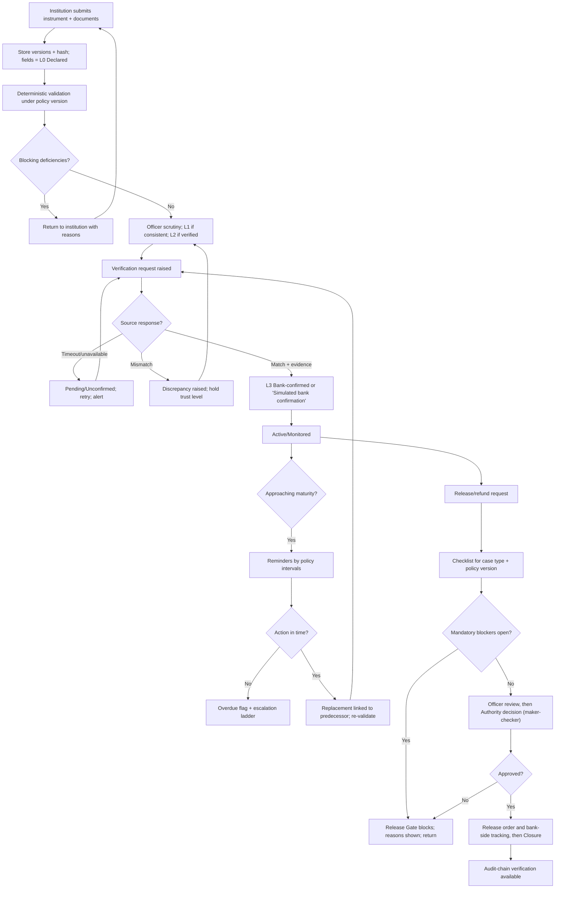

# FDR Sentinel — Security Deposit / FDR Lifecycle Integrity Platform
## Product Requirements Document (PRD)

**SIH 2026 Problem Statement ID:** 26265 · **Title:** Streamline of Security Deposit / FDR Portal · **Organization:** AICTE Regulation Bureau · **Theme:** Smart Automation · **Category:** Software

---

## Table of Contents

1. [Document Control](#1-document-control)
2. [Executive Summary](#2-executive-summary)
3. [Project Background and Official Problem Statement](#3-project-background-and-official-problem-statement)
4. [Problem Definition and Evidence Supporting the Need](#4-problem-definition-and-evidence-supporting-the-need)
5. [Current-State Understanding and Existing Process Landscape](#5-current-state-understanding-and-existing-process-landscape)
6. [Product Vision, Mission, Objectives and Guiding Principles](#6-product-vision-mission-objectives-and-guiding-principles)
7. [Stakeholder Analysis and User Personas](#7-stakeholder-analysis-and-user-personas)
8. [User Needs, Pain Points and Jobs to Be Done](#8-user-needs-pain-points-and-jobs-to-be-done)
9. [Product Scope](#9-product-scope)
10. [Proposed End-to-End Product Workflow](#10-proposed-end-to-end-product-workflow)
11. [User Journeys and Key Use Cases](#11-user-journeys-and-key-use-cases)
12. [Functional Product Requirements](#12-functional-product-requirements)
13. [AI-Assisted Features and Their Boundaries](#13-ai-assisted-features-and-their-boundaries)
14. [Role-Based Access and Authorization Model](#14-role-based-access-and-authorization-model)
15. [Business Rules and Policy-Dependent Requirements](#15-business-rules-and-policy-dependent-requirements)
16. [Product Data Requirements and Sensitive-Data Handling](#16-product-data-requirements-and-sensitive-data-handling)
17. [Non-Functional Product Expectations](#17-non-functional-product-expectations)
18. [Dashboard, Notification, Reporting and Search Requirements](#18-dashboard-notification-reporting-and-search-requirements)
19. [External System Integrations and Dependencies](#19-external-system-integrations-and-dependencies)
20. [Security, Privacy, Auditability and Governance Requirements](#20-security-privacy-auditability-and-governance-requirements)
21. [Prioritization (MoSCoW)](#21-prioritization-moscow)
22. [MVP Definition and Phased Roadmap](#22-mvp-definition-and-phased-roadmap)
23. [Product Acceptance Criteria and KPIs](#23-product-acceptance-criteria-and-kpis)
24. [Risks, Assumptions, Dependencies and Mitigations](#24-risks-assumptions-dependencies-and-mitigations)
25. [Stakeholder Questions and Decisions Still Required](#25-stakeholder-questions-and-decisions-still-required)
26. [Alternative-Solution Analysis](#26-alternative-solution-analysis)
27. [Research-Backed Rationale for Major Product Decisions](#27-research-backed-rationale-for-major-product-decisions)
28. [Requirements Traceability Matrix](#28-requirements-traceability-matrix)
29. [References and Evidence Register](#29-references-and-evidence-register)
30. [Appendix A — Consistency Review, Citation Audit and Unresolved Assumptions](#appendix-a--consistency-review-citation-audit-and-unresolved-assumptions)

**Evidence labels used in this document**

| Tag | Meaning |
|---|---|
| **[OFF]** | Explicitly stated in the official problem statement text supplied for PS 26265 [R1]. |
| **[DOC]** | Documented in a cited public source (AICTE, government, standards body). |
| **[RES]** | Finding from published research (see §29). |
| **[INF]** | Requirement inferred from the problem statement. |
| **[PROP]** | Proposed product feature (team design decision). |
| **[ASSUME]** | Assumption requiring stakeholder confirmation. |
| **[SIM]** | Simulated in the prototype; never presented as a real integration. |
| **[UNVER]** | Could not be verified in this research; do not rely on it without checking the primary source. |

## 2. Executive Summary

**Problem.** AICTE's approval-related regulatory work may require institutions to submit or maintain security deposits or Fixed Deposit Receipts (FDRs). Managing these instruments requires institution-wise records, verification, validity and maturity monitoring, renewal/replacement tracking, release/refund handling and document availability for scrutiny. The official statement says that when this relies on fragmented records and manual correspondence, keeping an accurate, current view of status and time-sensitive actions can be difficult [OFF][R1].

**Product.** **FDR Sentinel** is a proposed *complementary lifecycle-integrity layer* — not a replacement for any AICTE system. It gives each instrument one trusted record, makes the evidence level of every important fact explicit (declared, document-consistent, officer-verified, bank-confirmed), preserves renewal/replacement lineage, monitors deadlines with reminders and escalation, gates release on required evidence and human authorization, and keeps a tamper-evident audit history [PROP][R32].

**What the product is not.** It does not move money, replace AICTE's approval portal, assume a bank API, make legal determinations, or let AI authenticate, approve or release anything.

**Why now / evidence.** AICTE already operates public online processes for deposit amount calculation/payment and a JFDR application manual exists [DOC][R2][R3][R6]. What the public record does *not* show is a lifecycle-integrity layer with trust provenance and release gating; whether AICTE has such internal tooling is **unknown** and must be validated with stakeholders (§25). Separately, a July 2026 government audit circular describes a reported ₹645-crore fake-FDR fraud affecting eleven government departments/boards (not AICTE) and calls for independent bank confirmation, reconciliation and segregation of duties — directly relevant to the design philosophy [DOC][R9].

**Prototype commitment.** A modular monolith with a background worker, demonstrating the six scenarios named in the problem statement (new submission, validity tracking, approaching maturity, renewal, discrepancy identification, authorized release) plus duplicate detection, source-timeout handling, cross-tenant denial and an audit-tamper test, all on **synthetic data**, with simulated bank confirmations visibly labelled **SIMULATED** [PROP][SIM].

**Success will be judged by** honest gates (no confirmed state without evidence; no release with open blockers; renewal never overwrites history; tampering detected) and by measured — not invented — improvements in turnaround, accuracy and effort once a baseline exists (§23).

---

## 3. Project Background and Official Problem Statement

### 3.1 Organization and context

The All India Council for Technical Education (AICTE), Ministry of Education, Government of India, performs approval-related regulatory activities in accordance with applicable regulations, approval process handbooks and prescribed procedures [OFF][R1]. The current handbook (Approval Process Handbook 2024-25 to 2026-27) exists as an AICTE-published legal document [DOC][R7]; its security-deposit and release clauses were **not opened** in this research and must be confirmed before any policy is encoded [UNVER].

### 3.2 Official problem statement (as supplied)

PS 26265, *Streamline of Security Deposit/FDR Portal* [R1]. The statement asks for a secure, centralized portal for the AICTE Regulation Bureau and authorized stakeholders. Seventeen requirement items are extracted below and used as stable IDs (**PS-01 … PS-17**) in the traceability matrix (§28). They are consistent with the consolidated context [R32, §1.2].

| ID | Official requirement (paraphrased from [R1]) |
|---|---|
| PS-01 | Maintain institution-wise and instrument-wise records of security deposits/FDRs. |
| PS-02 | Capture reference numbers, issuing bank details, amount, issue date, maturity date, validity status, supporting documents and administrative status, as applicable. |
| PS-03 | Digital submission and secure storage of FDRs and other prescribed supporting records. |
| PS-04 | Authorized officials can review submissions and identify incomplete records. |
| PS-05 | Verify instrument details through legitimate bank-issued mechanisms wherever supported. |
| PS-06 | Distinguish institution-submitted information from independently confirmed information. |
| PS-07 | Flag missing information, inconsistencies and documents needing scrutiny. |
| PS-08 | Automated monitoring of maturity, validity, renewal/replacement and other prescribed timelines. |
| PS-09 | Configurable advance reminders; overdue/unresolved cases flagged for follow-up (and escalation). |
| PS-10 | Record and track release/discharge/refund requests, subject to regulations, conditions and competent-authority authorization. |
| PS-11 | Dashboard of active, expiring, matured, renewed, released and pending instruments. |
| PS-12 | Search, document-history review, permitted-field updates, scrutiny observations, case-status monitoring. |
| PS-13 | Automated reports: pending verifications, upcoming maturities, missing documents, cases needing intervention. |
| PS-14 | Role-based access, secure document storage, encryption, audit trails, controlled access to financial/institutional information. |
| PS-15 | Consider integration with existing AICTE systems and bank verification services where feasible and formally authorized. |
| PS-16 | Prototype shows measurable improvement in record accuracy, verification turnaround, renewal monitoring, manual effort and visibility of pending cases. |
| PS-17 | Testing covers new FDR submission, validity tracking, approaching maturity, renewal, discrepancy identification and authorized release processing. |

**Also in the statement:** renewal/replacement monitoring with complete change history; escalation of unresolved cases; user-friendly design; the overall goal of an "efficient, transparent and accountable digital mechanism" [OFF][R1]. These are folded into PS-08/09/10/12/14.

### 3.3 What the statement does not require

Per [R32 §1.3]: the system need not move money, act as a bank, replace AICTE's approval systems, make autonomous legal determinations, approve institutions or release funds via AI, integrate every bank, or depend on machine learning for core function.

---

## 4. Problem Definition and Evidence Supporting the Need

### 4.1 Problem definition

**The central problem is lifecycle control and trust, not storage.** A system could store every scanned FDR and still be unable to say: whether the instrument was independently confirmed; whether dates are current; whether a replacement was received; whether a release condition remains open; or whether the last status change was authorized [R32 §2.1].

### 4.2 Evidence register — what is established and what is not

| # | Claim | Status | Source |
|---|---|---|---|
| E1 | The official statement describes fragmented records/manual correspondence and a need for status visibility, deadline monitoring, verification, workflow and auditability. | **Documented** (problem setter's own words) | [R1] |
| E2 | AICTE's institute web portal supports checking and paying the security-deposit amount online when an application shows "Deposit Requested"; sub-status becomes "Deposit Received" after payment is reflected; amount discrepancies go to a helpdesk. | **Documented** (2018-19 manual; 2019-20 guide) | [R2][R3] |
| E3 | Government institutions need not pay the deposit but file an affidavit with the Regional Office before downloading the LOA (in the cited guide). | **Documented, dated** | [R2] |
| E4 | Handbook-era rules vary: a 2020-21 AICTE workshop deck refers to exemption of long-established existing institutions, a balance-deposit rule for certain applicants, no deposit where an NOC for release of an earlier FDR was already issued, and deposit-imposition cut-off dates. | **Documented, dated** | [R5] |
| E5 | AICTE has previously issued an HQ notice on release of FDRs of institutions established in 2010-11 (interest refund by 07.02.2019; principal processed only after 30.04.2019). | **Documented** | [R4] |
| E6 | A JFDR online application manual is published on AICTE's approval-process pages (2021-22 listing; a pharmacy-specific manual also listed). | **Documented (title/listing only; manual contents not read)** | [R6] |
| E7 | In 2002 the Government told Parliament that AICTE gets pledged *joint* FDRs in the name of AICTE and the institution's Society/Trust, with originals kept under custody of Regional Officers in bank lockers. | **Documented, historical (2002)** | [R8] |
| E8 | An AICTE letter of intent hosted by an institution instructs uploading a scanned FDR and affidavit to the portal and submitting the original FDR. | **Documented, undated, secondary host — use cautiously** | [R10] |
| E9 | A July 2026 audit circular (citing a May 2026 headquarters letter) describes an ED-inquiry-reported fraud in which fake FDRs worth ₹645 crore were issued to eleven government departments/boards by a bank branch; it directs auditors to check independent bank confirmation, periodic reconciliation, treatment of matured deposits, and segregation of duties. | **Documented (government audit circular; allegations as reported there)** | [R9] |
| E10 | Public baseline statistics on AICTE delay, loss, error rate or manual hours. | **Not found. No baseline is claimed.** | — |
| E11 | Plausible risks: missed maturity follow-ups; portal-vs-held-instrument mismatches; duplicated/reused documents; slow release from scattered evidence; context lost on officer turnover. | **Hypotheses to validate**, not proven AICTE failures | [R32 §2.2] |

### 4.3 Reading the evidence responsibly

- E2–E8 show that AICTE **has public deposit and JFDR processes**. This PRD therefore does **not** assert that AICTE lacks a portal or process, and does **not** allege internal deficiencies.
- E9 is not about AICTE; it is relevant because it shows regulators treating independent bank confirmation, reconciliation and segregation of duties as audit-critical for FDRs.
- The value proposition is therefore framed as *additional* capability — trust provenance, lineage, deadline escalation, release gating and tamper-evident history — "pending validation of the actual institutional gap" [R32 §16].

---

## 5. Current-State Understanding and Existing Process Landscape

### 5.1 Reconstructed, publicly documented process (partial)

1. An institution applies through the AICTE web portal; where a deposit applies, the application shows "Deposit Requested" [DOC][R2][R3].
2. The institution checks the computed amount in the portal and pays online; the sub-status updates to "Deposit Received" [DOC][R3]. (Instrument-specific steps for FDRs — scanned upload, original submission, affidavit — appear in an AICTE letter hosted by an institution [R10] and in the historical Parliament reply [R8].)
3. Government institutions follow an affidavit route [DOC][R2].
4. Release/refund of FDRs has occurred through HQ notices and bank instructions for specific cohorts [DOC][R4]; JFDR online application manuals exist [DOC][R6].

### 5.2 Known limitations of the evidence

- Most sources are **dated** (2002–2021) or secondary-hosted; the current handbook clauses were not opened [R7][UNVER].
- The internal workflow of the Regulation Bureau, regional offices, finance and vigilance cells — including how renewals and maturities are tracked — is **not public** [ASSUME].
- Whether any bank offers an FDR confirmation API to AICTE is **unverified**. NeSL's e-BG platform covers *bank guarantees*, not FDRs [R11][R12]; it must not be cited as evidence of FDR verification access.

### 5.3 Adjacent national infrastructure (reference only)

NeSL's e-BG platform enables paperless issuance and lifecycle events for bank guarantees, with reported integration into e-procurement portals (GeM, GePNIC) and an Entity Locker retrieval channel (May 2026 report) [DOC][R11]; a government body adopted it via an SOP/office order dated 24 Nov 2025 [R12]. This is a **design precedent** for verifiable bank-originated instruments, not an FDR channel.

---

## 6. Product Vision, Mission, Objectives and Guiding Principles

**Vision.** Every security deposit/FDR connected to AICTE approval processes has a single, trustworthy, auditable lifecycle record.

**Mission.** Automate repetitive administrative work; make evidence, uncertainty and next actions visible; preserve the entire lifecycle; keep financial and regulatory decisions within the prescribed authorization process [R32 §16].

**Positioning statement.** *FDR Sentinel is a trust-first lifecycle-integrity layer for AICTE-related security deposits/FDRs: it distinguishes declared from confirmed information, preserves renewal lineage, monitors deadlines, gates release on required evidence and authorization, and maintains a verifiable audit history.* [R32 §14] — Tagline: *Know what is declared. Know what is proven. Never silently lose a lifecycle event.*

### Objectives

| ID | Objective | Linked PS items |
|---|---|---|
| PRD-OBJ-01 | One institution-wise/instrument-wise register with documents and status. | PS-01–03 |
| PRD-OBJ-02 | Make provenance and verification state of key facts explicit and non-upgradable without evidence. | PS-05–07 |
| PRD-OBJ-03 | Surface time-sensitive events with configurable reminders and escalation. | PS-08–09 |
| PRD-OBJ-04 | Preserve renewal/replacement lineage and change history. | PS-08, PS-12 |
| PRD-OBJ-05 | Control release/refund through explainable readiness checks and human authorization. | PS-10 |
| PRD-OBJ-06 | Give officials dashboards, search and reports for pending work. | PS-11–13 |
| PRD-OBJ-07 | Provide role-based access, encryption and a tamper-evident audit trail. | PS-14 |
| PRD-OBJ-08 | Be integration-ready but honest about what is real, simulated or planned. | PS-15 |
| PRD-OBJ-09 | Measure improvement honestly against a baseline. | PS-16–17 |

### Guiding principles (from [R32 §4.2])

1. **Provenance before automation.** 2. **Explicit uncertainty** (pending/unconfirmed/disputed are visible states). 3. **Rules in the backend**, not only in the UI. 4. **No silent overwrite** — corrections and replacements create history. 5. **Release is gated.** 6. **Policy is versioned and configurable.** 7. **Integration-ready but honest.** 8. **Auditable by design.** 9. **Minimize AI decision risk.** 10. **Measure before claiming impact.**

---

## 7. Stakeholder Analysis and User Personas

### 7.1 Stakeholders

| Stakeholder | Role in lifecycle | Primary interest | Influence | Adoption risk |
|---|---|---|---|---|
| AICTE Regulation Bureau scrutiny officer | Reviews submissions, records observations | Fewer repeat queries; clear evidence | High | Distrust of automated flags; tool fatigue |
| Section/branch head | Oversees queues, escalations | Visibility of overdue/high-risk cases | High | Change from familiar trackers |
| Competent authority / approver | Authorizes release/discharge | Complete, defensible case file | Very high | Wants authority boundaries respected; signature/DSC expectations |
| Finance/accounts official | Tracks release orders, bank-side action | Reconciliation, correct financial fields | Medium | Process mismatch with accounting systems |
| Institution representative | Submits, renews, requests release | Clear status, fewer rejections | Medium | Varying digital literacy; document quality |
| Issuing bank (external, optional) | Confirms instrument details | Structured, authenticated requests | Medium | May have no channel or interest |
| System administrator | Users, roles, policy, config | Safe configuration | Medium | Misconfiguration risk |
| Auditor (internal/external) | Reviews controls and history | Reconstructable evidence | High | Needs read-only independent verification |
| AICTE IT / e-Governance | Hosts/integrates systems | Security, maintainability | Very high | Integration/hosting constraints (§19) |

### 7.2 Personas (illustrative, fictional; validate with real users)

| Persona | Profile | Goals | Frustrations (hypotheses) | Needs from product |
|---|---|---|---|---|
| **Ritu — Scrutiny Officer** | Reviews dozens of submissions per week | Decide quickly; never miss a discrepancy | Cross-checking documents manually; chasing missing files | Side-by-side declared vs evidence; reasoned flags; prioritized queue |
| **Mr. Verma — Branch Head** | Accountable for pending/overdue work | See what is slipping | No consolidated view; reassigning work | Dashboard, escalations, reassignment |
| **Dr. Nair — Competent Authority** | Authorizes release | Approve only on complete evidence | Incomplete file bundles | Readiness report with blockers; reason capture; maker-checker |
| **Amit — Institution Registrar** | Submits and renews FDRs | Know exactly what is missing; avoid lapses | Repeat rejections; unclear status | Guided fixes; reminders; own-institution view only |
| **Meera — Auditor** | Independent reviewer | Reconstruct a decision | Reconstructing history from files | Read-only evidence pack and audit-chain verification |
| **Sanjay — Administrator** | Manages accounts and policy | Change rules safely | Unaudited config changes | Versioned policy with approval and audit |

---

## 8. User Needs, Pain Points and Jobs to Be Done

Need IDs (**SN-xx**) are referenced in the traceability matrix. Pain points marked *hypothesis* are not documented failures.

| ID | Persona | Job to be done | Pain point (hypothesis unless cited) | Desired outcome |
|---|---|---|---|---|
| SN-01 | Institution | Submit an instrument with documents once | Unclear what is required | Submission accepted or returned with specific deficiencies |
| SN-02 | Officer | Know which values are declared vs proven | Mixed trust levels in one record | Per-field evidence level |
| SN-03 | Officer | Find discrepancies fast | Manual cross-checking | Explained, rule-based flags |
| SN-04 | Branch head | See instruments nearing maturity without confirmed action | Dates scattered | Early warning and escalation |
| SN-05 | Institution | Get reminders before deadlines | Missed renewal deadlines | Configurable advance reminders |
| SN-06 | Officer | See full renewal history | Replacements overwrite or detach | Predecessor–successor chain |
| SN-07 | Authority | Approve release on complete evidence | Scattered evidence | Readiness report with blockers |
| SN-08 | Auditor | Verify history was not altered | Reconstructing decisions | Hash-verified audit timeline |
| SN-09 | Officer | Handle bank non-response | Silent assumption of confirmation | Pending/unconfirmed states; retries |
| SN-10 | Admin | Adapt rules by handbook year/institution type | Hard-coded rules | Versioned policy |
| SN-11 | All staff | Find any case quickly | Fragmented search | Search and filters |
| SN-12 | Branch head | Decide what to review first | Flat lists | Transparent priority ordering |
| SN-13 | Institution | Be protected from cross-institution exposure | Confidentiality concern | Strict tenant isolation |
| SN-14 | Management | Know workload | No aggregate view | Maturity load and status dashboards |

---

## 9. Product Scope

### 9.1 In scope (this release = SIH prototype)

All **Must** items in §21: register, document versioning, deterministic validation and explained flags, trust levels and provenance, administrative state machine, maturity/validity monitor with reminders and escalation, renewal lineage, release gate with maker-checker, dashboard and reports, RBAC with tenant isolation, hash-chained audit with verification, simulated bank-confirmation adapter, synthetic data and demo clock, automated tests of the six official scenarios.

### 9.2 Out of scope for this release

Live bank or AICTE-system integration; SSO/DSC; payments; production hosting and certifications; legal-policy encoding beyond configurable examples; trained predictive models; native mobile apps.

### 9.3 Future scope

Authorized live bank-verification interface; authorized AICTE-portal/SSO/DSC integration; improved Vision-LLM/OCR across layouts; natural-language search; evidence-grounded scrutiny summaries; bilingual LLM-assisted notices; renewal-miss prediction only after authorized historical data and validation; pilot with an authorized stakeholder [R32 §8.3].

### 9.4 Explicit non-goals

The product will **not**: move money; act as a bank or payment gateway; determine banking facts without an authorized source; replace AICTE's approval portal; make legal determinations; approve/refuse institutions; let AI authorize or release a deposit; claim real-time bank verification, forgery detection or tamper-proof immutability; assert "AICTE has no FDR portal".

---

## 10. Proposed End-to-End Product Workflow

**Lifecycle:** Institution submission → document and field validation → provenance and trust-status assignment → authorized verification → maturity monitoring → renewal or replacement → release/refund request → competent-authority review and approval → closure and audit [PROP].

### 10.1 Main flow (numbered)

1. Institution user (or an officer entering legacy data) creates an instrument record and uploads documents (PRD-FR-001–016).
2. System stores each document version with a hash and assigns every field **L0 — Declared** (PRD-FR-031).
3. Deterministic validation runs under the effective policy version; flags with rule ID, reason, severity and next action are created (PRD-FR-020–027).
4. Incomplete/failing submissions are **returned** to the institution with specific deficiencies; corrected uploads create new versions (PRD-FR-028).
5. Passing consistency checks may raise fields to **L1 — Document-consistent** (not proof of authenticity).
6. An officer reviews evidence, records observations and may set **L2 — Officer-verified** (PRD-FR-032).
7. Officer initiates a bank confirmation request; a response (real, manual or **SIMULATED**) is recorded. Only a response record with source, reference, timestamp, result and evidence permits **L3 — Bank-confirmed** (PRD-FR-033–036).
8. The instrument is Active/Monitored; the scheduler computes days to maturity and triggers reminders and escalations (PRD-FR-040–048).
9. Replacement/renewal is submitted as a *new* instrument linked to its predecessor and runs steps 2–7 (PRD-FR-050–054).
10. Institution submits a release/refund request; the checklist for the case type and policy version is evaluated; blockers are listed (PRD-FR-060–064).
11. Officer reviews; incomplete items are returned; ready cases route to the competent authority; maker-checker separation is enforced (PRD-FR-065–067).
12. Authorized decision is recorded with actor, time, reason and evidence; release-order/bank-side tracking is recorded (PRD-FR-068).
13. Closure preserves the full history; auditor can verify the audit chain (PRD-FR-090–096).

### 10.2 Workflow diagram

### 10.3 Exceptional workflows

| Exception | Required behaviour | Policy-dependent? (source to confirm) |
|---|---|---|
| **Missing documents** | Checklist shows missing/unreadable/wrong-category items; institution notified; submission cannot progress past the policy-defined stage. | Yes — required document list per case/year (APH 2024-27 [R7], to confirm) |
| **Conflicting extracted vs entered values** | Both values kept with provenance; conflict flag; officer or institution resolves; resolution is audited. | No |
| **Duplicate instrument identifiers** | Probable-duplicate flag (bank + reference key; identical file hash); officer review; never auto-merged; not treated as proof of fraud. | Key definition needs confirmation |
| **Failed/unavailable external verification** | State stays *Pending/Unconfirmed/Source unavailable*; retries logged; officer alerted; L3 impossible. | No |
| **Expired or approaching-maturity instruments** | Reminders and escalation per policy; maturity ≠ release eligibility. | Intervals/recipients — owner to approve (example 90/60/30/15/7 are illustrations only [R32 §5.6]) |
| **Replacement of an existing FDR** | New instrument linked to predecessor; old record preserved; gap/overlap flagged per policy; old instrument not marked released merely because a successor was uploaded. | Gap/overlap rule — confirm |
| **Rejected/returned submissions** | Reason required; prior versions retained; institution sees actionable deficiencies. | Reason categories — confirm |
| **Unauthorized access attempts** | Denied server-side; event logged; repeated failures alert admin. | No |
| **Incomplete release requirements** | Gate blocks transition and lists blockers; UI state changes cannot bypass it. | Yes — release checklist (APH [R7]; JFDR process [R6]) |
| **Failed notification delivery** | Delivery status recorded; bounded retries; dashboard shows failed notices; case not treated as "institution informed". | Permitted channels — confirm |

---

## 11. User Journeys and Key Use Cases

| ID | Use case | Actor | Main path | Exceptions covered |
|---|---|---|---|---|
| UC-01 | New FDR submission | Institution | Create record → upload → see L0 + deficiencies → resubmit | Missing docs; duplicate; conflicting values |
| UC-02 | Scrutiny and discrepancy handling | Officer | Open queue → review flags with reasons → comment → return or verify | Mismatch; low-confidence extraction |
| UC-03 | Bank confirmation | Officer | Raise request → record response → trust update | Timeout; mismatch; simulated label |
| UC-04 | Validity tracking | Branch head | Dashboard → filter by maturity window → assign | Overdue; reassignment |
| UC-05 | Approaching maturity | System/Institution | Reminder → institution action → escalation if none | Failed delivery |
| UC-06 | Renewal/replacement | Institution/Officer | Submit successor → link → validate → verify | Gap/overlap; unlinked successor |
| UC-07 | Release request | Institution | Submit request → checklist → return/resolve → routed | Blockers |
| UC-08 | Authorized release | Authority | Review readiness report → approve/reject/return with reason | Maker-checker violation attempt |
| UC-09 | Audit verification | Auditor | View timeline → run chain verification | Chain break |
| UC-10 | Policy change | Admin | Draft policy → authorize → activate version | Unauthorized change |
| UC-11 | Cross-tenant attempt | Institution A user | Requests B's record | Denied and logged |
| UC-12 | Scheduler outage | System | Failure detected → restart → catch-up without duplicates | Duplicate-notice prevention |

**Primary user journey (Institution — normal case).** Log in → "Add instrument" → enter fields and upload scan → see each field labelled *Declared* → system lists "FDR copy: present; Lien/pledge letter: missing (per active policy)" → institution uploads missing item (new version) → status *Submitted* → officer scrutiny → later reminders at configured intervals → renewal submission linked to original.

**Exception journey (Officer).** Opens a case showing two flags: *Name mismatch (form vs document)* and *Amount below policy value* — each with source value, expected value, rule/version and suggested next action → returns the case with comments → institution corrects → earlier versions remain visible.

**Dispute journey.** Institution disputes a release block → case shows each unmet checklist item and evidence → branch head reviews → decision recorded with reasons; nothing is deleted.

---

## 12. Functional Product Requirements

**Conventions.** Priority: **M**ust / **S**hould / **C**ould (MoSCoW detail in §21). Source: OFF / INF / PROP / SIM. Each requirement is testable; acceptance criteria in the table are the minimum test.

### Module A — Institution and Instrument Repository

| ID | Requirement | Src | Pri | Acceptance criterion |
|---|---|---|---|---|
| PRD-FR-001 | Maintain institution master data separately from instrument records; one institution can have many instruments with stable internal IDs. | OFF (PS-01) | M | Create institution with 3 instruments; each has distinct ID. |
| PRD-FR-002 | Capture, as policy-configurable fields: instrument type, bank name/branch, reference number, amount/currency, issue date, maturity date, validity status, lien/pledge details, assigned office, administrative state, trust state. | OFF (PS-02) | M | All fields persist; required set is configurable. |
| PRD-FR-003 | Enforce a configurable duplicate key (default: bank identity + reference number); on suspected duplicate raise a **flag**, never auto-merge. | INF | M | Seeded duplicate across two institutions flagged for officer review. |
| PRD-FR-004 | Validate date logic (maturity after issue; plausible ranges) and amount > 0. | OFF (PS-04/07) | M | Invalid dates rejected with reason. |
| PRD-FR-005 | Separate **administrative state** from **trust state** (and from verification-request status). | PROP | M | An instrument can be *Submitted*, *Expiring Soon* and *L0* simultaneously. |
| PRD-FR-006 | Mask sensitive identifiers (e.g., reference/account numbers) in list views by default. | INF (PS-14) | S | List view shows masked values; detail view requires permitted role. |

### Module B — Document Management

| ID | Requirement | Src | Pri | Acceptance criterion |
|---|---|---|---|---|
| PRD-FR-010 | Upload documents of configured types/sizes only; store in protected storage (never a public directory). | OFF (PS-03) | M | Disallowed type rejected; direct URL access without authorization fails. |
| PRD-FR-011 | Record uploader, time, category, SHA-256 hash, version, parent instrument/case. | PROP | M | Metadata present for every upload. |
| PRD-FR-012 | Re-upload creates a new version; previous versions remain viewable and immutable. | OFF (history) | M | Two uploads → two versions; first still retrievable. |
| PRD-FR-013 | Malware/safe-file handling before a document becomes viewable. | INF (PS-14) | S | Test-malware sample (e.g., EICAR) is quarantined. |
| PRD-FR-014 | View/download only for permitted roles via time-limited access links. | OFF (PS-14) | M | Expired link denied. |
| PRD-FR-015 | Document completeness checklist by case type and policy version: present / missing / unreadable / wrong-category / awaiting confirmation. | OFF (PS-04/07) | M | Missing item shown to institution and officer. |
| PRD-FR-016 | Hash equality is shown as "identical file bytes" and **never** as proof of authenticity. | PROP | M | UI text and audit data use this wording. |

### Module C — Validation and Discrepancy Detection

| ID | Requirement | Src | Pri | Acceptance criterion |
|---|---|---|---|---|
| PRD-FR-020 | Deterministic rule engine evaluating required fields, date logic, amount versus policy value (where policy is configured), institution-name consistency, duplicates. | OFF (PS-07) | M | Seeded defect set produces expected flags. |
| PRD-FR-021 | Each flag stores rule ID, rule/policy version, input evidence, comparison result, severity, next action. | PROP | M | No flag without these fields. |
| PRD-FR-022 | Distinguish deterministic rules from heuristic indicators; heuristics labelled "Advisory — human review required". | PROP | M | Heuristic flags carry label. |
| PRD-FR-023 | Name-similarity checks show the compared strings and similarity score; borderline cases go to officer review. | PROP | S | Variant spellings produce a reviewable flag, not auto-reject. |
| PRD-FR-024 | Cross-institution probable-duplicate and identical-file-hash detection with officer review. | PROP | S | Seeded duplicate pair detected. |
| PRD-FR-025 | Officer can dismiss/resolve a flag only with a reason; dismissal is audited. | PROP | M | Dismissal without reason blocked. |
| PRD-FR-026 | Flags never alter trust level silently. | PROP | M | No code path raises trust from a flag outcome. |
| PRD-FR-027 | Flags language avoids accusation (e.g., "requires scrutiny", not "fraud"). | PROP | M | Copy review checklist passed. |
| PRD-FR-028 | Rejected/returned submissions require a reason; institution sees actionable deficiencies and prior versions remain. | INF | M | Return without reason blocked. |

### Module D — Trust, Provenance and Verification

| ID | Requirement | Src | Pri | Acceptance criterion |
|---|---|---|---|---|
| PRD-FR-030 | Store per-field provenance: value, source type (entered / imported / OCR-extracted / Vision-LLM-extracted / officer-entered / bank-response), actor/service, time, evidence reference. | OFF (PS-06) | M | Field detail shows provenance. |
| PRD-FR-031 | Trust levels: **L0 Declared**, **L1 Document-consistent** (not authenticity), **L2 Officer-verified**, **L3 Bank-confirmed**. | OFF (PS-06) | M | Each level has defined entry conditions in code. |
| PRD-FR-032 | L2 requires an authorized officer decision with reason and evidence references. | PROP | M | Non-officer cannot set L2. |
| PRD-FR-033 | L3 requires a verification response record (source/method, response reference, timestamp, result, evidence). Without it, L3 is impossible (database-level constraint). | OFF (PS-05/06) | M | Direct write of L3 without record rejected. |
| PRD-FR-034 | Verification requests reference one instrument and a unique request code; responses must carry the code; mismatches create a discrepancy. | PROP | M | Response with wrong code rejected. |
| PRD-FR-035 | Timeout/unavailable/no-response states remain *Pending/Unconfirmed/Source unavailable*; retries are logged; officer alerted. | OFF (PS-05) | M | Simulated timeout never yields L3. |
| PRD-FR-036 | Simulated responses are labelled "SIMULATED" in UI, exports and audit data. | SIM | M | All three surfaces show label. |
| PRD-FR-037 | Preserve conflicting values; do not overwrite when sources disagree. | PROP | M | Conflict view lists both values. |
| PRD-FR-038 | Manual verification path (officer records a bank letter/email evidence) is supported, labelled as manual, and distinguished from a system-received response. | INF | S | Manual evidence recorded with method = manual. |

### Module E — Maturity, Validity, Reminders and Escalation

| ID | Requirement | Src | Pri | Acceptance criterion |
|---|---|---|---|---|
| PRD-FR-040 | Daily job computes days-to-maturity, validity and overdue conditions using a stated time-zone convention. | OFF (PS-08) | M | Time-travel test changes states correctly. |
| PRD-FR-041 | Distinguish maturity date, validity period, institution action due date, officer action due date. | PROP | M | Separate fields and rules. |
| PRD-FR-042 | Reminder intervals and recipients configurable by policy (example 90/60/30/15/7 days are illustrations, not AICTE rules). | OFF (PS-09) | M | Interval change affects next run. |
| PRD-FR-043 | Notification history: recipient, channel, timestamp, delivery result, retries, related instrument/action. | PROP | M | History view lists attempts. |
| PRD-FR-044 | Idempotency: one reminder per (instrument, event, interval, recipient); no duplicates on rerun/restart. | PROP | M | Replay test yields zero duplicates. |
| PRD-FR-045 | Overdue and unresolved cases flagged; escalation to next role after a configurable period. | OFF (PS-09) | M | Escalation reaches branch head at configured day. |
| PRD-FR-046 | Worker failure detected; restart performs catch-up for missed runs. | PROP | M | Stop/restart test → missed reminders issued once. |
| PRD-FR-047 | Maturity or matured status does not imply release eligibility. | PROP | M | Matured instrument with open blockers stays blocked. |
| PRD-FR-048 | **Demo-only** date-advance control, visibly marked, disabled outside demo mode. | SIM | M | Control absent in production-mode config. |

### Module F — Renewal and Replacement Lineage

| ID | Requirement | Src | Pri | Acceptance criterion |
|---|---|---|---|---|
| PRD-FR-050 | Renewal/replacement is a new instrument linked to its predecessor; the predecessor is never overwritten. | OFF (history) | M | Chain A→B shows both records intact. |
| PRD-FR-051 | Successor records dates, amounts, documents, checks, verification state and decision. | PROP | M | All present. |
| PRD-FR-052 | Prevent cyclic or ambiguous lineage (DB constraint + validation). | PROP | M | Attempt to link B→A after A→B rejected. |
| PRD-FR-053 | Flag gaps/overlaps between predecessor maturity and successor validity per policy. | PROP | S | Seeded gap flagged. |
| PRD-FR-054 | Uploading a successor does not mark the predecessor released; replacement, review, verification, approval and release are separate events. | PROP | M | Predecessor status unchanged after upload. |

### Module G — Release / Discharge / Refund

| ID | Requirement | Src | Pri | Acceptance criterion |
|---|---|---|---|---|
| PRD-FR-060 | Institution can submit a release/discharge/refund request with supporting documents. | OFF (PS-10) | M | Request created and tracked. |
| PRD-FR-061 | System loads the checklist for case type and effective policy version. | PROP | M | Checklist differs by policy version. |
| PRD-FR-062 | Readiness engine evaluates required documents, unresolved observations/flags, pending verification, renewal conditions, clearances (as configured) and lists satisfied/unmet checks with evidence. | PROP | M | Report lists each check with result. |
| PRD-FR-063 | **Release Gate:** transition to approved/released is rejected server-side while mandatory blockers are open. | OFF (PS-10) | M | API call with open blocker returns error and logs attempt. |
| PRD-FR-064 | Clearing a UI flag cannot bypass authorization. | PROP | M | Flag toggle without authority has no effect on gate. |
| PRD-FR-065 | Officer review step: record observations; return with reason or route onward. | OFF (PS-12) | M | Both paths work. |
| PRD-FR-066 | Maker-checker: requester/reviewer ≠ approver where policy requires; configurable. | PROP | M | Same user cannot both submit and approve. |
| PRD-FR-067 | Competent-authority approval limited to users with that delegated role; reason required. | OFF (PS-10) | M | Non-authority approval denied and logged. |
| PRD-FR-068 | Record release order and bank-side action tracking as evidence; no money movement. | INF | S | Evidence attachable; status updates audited. |
| PRD-FR-069 | AI output never forms part of the gate decision. | PROP | M | Gate code path has no model call. |

### Module H — Dashboard, Search, Reports (detail in §18)

| ID | Requirement | Src | Pri | Acceptance criterion |
|---|---|---|---|---|
| PRD-FR-070 | Dashboard counts by administrative status: active, expiring, matured, renewed, released, pending. | OFF (PS-11) | M | Counts equal DB queries on seeded data. |
| PRD-FR-071 | Search/filter by institution, bank, reference, status, dates, assigned office, flag/priority. | OFF (PS-12) | M | All filters return correct sets. |
| PRD-FR-072 | Document-history and field-history views per instrument. | OFF (PS-12) | M | Versions and changes listed. |
| PRD-FR-073 | Scrutiny observations recorded as append-only notes with author/time. | OFF (PS-12) | M | Edit creates new note; old retained. |
| PRD-FR-074 | Reports: pending verification, upcoming maturities, missing documents, interventions; drill-down; export (CSV/PDF) if authorized. | OFF (PS-13) | M | Report rows match drill-down. |
| PRD-FR-075 | Transparent priority queue (sorted by urgency, discrepancy severity, trust state, overdue age) with visible factors. | PROP | S | Seeded urgent cases appear in top N. |
| PRD-FR-076 | Deterministic month-wise maturity load (count and amount). | PROP | S | Totals match independent calculation. |
| PRD-FR-077 | Dashboard definitions documented so numbers are consistent across screens. | PROP | M | Definition sheet exists; tests assert consistency. |

### Module I — Notifications

| ID | Requirement | Src | Pri | Acceptance criterion |
|---|---|---|---|---|
| PRD-FR-080 | In-app and email notifications for reminders, deficiencies, status changes; SMS/WhatsApp only if approved (otherwise mocked and labelled). | OFF (PS-09) | M | Mock channels show "MOCK" label. |
| PRD-FR-081 | Template-first notices populated from verified system fields. | PROP | M | Template fields match case data. |
| PRD-FR-082 | Notices with legal/administrative effect require authorized approval before dispatch (at least in prototype). | PROP | S | Dispatch blocked until approved. |
| PRD-FR-083 | Failed deliveries retried within bounds and surfaced. | PROP | M | Failure visible; case not marked "informed". |

### Module J — Access, Audit and Governance

| ID | Requirement | Src | Pri | Acceptance criterion |
|---|---|---|---|---|
| PRD-FR-090 | RBAC with record-scoped checks on every endpoint; institution tenant isolation. | OFF (PS-14) | M | Institution A denied B's record. |
| PRD-FR-091 | Audit event for each material action: actor/service, time, action, record, before/after, reason, document hash/evidence, policy version, outcome. | OFF (PS-14) | M | Sampled actions all have fields. |
| PRD-FR-092 | Audit events append-only with hash chaining; no UPDATE/DELETE path for the application role. | PROP | M | Update attempt fails. |
| PRD-FR-093 | Audit verification screen replays the chain and reports first failure. | PROP | M | Pass → tamper test → fail. |
| PRD-FR-094 | Authorization failures and trust-level-change attempts are logged. | PROP | M | Entries visible to auditor. |
| PRD-FR-095 | Auditor role is read-only. | PROP | M | Write endpoints return 403. |
| PRD-FR-096 | Policy/configuration changes are versioned, authorized and audited; administrators do not gain approval authority by role. | PROP | M | Admin cannot approve release. |

### Module K — Policy and Administration

| ID | Requirement | Src | Pri | Acceptance criterion |
|---|---|---|---|---|
| PRD-FR-100 | Versioned policy (effective dates; case types; required fields/documents; reminder intervals; escalation ladder; checklist; maker-checker flags). | PROP | M | Historical decision shows the policy version in force. |
| PRD-FR-101 | Decisions reference the policy version; reinterpretation under later rules is not retroactive. | PROP | M | Version stored with each decision. |
| PRD-FR-102 | Priority-score weights (if used) editable only via audited configuration. | PROP | C | Weight change logged. |

### Module L — Legacy Import and Demo Support

| ID | Requirement | Src | Pri | Acceptance criterion |
|---|---|---|---|---|
| PRD-FR-110 | Bulk CSV import; imported rows start at L0; row-level quality report. | INF | S | 100 rows, 5 invalid → report names exactly those. |
| PRD-FR-111 | Imported data carries source = "imported (unverified)". | INF | S | Provenance shows. |
| PRD-FR-120 | Synthetic dataset (visibly fictional) with seeded scenarios; no real institution/bank data without authorization. | PROP | M | Dataset generation script and data dictionary exist. |
| PRD-FR-121 | Simulated bank adapter implements the same interface a real adapter would; returns match / mismatch / timeout. | SIM | M | Three response paths demonstrable. |
| PRD-FR-122 | Status legend in UI/docs: Implemented / Simulated / Planned-integration-dependent. | PROP | M | Legend visible in demo mode. |

---

## 13. AI-Assisted Features and Their Boundaries

### 13.1 Position

The core product requires **no AI/ML** [R32 §1.3, §7.2]. AI features are *candidates to prioritize*, selected by feasibility, evidence, privacy and hackathon time. Deterministic software handles dates, completeness, access, authorization and release gating.

### 13.2 Guardrails (mandatory; each testable)

| ID | Guardrail |
|---|---|
| **PRD-AI-001** | AI does not diagnose, certify, authenticate or approve any financial instrument. |
| **PRD-AI-002** | Extracted fields are *suggestions* requiring human review; they are tagged `OCR-Extracted` or `Vision-LLM-Extracted`, never "verified". |
| **PRD-AI-003** | OCR/extraction consistency does not prove an FDR is genuine; the UI must not imply it does. |
| **PRD-AI-004** | An anomaly or priority score indicates review priority, not proven fraud; wording avoids accusation. |
| **PRD-AI-005** | Risk/priority scoring is transparent: factor contributions, source data, configuration version shown; weights are disclosed as prototype assumptions, not trained or validated against AICTE outcomes. |
| **PRD-AI-006** | AI-generated scrutiny notes and notices require authorized review before finalization or dispatch; unreviewed model output is never attributed to an officer. |
| **PRD-AI-007** | Release and refund decisions remain subject to authorized human approval and applicable policy; no model call exists in the release-gate path (PRD-FR-069). |
| **PRD-AI-008** | No external bank-confirmation API is assumed; simulated confirmations are visibly labelled SIMULATED. |
| **PRD-AI-009** | Historical-data-dependent predictions (e.g., renewal-miss) are not represented as validated without suitable real labelled data; synthetic-data results show only the planted patterns. |
| **PRD-AI-010** | Raw financial documents are not sent to an external model API without formal authorization, approved provider/data-handling terms and a security review; use synthetic/authorized anonymized files or self-hosted/approved processing. |
| **PRD-AI-011** | Natural-language search (if built) maps text to a restricted, allow-listed, read-only filter schema; the model gets no database credentials and generates no SQL; backend enforces authorization. |
| **PRD-AI-012** | Model output is validated against schema/type rules; the model must not invent missing values; low-confidence values are highlighted for human confirmation. |

Rationale from research: humans over-rely on automated aids (automation bias) [R27]; guidelines for human–AI interaction recommend making capability limits and uncertainty clear and supporting correction [R26]; risk management frameworks recommend human oversight and documented limits for AI in consequential settings [R28]; and inherently interpretable models/rules are preferred for high-stakes decisions over post-hoc explanations of black boxes [R30].

### 13.3 Candidate AI/automation capabilities

| ID | Capability | Value | Recommended priority | Key boundary | Evidence/foundation |
|---|---|---|---|---|---|
| PRD-AI-101 | OCR / Vision-LLM field extraction with reconciliation against entered values | Less re-typing; form-vs-document comparison | **Could** (Phase B/C) | Suggestions only; human confirms; privacy review | OCR engines (Tesseract [R21]); document-understanding models (LayoutLM [R22], Donut [R23]) — none validated on real Indian bank FDR layouts [UNVER] |
| PRD-AI-102 | Explainable anomaly flags (deterministic first; heuristic metadata/image indicators later) | Directs scrutiny | **Should** (deterministic); **Could** (heuristic) | Advisory label; metadata signs can be benign | Tree/isolation-based anomaly methods exist [R24] and per-feature attribution methods [R25]; *not required* for rule flags |
| PRD-AI-103 | Transparent 0–100 priority score | Work-queue ordering | **Should/Could** | Not a fraud probability; shows breakdown; missing data not penalized | Rule-based weighted formula (interpretable) [R30] |
| PRD-AI-104 | Natural-language search → structured filters | Faster ad-hoc discovery | **Could** (Phase C) | Read-only, allow-listed, backend-authorized | — |
| PRD-AI-105 | Evidence-grounded scrutiny summary | Faster case handover | **Could** (Phase C) | Every assertion traceable; officer edits/adopts | — |
| PRD-AI-106 | Template-first notices; optional LLM Hindi/English drafting | Less repetitive correspondence | Templates **Must/Should**; LLM **Could** | Officer approval; fixed legal wording; exact dates/refs | — |
| PRD-AI-107 | Deterministic maturity-load chart | Workload planning | **Should** | It is aggregation, not prediction | — |
| PRD-AI-108 | Renewal-miss prediction | Early warning | **Won't** (this release) | Needs authorized historical labelled data and validation | PRD-AI-009 |
| PRD-AI-109 | Document-type classification vs checklist | Detect wrong-category uploads | **Could**; manual category = reliable fallback | Presence ≠ adequacy; human correction | Checklist itself is core (PRD-FR-015) |

**Extraction evaluation rule (if built).** Report exact-match per field and per document type, uncertain/missing counts and human-correction rate separately; do not pool deterministic rule accuracy with heuristic indicators [R32 §10.2].

---

## 14. Role-Based Access and Authorization Model

### 14.1 Roles and permissions

Legend: **R** read · **C** create · **U** update (permitted fields, append-only where stated) · **A** approve · **—** none. All rows subject to institution/office scoping and least privilege [R16: AC-5, AC-6].

| Capability | Institution | Scrutiny officer | Branch head | Finance | Competent authority | Admin | Auditor |
|---|---|---|---|---|---|---|---|
| Own-institution instruments | R/C/U (until submitted) | — | — | — | — | — | — |
| Assigned/scoped instruments | — | R/U | R | R (financial fields) | R | R (metadata) | R |
| Upload documents | C | C | — | — | — | — | — |
| Set L2 (officer-verified) | — | **A** | — | — | — | — | — |
| Record bank response (manual/simulated) | — | C | — | — | — | — | — |
| Raise/resolve flags | — | C/U (reason required) | U | — | — | — | — |
| Reassign/escalate | — | — | **A** | — | — | — | — |
| Submit release request | C | — | — | — | — | — | — |
| Review release request | — | U | R/U | R | R | — | R |
| Approve/reject release | — | — (cannot self-approve) | Only if delegated | — | **A** (delegated) | — | — |
| Record release order/bank-side action | — | — | — | C/U | — | — | R |
| Configure policy/users | — | — | — | — | — | **C/U** (policy changes need authorization & versioning) | R |
| Run audit verification | — | — | R | — | R | R | **R/Run** |
| Internal-only notes | — | R/C | R/C | R | R | — | R |

### 14.2 Rules

- **PRD-FR-090 / PRD-BR-010:** every endpoint checks role *and* record scope server-side.
- Administrators manage accounts and configuration but **cannot approve** financial actions by virtue of the admin role.
- Maker-checker: the same user cannot both prepare and approve a release where policy requires separation (PRD-FR-066) [R16: AC-5].
- Institutions never see internal-only notes or other institutions' data.
- Service accounts for adapters are scoped to the adapter's operations and logged.
- MFA for official users where AICTE-approved IdP supports it [ASSUME]; session timeouts and failed-login lockout per organizational policy [R16: AC-7 family].
- Role model follows the standard RBAC formulation [R17].

---

## 15. Business Rules and Policy-Dependent Requirements

Rules are **configuration**, not code. Items marked **POLICY** must be confirmed against the named official source; none is presented as an AICTE rule.

| ID | Rule | Type | Source needed to confirm |
|---|---|---|---|
| PRD-BR-001 | An instrument's trust level may rise only through the defined entry conditions (L1 by consistency rules; L2 by officer decision; L3 by verification-response record). | Product invariant | — |
| PRD-BR-002 | L3 requires a response record; timeouts, mismatches and unavailability never yield L3. | Product invariant | — |
| PRD-BR-003 | Simulated confirmation is always labelled; production mode disables simulation. | Product invariant | — |
| PRD-BR-004 | Administrative-state transitions are validated server-side against an allowed-transition table. | Product invariant | State list to be validated with AICTE [R32 §6.1] |
| PRD-BR-005 | No replacement overwrites its predecessor; lineage is acyclic and unambiguous. | Product invariant | — |
| PRD-BR-006 | Maturity or matured status does not imply release eligibility. | Product invariant | — |
| PRD-BR-007 | Release requires: required documents present, mandatory flags resolved, pending verifications resolved, renewal conditions met, clearances recorded (as configured), and authorized approval. | **POLICY (contents)** | APH 2024-27 release clauses [R7]; JFDR process [R6]; competent-authority delegation order |
| PRD-BR-008 | Required deposit amount/exemptions per institution type and year. | **POLICY** | APH 2024-27 [R7]; earlier handbook changes [R5] show variation |
| PRD-BR-009 | Required document types per case/instrument type. | **POLICY** | APH [R7]; AICTE forms/affidavit formats [R2][R10] |
| PRD-BR-010 | Every action is authorized against role and record scope. | Product invariant | — |
| PRD-BR-011 | Reminder intervals, recipients, escalation periods and overdue definitions. | **POLICY** | AICTE Regulation Bureau decision (example intervals only) |
| PRD-BR-012 | Duplicate key definition (bank identity + reference, or other). | **POLICY/ASSUME** | Bank reference conventions; AICTE records |
| PRD-BR-013 | Gap/overlap tolerance between predecessor and successor validity. | **POLICY** | AICTE decision |
| PRD-BR-014 | Retention periods for documents, audit logs and notices. | **POLICY** | Records-retention rules; legal review; CERT-In log-retention direction [R15] |
| PRD-BR-015 | Notices with legal effect require authorized approval before dispatch. | Product safeguard | AICTE communication SOP |
| PRD-BR-016 | Time-zone/date convention: Indian Standard Time, calendar days. | ASSUME | Confirm with AICTE |
| PRD-BR-017 | Which roles may scrutinize, verify, recommend, clear, approve and close. | **POLICY** | AICTE office orders / delegation of powers |
| PRD-BR-018 | Handbook year / institution category that applies to each case. | **POLICY** | APH version history [R5][R7] |

Because rules differ by year and institution type [R5], each decision stores the policy version in force (PRD-FR-101).

---

## 16. Product Data Requirements and Sensitive-Data Handling

### 16.1 Logical entities (illustrative; final schema requires AICTE validation)

`Institutions`, `Users`, `Roles/UserRoles`, `Instruments`, `InstrumentEvents`, `Documents/DocumentVersions`, `FieldProvenance`, `VerificationRequests`, `VerificationResponses`, `Discrepancies/Observations`, `ReleaseRequests`, `ChecklistItems/ReadinessAssessments`, `Approvals`, `Notifications`, `PolicyVersions`, `AuditEvents` [R32 §6.2].

Key relations: institution 1—* instrument; instrument 1—* documents/verifications/observations/events; instrument ↔ predecessor/successor (acyclic); release request 1—* checklist items/approvals; decision → policy version; every material transition → actor, evidence, audit event.

### 16.2 Data classification

| Data | Sensitivity | Handling |
|---|---|---|
| Instrument reference, bank, amount, dates | Confidential financial/institutional | Role-scoped; masked in lists; encrypted at rest/in transit |
| FDR scans, bank letters, affidavits | Confidential evidence; may contain personal data (signatory names, contact details) | Protected object storage; signed time-limited links; hashes; malware scan; no external model use without approval |
| User identities, contact details | Personal data | Minimized; consent/notice per applicable law |
| Audit events | Integrity-critical | Append-only, hash-chained; restricted access |
| Policy/configuration | Integrity-critical | Versioned, authorized, audited |
| Synthetic demo data | Non-sensitive | Visibly fictional |

### 16.3 Handling rules

- **Data minimization:** collect only fields needed for the lifecycle; do not store full account numbers unless policy requires [PROP].
- **Privacy law:** the DPDP Act, 2023 is in force through the DPDP Rules, 2025 (notified 13 Nov 2025) with staggered commencement; summaries indicate most operative obligations apply after roughly 18 months (about May 2027) [DOC, secondary][R13][R14]. Whether AICTE or the system operator is the data fiduciary, and which obligations apply, requires **legal review** [ASSUME]. Reasonable security safeguards are an explicit obligation under the Rules per law-firm summaries [R13][UNVER vs. Gazette text].
- **Logging:** CERT-In directions require enabling ICT-system logs and retaining them securely within India for a rolling 180 days, plus 6-hour incident reporting by covered entities [DOC, secondary][R15]; whether and how this applies to the production deployment is for AICTE IT to confirm.
- **LLM use:** only with approved provider/self-hosting and redaction (PRD-AI-010).
- **Retention/deletion:** configurable; audit data is not deleted through application paths; retention periods to be set by the authority [PRD-BR-014].

---

## 17. Non-Functional Product Expectations

Numeric targets are **provisional** [ASSUME]; they must be validated in testing and with AICTE IT.

| ID | Area | Expectation | Provisional target / validation |
|---|---|---|---|
| PRD-NFR-001 | Security | Server-side RBAC and record scoping; TLS in transit; encryption at rest; secrets not in code | Zero cross-tenant reads in automated tests |
| PRD-NFR-002 | Authentication | Organization-approved IdP/SSO when available; MFA for officials where available; session timeout | Prototype: local auth with MFA option |
| PRD-NFR-003 | Privacy | Masking, minimization, purpose-bound access | Masked list views verified |
| PRD-NFR-004 | Performance | Search/dashboard responsive for working volumes | p95 < ~2 s at demo scale; load test at a larger synthetic scale (e.g., tens of thousands of rows) and report |
| PRD-NFR-005 | Reliability | Idempotent scheduled jobs; transactional state changes; catch-up after outage | Restart test passes |
| PRD-NFR-006 | Availability/recovery | Backups and a tested restore | One restore rehearsal before demo; production RPO/RTO set by AICTE IT |
| PRD-NFR-007 | Data integrity | DB constraints for uniqueness, lineage and L3 evidence | Constraint tests |
| PRD-NFR-008 | Auditability | Every material action audited with policy version | Sampled completeness check |
| PRD-NFR-009 | Explainability | Every flag/blocker shows rule, evidence, next action | 100% of flags in test set |
| PRD-NFR-010 | Accessibility | Keyboard navigation; readable contrast; clear error text; target alignment with WCAG 2.x (the Indian GIGW guidelines may also apply — confirm) | Manual accessibility checklist [UNVER vs. GIGW text] |
| PRD-NFR-011 | Usability | Core submission and review tasks completable without training document | SUS or task-success test with ≥5 participants |
| PRD-NFR-012 | Low bandwidth/regional use | Lightweight pages; resumable uploads where feasible | Test on throttled connection |
| PRD-NFR-013 | Interoperability | Adapter interfaces; REST/OpenAPI; CSV export | OpenAPI document published |
| PRD-NFR-014 | Maintainability | Modular monolith; rule engine unit tests; documented policy schema | Rule-engine coverage target set by team |
| PRD-NFR-015 | Scalability | Single-region deployment adequate for expected volumes; vertical scaling first | Verified by load test; no distributed-system complexity unless justified |
| PRD-NFR-016 | Cost/sustainability | Open-source stack; deployable on government cloud or on-prem | Cost model drafted with AICTE IT |
| PRD-NFR-017 | Secure development | Address common web risks (access control, injection, file upload) using OWASP guidance | OWASP-based checklist and tests [R29] |
| PRD-NFR-018 | Language | English UI for prototype; Hindi templates as optional later item | — |

---

## 18. Dashboard, Notification, Reporting and Search Requirements

### 18.1 Dashboards (role-scoped)

| ID | Widget / view | Definition | Audience |
|---|---|---|---|
| PRD-FR-070a | Status counts | Instruments by administrative state: Active, Expiring Soon, Matured, Renewed, Released, Pending | Officer, Head, Authority |
| PRD-FR-070b | Maturity window | Instruments maturing within a selectable window | Officer, Head |
| PRD-FR-070c | Overdue/escalated | Cases past due or escalated, by office/assignee (within scope) | Head |
| PRD-FR-070d | Verification queue | Pending requests, age, source-unavailable cases | Officer, Head |
| PRD-FR-070e | Completeness | Present / missing / unreadable / awaiting items per case | Officer, Institution (own) |
| PRD-FR-070f | Release blockers | Requests with unmet checklist items | Officer, Authority |
| PRD-FR-076 | Maturity load | Month-wise count and amount from recorded maturity dates (aggregation, not prediction) | Head, Management |
| PRD-FR-075 | Priority queue | Ordered list with factor breakdown (optional 0–100 score; weights disclosed as assumptions) | Officer, Head |

**Definition rule (PRD-FR-077):** a one-page metric dictionary defines every dashboard number (e.g., "Expiring Soon = maturity within N days under active policy and no linked verified successor"). Tests assert dashboard counts equal independent queries.

### 18.2 Notifications

| Event | Recipients (policy-configurable) | Channel (prototype) | Notes |
|---|---|---|---|
| Deficiency/return | Institution | In-app + email | Lists specific missing items |
| Approaching maturity | Institution, assigned officer | In-app + email | Intervals from policy |
| Overdue | Officer, then branch head | In-app + email | Escalation ladder |
| Verification pending/failed | Officer | In-app | Source-unavailable alert |
| Release request status | Institution | In-app + email | Template-first |
| Notification failure | Admin/officer | In-app | Retries recorded |

Rules: PRD-FR-043/044/080–083. SMS/WhatsApp are **mock** unless an approved gateway exists, and mocks are labelled.

### 18.3 Reports

| Report | Content | Filters | Export |
|---|---|---|---|
| Pending verification | Instruments awaiting L2/L3 with age | institution, bank, office, date | CSV/PDF if authorized |
| Upcoming maturities | Instruments within window with trust level and renewal status | window, bank, office | CSV/PDF |
| Missing documents | Cases with missing/unreadable/wrong-category items | policy version, case type | CSV/PDF |
| Interventions | Overdue, escalated, disputed, source-unavailable cases | office, severity | CSV/PDF |
| Audit evidence pack | Case timeline + document hashes + chain-verification result | case | PDF (Phase B/C) |

### 18.4 Search

Filter by institution, bank, reference, status, trust level, date ranges, assigned office, flag/priority; drill-down to documents, history and audit timeline; results respect role and record scope. Natural-language search is optional (PRD-AI-104/011).

---

## 19. External System Integrations and Dependencies

**No integration is assumed to be available.** Each is designed behind an adapter interface; the prototype uses simulation or manual flows, clearly labelled.

| Integration | Purpose | Status | Prototype behaviour | Dependency to unlock |
|---|---|---|---|---|
| Bank confirmation channel | L3 verification (PS-05) | **Unverified — no evidence of an FDR confirmation API.** NeSL e-BG covers bank guarantees only [R11][R12]. | **[SIM]** adapter returns match/mismatch/timeout, labelled SIMULATED; manual evidence path | Formal AICTE–bank agreement; bank-supported channel and data-sharing authorization |
| AICTE approval/e-Governance portal | Read institution and deposit status; avoid re-entry (PS-15) | Public processes exist [R2][R3][R6]; API/data access **unverified** | CSV import/synthetic mirror | Authorization and technical interface from AICTE e-Governance |
| Identity provider / SSO / DSC | Official authentication and signatures | Unverified | Local auth with RBAC; optional TOTP | AICTE IT-approved IdP; DSC provider |
| Email gateway | Notices | Standard SMTP feasible | Local mail catcher or approved SMTP | Approved sender domain |
| SMS/WhatsApp gateway | Alerts | Unverified | **Mock**, labelled | Approved provider and templates |
| Vision-LLM / OCR service | Optional extraction | Optional | Self-hosted OCR or synthetic documents only | Privacy/security approval (PRD-AI-010) |
| Hosting | Production runtime | Unknown | Docker Compose locally | AICTE IT hosting/security requirements |
| Entity Locker / e-BG (future) | Possible retrieval of bank-originated instruments if AICTE accepts e-BG | Reported channel for e-BG documents [R11] | Not implemented | Policy decision to accept e-BG; authorization |

**Fallback principle:** when an integration is absent, the core workflow still runs through manual evidence recording, with the manual/simulated origin recorded in provenance and audit data.

---

## 20. Security, Privacy, Auditability and Governance Requirements

### 20.1 Security requirements

| ID | Requirement | Basis |
|---|---|---|
| PRD-SEC-001 | Least privilege and separation of duties as design principles for role definitions and approvals. | NIST SP 800-53 AC-5, AC-6 [R16]; RBAC model [R17] |
| PRD-SEC-002 | Protect audit information from unauthorized modification and deletion; support independent verification. | NIST AU-9 [R16]; tamper-evident logging research [R18][R19][R20] |
| PRD-SEC-003 | Encrypt data in transit and at rest; manage keys outside code. | [R16][R13 Rule 6 summary] |
| PRD-SEC-004 | File-upload hardening: type/size allow-list, content scanning, isolated processing, non-public storage. | OWASP guidance [R29] |
| PRD-SEC-005 | Rate limiting and lockout on authentication; log failures. | [R16 AC-7 family][R29] |
| PRD-SEC-006 | Signed, time-limited document URLs; no direct object-store exposure. | [R29] |
| PRD-SEC-007 | Test: Institution A cannot read Institution B (automated, in CI). | PS-14 |
| PRD-SEC-008 | LLM-specific: untrusted document text is data, not instructions; no tool or database access for models. | PRD-AI-010/011 |

### 20.2 Audit and tamper evidence

- **Event content:** actor/service, timestamp, action, affected record, before/after, reason, document hash or evidence reference, policy version, outcome (PRD-FR-091).
- **Mechanism:** append-only event store; each event hash includes the previous event hash (hash chain) — a standard technique in secure audit-log literature [R18][R20] and the same principle underlying Merkle-tree transparency logs [R19]. A verification screen replays the chain and reports the first inconsistency (PRD-FR-093).
- **Honest limit:** a hash chain makes ordinary alteration *detectable*; a sufficiently privileged operator who can rewrite the whole chain is a residual threat unless head hashes are anchored externally (future: periodic anchoring to an independent store) [R18]. The product never claims immutability or impossibility of tampering.
- **Demonstration:** controlled alteration of a **test copy** must change verification from pass to fail.

### 20.3 Governance

- **Policy ownership:** a named AICTE policy owner approves policy versions (PRD-FR-096).
- **Change control:** policy, role and weight changes are authorized, versioned and audited.
- **Model governance (if any AI is enabled):** documented purpose, limits, evaluation, human oversight and incident handling consistent with a recognized AI risk framework [R28].
- **Legal and security review before any real deployment:** DPDP compliance analysis [R13][R14], CERT-In obligations [R15], AICTE IT security review.
- **Audit relevance:** government audit instructions on FDRs emphasise independent bank confirmation, reconciliation, treatment of matured deposits and segregation of duties [R9]; the design maps to these checks (trust levels, reports, maturity monitoring, maker-checker).

---

## 21. Prioritization (MoSCoW)

Scope reflects the prototype release (SIH 2026) [PROP]; reasoning follows the build priorities in [R32 §8].

| Priority | Items |
|---|---|
| **Must** | Repository (FR-001–005); document upload, versioning, hash, protected storage, checklist (FR-010–012, 014–016); deterministic rule engine with explained flags (FR-020–022, 025–028); trust levels and provenance (FR-030–037); administrative state machine; maturity/validity monitor, reminders, idempotency, catch-up, escalation, demo clock (FR-040–048); renewal lineage (FR-050–052, 054); release request, checklist, gate, maker-checker, authority approval (FR-060–067, 069); dashboard, search, history, notes, reports, metric dictionary (FR-070–074, 077); RBAC, tenant isolation, audit chain and verification, auditor read-only (FR-090–096); versioned policy (FR-100–101); synthetic data, simulated adapter, status legend (FR-120–122); in-app/email notifications with history and template-first notices (FR-080, 081, 083); automated tests for the six official scenarios |
| **Should** | Masked list views (FR-006); malware handling (FR-013); name-similarity flags (FR-023); cross-institution duplicate and file-hash detection (FR-024); manual verification evidence path (FR-038); gap/overlap flag (FR-053); release-order tracking (FR-068); transparent priority queue (FR-075); maturity-load chart (FR-076); notice approval before dispatch (FR-082); legacy CSV import (FR-110–111); exportable reports; hash-chain demo test; load test at larger synthetic scale |
| **Could** | OCR/Vision-LLM prefill (AI-101); heuristic metadata/image anomaly indicators (AI-102 heuristics); 0–100 score with configurable weights (FR-102); document-type classifier (AI-109); NL search (AI-104); scrutiny summaries (AI-105); LLM-assisted Hindi drafting (AI-106); audit evidence-pack PDF |
| **Won't (this release)** | Live bank API integration; live AICTE-system integration/SSO/DSC; renewal-miss prediction (AI-108); payments or money movement; autonomous approval/release; claims of forgery detection; production certification/hosting |

---

## 22. MVP Definition and Phased Roadmap

### 22.1 Minimum viable product

The smallest complete system that passes the official scenarios [R1]:

**Phase A — Must work end-to-end.** Registry; 3–4 practical roles; submission and versioned upload; rule engine and flags; trust/provenance; state machine; monitor, reminders and escalation; renewal lineage; release gate with maker-checker; dashboard and essential reports; append-only hash-chained audit and verification; automated tests for PS-17 scenarios [R32 §8.1].

**Phase B — Differentiators if Phase A is stable.** Simulated bank request/response flow (SIMULATED); duplicate and file-hash detection; completeness checklist and guided deficiency flow; transparent priority queue; escalation beyond first reminder; hash-chain verification with tamper test; maturity-load chart; exportable reports and notification log; optional OCR/Vision-LLM prefill only with synthetic/approved documents [R32 §8.2].

**Phase C — Roadmap.** Better extraction across layouts; advanced advisory indicators; NL search; scrutiny summaries; LLM-assisted bilingual notices; prediction only with authorized historical data; authorized live bank and AICTE integrations; SSO/DSC; pilot [R32 §8.3].

**Critical path:** data model → authentication → submission/upload → rules → state machine → scheduler/reminders → renewal lineage → release gate → audit/tests → demo rehearsal. If time is short, cut OCR/advanced analytics before cutting release gating, trust-state honesty, replacement history or auditing [R32 §8.5].

### 22.2 Roadmap summary

| Phase | Outcome | Entry condition |
|---|---|---|
| A (prototype core) | PS-17 scenarios pass on synthetic data | Policy schema and synthetic dataset defined |
| B (differentiators) | Duplicate/hash detection, simulated bank flow, priority queue, tamper demo | Phase A tests green |
| C-1 (pilot readiness) | Policy validated with AICTE; security review; hosting plan | Stakeholder engagement |
| C-2 (integrations) | Authorized adapters; SSO/DSC | Formal authorization |
| C-3 (advanced AI) | Extraction/summaries/NL search with approved processing | Privacy approval; labelled evaluation data |

---

## 23. Product Acceptance Criteria and KPIs

### 23.1 Acceptance gates (pass/fail; proposed, not results)

| ID | Gate |
|---|---|
| PRD-AC-01 | All six PS-17 scenarios pass in automated and live-demo form. |
| PRD-AC-02 | No L3 / bank-confirmed state exists without a verification response record (DB-level check). |
| PRD-AC-03 | A source timeout/unavailable result never produces a confirmed state. |
| PRD-AC-04 | No replacement overwrites predecessor history. |
| PRD-AC-05 | No release transition succeeds while mandatory blockers are open. |
| PRD-AC-06 | Unauthorized cross-institution access is denied and logged. |
| PRD-AC-07 | Controlled audit tamper test: chain verification passes before and fails after. |
| PRD-AC-08 | Reminder processing is idempotent; failed jobs recover without duplicates. |
| PRD-AC-09 | Simulated confirmations are labelled in UI, exports and audit data. |
| PRD-AC-10 | An unauthorized user cannot alter a trust level or approve release; attempt logged. |

### 23.2 KPIs

All targets are **provisional**; baselines must be measured, not assumed. Synthetic tests demonstrate rule/workflow correctness, not real-bank connectivity, production accuracy or operational savings [R32 §16].

| KPI | Definition | Baseline requirement | Target / target-setting method | Measurement | Data source | Frequency | Limitations |
|---|---|---|---|---|---|---|---|
| Record accuracy | % of sampled fields matching source documents | Measure current records on a reviewed sample | Set improvement target with AICTE after baseline | Compare to source on sample | Sample audit | Per test cycle/pilot | Needs agreed definitions and source access |
| Completeness | % mandatory fields/documents present at submission | Count under current process | Target agreed with owner | Automated count | System | Continuous | Presence ≠ adequacy |
| Verification turnaround | Time from request to recorded outcome | Measure current elapsed time (pilot) | Reduce vs baseline (value set after baseline) | Timestamps | Verification records | Weekly in pilot | Simulation measures only local flow; bank response time dominates in reality |
| Maturity-alert reliability | Eligible reminders generated and delivered on time ÷ eligible | None needed for functional test; real baseline in pilot | 100% generation, 0 duplicates in time-advance test | Replay/time-travel test | Notification log | Per test run | Delivery depends on channel |
| Discrepancy detection (seeded) | Precision/recall vs seeded, labelled defects | n/a (synthetic) | Recall 100% on deterministic seeded rules; report precision | Answer-key comparison | Test harness | Per release | Synthetic only; report heuristic indicators separately |
| Extraction quality (if built) | Per-field exact match; uncertain/missing; human-correction rate | n/a | Report honestly; no target until labelled data exists | Labelled scans | Test set | Per model change | May not generalize to real bank layouts |
| Priority-queue usefulness | Share of seeded urgent cases in top-N | n/a | Seeded urgent cases all in top-N | Answer key | Test harness | Per release | Weights are assumptions |
| Time to answer maturity query | Time to list instruments due in a window | Current method timed in a controlled task | Reduction vs baseline | Timed task | Observation/system | Pilot | Depends on data volume |
| Manual effort | Staff minutes per case | Timed baseline | Reduction vs baseline; no percentage before measurement | Timed trials | Observation | Pilot | Small samples; student testers not representative |
| Overdue visibility | Cases whose due condition was not surfaced/actioned | Count from current process | Zero unsurfaced in test; real claim needs pilot | Query | System | Continuous | Real lapse-reduction needs authorized pilot |
| Release-block enforcement | Attempted releases correctly blocked ÷ attempted with open blockers | n/a | 100% | Test | Audit log | Per release | Core pass/fail |
| Audit completeness | % sampled material actions with required fields | n/a | 100% in test | Sample | Audit store | Per release | Needs agreed "material action" definition |
| Audit tamper detection | Pass→fail on controlled mutation | n/a | Detected | Test | Verification screen | Per release | Demonstrates test design, not immunity |
| Usability | SUS or task success/time | n/a | Report result; threshold set by team | Survey/observation | Participants | Pre-demo | Participant representativeness |

**Labelling rule:** every reported figure is tagged *measured*, *target*, *simulation result* or *future pilot metric*; no target percentage is presented as an achieved result [R32 §10.2].

---

## 24. Risks, Assumptions, Dependencies and Mitigations

### 24.1 Risks

| ID | Risk | Severity | Likelihood | Mitigation | Owner |
|---|---|---|---|---|---|
| RSK-01 | No bank/AICTE access; integration cannot be demonstrated live | High | High | Adapter pattern; simulation clearly labelled; manual evidence path | Tech lead |
| RSK-02 | Misinterpretation of AICTE rules (year/type variation) | High | Medium | Policy-as-data; validate with domain contact; PRD-BR items marked POLICY | Product owner |
| RSK-03 | Overclaiming (existing portal, impact numbers, forgery detection, immutability) | High | Medium | Claims checklist; status legend; metrics labelling | Team lead |
| RSK-04 | Release approved without full evidence | High | Low | Server-side gate; maker-checker; tests | Backend |
| RSK-05 | Silent trust upgrade | High | Low | DB constraint for L3; tests | Backend |
| RSK-06 | Reminder failure/duplicates | High | Medium | Idempotency, catch-up, health alerts | Worker owner |
| RSK-07 | Data leakage / cross-tenant access | High | Low–Med | Tenant scoping tests; masking; signed URLs | Backend/QA |
| RSK-08 | Insider alters history | High | Low–Med | Hash chain; no update/delete grants; external anchoring (future) | Backend |
| RSK-09 | Incorrect extraction accepted | Medium | Medium | Human confirmation; provenance tag; show image beside value | Frontend/AI owner |
| RSK-10 | Sending sensitive docs to external AI | High | Low (by policy) | PRD-AI-010; synthetic data only for demos | Team lead |
| RSK-11 | Hackathon time overrun | Medium | High | Phase A discipline; cut AI first | Team lead |
| RSK-12 | Adoption resistance | Medium | Medium | Familiar tables; guided UX; pilot; training notes | Product owner |
| RSK-13 | Legal/privacy non-compliance in production | High | Medium | Legal review; minimization; retention policy [R13][R14][R15] | Product owner |
| RSK-14 | False accusation from advisory flags | Medium | Medium | Neutral wording; human review; reason on dismissal | UX/Product |
| RSK-15 | Dataset realism: synthetic data hides real-world layout variability | Medium | High | Disclose limits; test on authorized samples later | QA |

### 24.2 Assumptions requiring confirmation

| ID | Assumption |
|---|---|
| A-01 | Team of six; ~36-hour software finale (third-party report [R31]; not confirmed from the official SIH guidelines [UNVER]). |
| A-02 | Reminder intervals (90/60/30/15/7) are illustrative only. |
| A-03 | Duplicate key = bank identity + reference. |
| A-04 | Dates use IST calendar-day arithmetic. |
| A-05 | AICTE has not yet provided data access; synthetic data is acceptable for the prototype. |
| A-06 | Roles listed match AICTE's actual delegation (to be validated). |
| A-07 | DPDP/CERT-In applicability to the production deployment is to be decided by AICTE/legal. |
| A-08 | An approved IdP/SSO and hosting environment will be specified by AICTE IT. |

### 24.3 Dependencies

AICTE policy owner decisions (§25); authorized bank channel (if any); AICTE e-Governance interface; IdP/hosting; approved SMS/email gateways; privacy/security approval for any model use; labelled authorized sample documents for extraction evaluation.

---

## 25. Stakeholder Questions and Decisions Still Required

| # | Question | Owner | Needed for |
|---|---|---|---|
| Q1 | Which handbook/rule version applies to each institution type and case type? | AICTE Regulation Bureau | PRD-BR-007/008/018 |
| Q2 | What is the official release checklist for in-scope FDR/security-deposit cases? | Regulation Bureau / competent authority | PRD-FR-061–062 |
| Q3 | Which officers/sections may scrutinize, verify, recommend, clear, approve and close? | AICTE administration | §14, PRD-BR-017 |
| Q4 | What systems currently record deposit payment, FDR records, release requests and JFDR status? | AICTE e-Governance | §19 |
| Q5 | Is there an approved bank verification channel; for which banks/instruments? | AICTE finance / banks | PRD-FR-033–036 |
| Q6 | Approved document formats, retention periods, audit retention and security standards? | AICTE IT / legal | PRD-BR-014, §20 |
| Q7 | Required identity provider/SSO and hosting? | AICTE IT | PRD-NFR-002 |
| Q8 | Permitted notification channels and recipients per category? | Regulation Bureau | PRD-FR-080 |
| Q9 | Is legacy-data migration in scope; who owns cleaning? | Regulation Bureau | PRD-FR-110 |
| Q10 | What baseline process can an authorized pilot measure? | Regulation Bureau | §23 |
| Q11 | Is the physical original FDR still held by Regional Officers (as in [R8]); should custody/location be tracked? | Regional offices | Data model |
| Q12 | Does AICTE accept e-BG or other digital instruments for any case? | Policy owner | §19 |
| Q13 | Is the AICTE or the operator the data fiduciary under DPDP; what notices/consents apply? | Legal | §16 |

---

## 26. Alternative-Solution Analysis

Only alternatives with reliable public evidence are listed. **No competitor product comparisons are made**, because no off-the-shelf regulator-side FDR lifecycle product was verified in this research [UNVER].

| Alternative | What the evidence shows | Overlap with PS 26265 | Stance |
|---|---|---|---|
| **AICTE's existing portal processes** (online deposit amount check/payment; JFDR manuals; affidavit/regional-office steps) | Public manuals describe deposit calculation/payment statuses and JFDR application guides [R2][R3][R6]; internal tooling for tracking, verification and release is not public | Initial deposit and some refund application steps | **Complement / integrate only through authorized interfaces**; do not replace; validate the actual gap (§25) |
| **Manual bank-confirmation correspondence** (letters/email through official channels) | Audit guidance refers to confirmation "through official channels" and reconciliation [R9] | Verification (PS-05) | **Support** via structured request/response recording with manual path; do not assume an API |
| **NeSL e-BG and Entity Locker** | Digital issuance/verification and lifecycle for *bank guarantees*, adopted by procurement portals and departments [R11][R12] | Precedent for bank-originated verifiable instruments; **not FDRs** | **Learn from; keep adapter slot** if AICTE ever accepts e-BG |
| **Spreadsheets/email trackers** | Hypothesized as the status quo in the problem statement's "fragmented records" language [R1]; actual AICTE practice unknown | Records, reminders | **Replace for the managed lifecycle**, with CSV import for continuity |
| **Treasury/ERP/CLM products** | Not evaluated; no evidence gathered | Possibly instrument tracking | Out of evidence; revisit if AICTE names a platform |

**Differentiation claim (carefully worded):** FDR Sentinel's proposed value is the *combination* of per-field trust provenance, renewal lineage, deadline escalation, release gating and verifiable audit history in one lifecycle layer. Individual techniques (rules, hashing, schedulers) are standard; novelty is not claimed beyond fit to this workflow.

---

## 27. Research-Backed Rationale for Major Product Decisions

| Decision | Rationale | Evidence |
|---|---|---|
| Treat the problem as *lifecycle trust*, not storage | Regulatory audits of FDRs focus on independent confirmation, reconciliation, matured-deposit handling and segregation of duties — not merely record keeping | CAG audit circular [R9] |
| Trust levels L0–L3 with L3 only from a response record | A reported fake-FDR case surfaced only when closure was attempted and no matching bank record existed; distinguishing declared from bank-confirmed information is the core control | [R9]; PS requirement to distinguish submitted vs independently confirmed [R1] |
| Simulated bank adapter, not assumed API | No evidence of an FDR confirmation API; the nearest national platform covers bank guarantees only | [R11][R12] |
| Policy-as-data with versions | Documented rules vary across handbook years and institution types | [R5][R2][R7] |
| Server-side Release Gate and maker-checker | Separation of duties and least privilege are standard control principles; financial approvals should not depend on UI behaviour | NIST AC-5/AC-6 [R16]; RBAC [R17] |
| Hash-chained audit log with replayable verification | Established secure-log technique; Merkle-based transparency logs are used for public auditability; residual privileged-operator risk acknowledged | [R18][R19][R20] |
| Deterministic validation first; AI optional | Core requirements are rule-based; high-stakes decisions benefit from interpretable methods; automation bias requires human-in-the-loop design | [R30][R27][R26][R28] |
| Extraction suggestions only, human-confirmed | OCR/document-understanding models can misread fields and are not validated on this document class; extraction consistency ≠ authenticity | [R21][R22][R23]; PRD-AI-002/003 |
| Priority score as transparent weighted formula | Interpretable and auditable; anomaly/attribution methods exist but add complexity without required data | [R24][R25][R30] |
| Idempotent scheduler with catch-up | Deadline notifications must not be lost or duplicated | PRD-FR-044/046 (engineering practice) |
| Protect uploads and masks sensitive data | Common web-application risks include broken access control and unsafe file upload | OWASP guidance [R29] |
| Legal review before production | DPDP Rules phased in; CERT-In log/incident directions may apply | [R13][R14][R15] |

---

## 28. Requirements Traceability Matrix

**Columns:** official PS item [R1] → stakeholder need (SN, §8) → PRD requirements → verification (acceptance gate / test).

| PS ID | Official requirement (short) | Stakeholder needs | PRD requirements | Verification |
|---|---|---|---|---|
| PS-01 | Institution-wise/instrument-wise records | SN-11, SN-13 | PRD-FR-001, 003, 005, 070–072, 090 | AC-06; counts match DB |
| PS-02 | Reference, bank, amount, dates, validity, documents, status | SN-01 | PRD-FR-002, 004, 010–012, 041 | Field persistence tests |
| PS-03 | Digital submission and secure storage | SN-01 | PRD-FR-010–016, PRD-SEC-004/006 | Upload, version, access-denied tests |
| PS-04 | Review submissions; identify incomplete records | SN-01, SN-03 | PRD-FR-004, 015, 020, 028, 065 | Missing-doc scenario |
| PS-05 | Bank-issued verification where supported | SN-02, SN-09 | PRD-FR-033–038, 121; PRD-AI-008 | AC-02, AC-03, AC-09 |
| PS-06 | Distinguish submitted vs confirmed | SN-02 | PRD-FR-030–033, 037; PRD-BR-001–003 | AC-02 |
| PS-07 | Flag missing info, inconsistencies | SN-03 | PRD-FR-020–027; PRD-AI-102 | Seeded-defect precision/recall |
| PS-08 | Monitor maturity/validity/renewal timelines | SN-04, SN-06 | PRD-FR-040–041, 047, 050–054 | Time-travel test; AC-04 |
| PS-09 | Configurable reminders; overdue flags; escalation | SN-04, SN-05 | PRD-FR-042–046, 080, 083 | AC-08; escalation test |
| PS-10 | Release/discharge/refund requests, conditions, authority | SN-07 | PRD-FR-060–069; PRD-BR-007; PRD-AI-007 | AC-05, AC-10 |
| PS-11 | Dashboard: active/expiring/matured/renewed/released/pending | SN-04, SN-14 | PRD-FR-070, 076–077 | Counts vs DB |
| PS-12 | Search, history, permitted updates, observations, status | SN-11, SN-12 | PRD-FR-071–073, 075 | Filter and history tests |
| PS-13 | Automated reports | SN-04, SN-14 | PRD-FR-074; §18.3 | Report vs drill-down |
| PS-14 | RBAC, secure storage, encryption, audit trails | SN-08, SN-13 | PRD-FR-090–096; PRD-SEC-001–008; PRD-NFR-001–003, 008 | AC-06, AC-07, AC-10 |
| PS-15 | Integration where feasible and authorized | SN-09, SN-10 | §19; PRD-FR-121; PRD-NFR-013 | Adapter-off test |
| PS-16 | Measurable improvement | SN-12, SN-14 | §23.2 KPIs; PRD-FR-077 | KPI measurement plan |
| PS-17 | Scenario testing | All | PRD-FR-120–122; PRD-AC-01 | Six-scenario test suite |
| (PS text) | Renewal/replacement history | SN-06 | PRD-FR-050–054 | AC-04 |
| (PS text) | User-friendly | SN-01, SN-11 | PRD-NFR-010–012 | SUS/task test |

**Scenario-to-requirement map (PS-17):**

| Scenario | Requirements exercised |
|---|---|
| New FDR submission | FR-001–005, 010–012, 020–021, 030–031 |
| Validity tracking | FR-040–041, 070 |
| Approaching maturity | FR-042–046, 080 |
| Renewal | FR-050–054 |
| Discrepancy identification | FR-020–027 |
| Authorized release processing | FR-060–069, 090–096 |
| Added: duplicate | FR-003, 024 |
| Added: source timeout | FR-035–036 |
| Added: cross-tenant denial | FR-090 |
| Added: audit tamper test | FR-092–093 |

---

## 29. References and Evidence Register

**Verification status key:** ✔ **opened** in this research and relevant text read; ◐ **seen in search results only** (snippet, not fully opened); ○ **not opened in this session — cited from the authors' publication records; verify DOI/URL before formal submission**; ⚠ **secondary source** (law-firm/news summary of a primary document).

| Ref | Source | Date | Link / identifier | Status | Used for |
|---|---|---|---|---|---|
| R1 | Official problem statement text for SIH 2026 PS 26265, "Streamline of Security Deposit/FDR Portal", AICTE Regulation Bureau, as supplied by the project team. The official SIH portal page was **not retrieved**; a third-party mirror named in [R32] was not opened. | SIH 2026 | Supplied text; official portal: sih.gov.in | ◐ | Controlling scope |
| R2 | AICTE, "Simple Steps for Making Security Deposit through Online" (2019-20 application era) | 2019 (approx.) | https://aicte.gov.in/sites/default/files/Security_Deposit.pdf | ✔ | Deposit statuses, helpdesk, govt-institution affidavit |
| R3 | AICTE, "User Manual for Security Deposit Payment", Approval Process 2018-19 | 2018 | https://aicte.gov.in/sites/default/files/User%20Manual_Security%20Deposit%20Payment.pdf | ◐ | "Deposit Requested"/"Deposit Received" flow |
| R4 | AICTE HQ, "Release of FDRs created by the Technical Institutes established in the year 2010-11" (listed under Approval Process 2019-20) | Feb 2019 | https://aicte.gov.in/sites/default/files/Message%20for%20portal.pdf ; listing: https://aicte.gov.in/node/1285 | ◐ | Historic FDR release process |
| R5 | AICTE, "APH Changes 2020-21 — Stakeholders Workshop" | 2020 | https://aicte.gov.in/sites/default/files/APH%20Changes%2020-21-%20Stakeholders%20Workshop-1.pdf | ◐ | Rule variation across years |
| R6 | AICTE approval-process manuals listing JFDR user manuals (institutions: node/2167; pharmacy: node/1709) | 2021-22 listing | https://aicte.gov.in/node/2167 ; https://aicte.gov.in/node/1709 | ◐ (titles only) | Existence of JFDR online process |
| R7 | AICTE, *Approval Process Handbook 2024-25 to 2026-27* | 2023–24 | https://aicte.gov.in/sites/default/files/APH%20Final.pdf | ◐ (document confirmed; security-deposit/release clauses **not read**) | Policy source to confirm |
| R8 | Lok Sabha Unstarred Question No. 4294, answered 17.12.2002 (AICTE pledged joint FDRs) | 17 Dec 2002 | https://eparlib.nic.in/bitstream/123456789/439331/1/53245.pdf | ✔ | Historical custody/joint-FDR practice |
| R9 | Office of the Accountant General (Audit-II), Kerala, circular "Verification of Government Deposits/Investments with Banks…" dated 20-07-2026, forwarding C&AG headquarters letter of 22.05.2026 and Synchronisation Wing letter dated 19.05.2026 (circular number illegible in the retrieved scan) | 20 Jul 2026 | https://cag.gov.in/uploads/ae_circulars_office_orders/CircularsOfficeOrders-06a759096da1e76-62695435.pdf | ✔ (OCR text; figures as stated in the document) | Fake-FDR audit context and audit checks |
| R10 | AICTE letter of intent (sample hosted by an institution), instructing scanned FDR and affidavit upload and original FDR submission | undated | https://www.stisttvm.edu.in/public/images/uploads/AICTE%20LOI.pdf | ◐ ⚠ | Instrument submission practice (use cautiously) |
| R11 | IndiaLaw, "Digital Transformation of Bank Guarantees: NeSL's Integration of Electronic Bank Guarantees with Entity Locker" | 8 May 2026 | https://www.indialaw.in/blog/banking-and-finance/electronic-bank-guarantees/ | ◐ ⚠ | e-BG scope and integrations (bank guarantees, not FDRs) |
| R12 | Directorate General of Shipping, Office Order 134 of 2025 and e-BG SOP | 24 Nov 2025 | https://betadgs.dgshipping.gov.in/download/1764045242_692531ba86f21_office-order-134-of-2025-001.pdf | ◐ | Government adoption precedent for e-BG |
| R13 | Digital Personal Data Protection Rules, 2025, notified 13 Nov 2025 (G.S.R. 846(E)); law-firm summaries: S.S. Rana & Co. https://ssrana.in/articles/meity-notifies-final-digital-personal-data-protection-rules-2025/ ; Conventus Law https://conventuslaw.com/?p=131129 | 13–14 Nov 2025 | Gazette (official text **not opened**) | ◐ ⚠ | Phased commencement; security safeguards (Rule 6 per summary) |
| R14 | Digital Personal Data Protection Act, 2023 (assent 11 Aug 2023, per secondary summary) | Aug 2023 | MeitY / India Code (official text **not opened**) | ○ ⚠ | Privacy framework |
| R15 | CERT-In, Directions under sub-section (6) of section 70B, IT Act 2000, No. 20(3)/2022-CERT-In | 28 Apr 2022 (effective 27/28 Jun 2022 per summaries) | https://www.cert-in.org.in/PDF/CERT-In_Directions_70B_28.04.2022.pdf (URL taken from a secondary footnote; official PDF **not opened**) | ◐ ⚠ | 6-hour incident reporting; 180-day log retention in India |
| R16 | NIST SP 800-53 Rev. 5, *Security and Privacy Controls for Information Systems and Organizations* (controls AC-5, AC-6, AC-7, AU-9) | Sep 2020 (updates to 5.2) | https://csrc.nist.gov/pubs/sp/800/53/r5/upd1/final ; DOI 10.6028/NIST.SP.800-53r5 | ◐ (control existence confirmed via control catalogues; NIST text not opened) | Least privilege, separation of duties, audit protection |
| R17 | Ferraiolo, Sandhu, Gavrila, Kuhn, Chandramouli, "Proposed NIST Standard for Role-Based Access Control", *ACM TISSEC* 4(3):224–274 | 2001 | DOI 10.1145/501978.501980 | ○ | RBAC model |
| R18 | Crosby & Wallach, "Efficient Data Structures for Tamper-Evident Logging", *USENIX Security Symposium* | 2009 | https://www.usenix.org/legacy/event/sec09/tech/full_papers/crosby.pdf | ○ | Tamper-evident logging; residual operator risk |
| R19 | Laurie, Langley, Kasper, "Certificate Transparency", RFC 6962 | Jun 2013 | https://www.rfc-editor.org/rfc/rfc6962 | ○ | Merkle-tree append-only logs |
| R20 | Schneier & Kelsey, "Secure Audit Logs to Support Computer Forensics", *ACM TISSEC* 2(2):159–176 | 1999 | DOI 10.1145/317087.317089 | ○ | Hash-chained audit logs |
| R21 | R. Smith, "An Overview of the Tesseract OCR Engine", *ICDAR 2007* | 2007 | DOI 10.1109/ICDAR.2007.4376991 | ○ | OCR baseline |
| R22 | Xu et al., "LayoutLM: Pre-training of Text and Layout for Document Image Understanding", *KDD 2020* | 2020 | arXiv:1912.13318 ; DOI 10.1145/3394486.3403172 | ○ | Document-understanding models |
| R23 | Kim et al., "OCR-free Document Understanding Transformer (Donut)", *ECCV 2022* | 2022 | arXiv:2111.15664 | ○ | OCR-free extraction models |
| R24 | Liu, Ting, Zhou, "Isolation Forest", *IEEE ICDM 2008* | 2008 | DOI 10.1109/ICDM.2008.17 | ○ | Anomaly detection method (optional, not core) |
| R25 | Lundberg & Lee, "A Unified Approach to Interpreting Model Predictions (SHAP)", *NeurIPS 2017* | 2017 | arXiv:1705.07874 | ○ | Feature attribution (optional) |
| R26 | Amershi et al., "Guidelines for Human-AI Interaction", *CHI 2019* | 2019 | DOI 10.1145/3290605.3300233 | ○ | Human-in-the-loop design guidance |
| R27 | Parasuraman & Manzey, "Complacency and Bias in Human Use of Automation: An Attentional Integration", *Human Factors* 52(3):381–410 | 2010 | DOI 10.1177/0018720810376055 | ○ | Automation bias |
| R28 | NIST, *Artificial Intelligence Risk Management Framework (AI RMF 1.0)*, NIST AI 100-1 | Jan 2023 | DOI 10.6028/NIST.AI.100-1 | ○ | AI governance |
| R29 | OWASP, Application Security Verification Standard and File Upload Cheat Sheet | current | https://owasp.org/www-project-application-security-verification-standard/ ; https://cheatsheetseries.owasp.org/cheatsheets/File_Upload_Cheat_Sheet.html | ○ | Secure web/upload practices |
| R30 | Rudin, "Stop explaining black box machine learning models for high stakes decisions and use interpretable models instead", *Nature Machine Intelligence* 1:206–215 | 2019 | DOI 10.1038/s42256-019-0048-x | ○ | Interpretable models for high-stakes use |
| R31 | Reskilll, "Smart India Hackathon 2026 Launched: Timeline, Registration, and How to Participate" | Aug 2026 | https://blogs.reskilll.com/smart-india-hackathon-2026-launched-timeline-registration-how-to-participate/ | ◐ ⚠ | Reported timeline (third-party; not official) |
| R32 | Project context file `Context.md` ("SIH 2026 — AICTE Security Deposit / FDR Portal: Consolidated Project Context…") | 2026 | Supplied by the project team | ✔ | Product definition, lifecycle, USP catalogue, MVP phases |

> Not cited as verified, though named in [R32 §15]: the AICTE e-Governance RFP "JFDR section 7.2.2" (RFPeGov.pdf — the document exists on aicte.gov.in, but the cited section was **not located**), an SIH PS-26265 third-party mirror, and the NeSL e-BG product page (not opened; IndiaLaw/DG Shipping used instead).

---

## Appendix A — Consistency Review, Citation Audit and Unresolved Assumptions

### A.1 Consistency review against `Context.md`

| Check | Result |
|---|---|
| Product name and positioning match context (FDR Sentinel; complementary lifecycle-integrity layer) | Consistent |
| Trust levels L0–L3 and "no silent upgrade" rule | Consistent (PRD-FR-031–033) |
| State/trust separation | Consistent (PRD-FR-005) |
| Official scenarios (six) + added S4 duplicate, S7 timeout, cross-tenant, tamper | Consistent (§28) |
| AI features treated as candidates; eight USPs prioritized (extraction Could; anomaly flags Should/Could; score Should/Could; NL search Could; summary Could; notices template Must/Should + LLM Could; maturity chart Should; prediction Won't; classification Could) | Consistent with [R32 §5.11] |
| Phases A/B/C | Consistent (§22) |
| Avoided claims list ("AICTE has no portal", live bank verification, forgery guarantee, % savings, impossible tampering, auto-release, NeSL verifies FDRs) | Respected; see §4.3, §19, §20.2 |
| Dataset size | Context offers two ranges (≈60 institutions/120 instruments vs 30–50/200–500). **Proposal for this PRD:** ≈60 institutions and ≈150–200 instruments, adjustable; the PS sets no size [ASSUME]. |
| Duplicate requirement IDs / contradictory scope | None found in this pass; IDs are unique and referenced in §28 |

### A.2 Citation audit

- **Verified by opening the source:** R2 (guide), R8 (Parliament reply), R9 (audit circular), R32 (context).
- **Seen in search results/snippets only:** R1, R3–R7, R10–R13, R15, R16, R31. Statements drawn from them are limited to what the snippet shows.
- **Not opened (bibliographic details supplied from the authors' records):** R14, R17–R30. Verify DOI/URL and wording before formal submission; no quotation is used.
- **Secondary sources flagged ⚠:** R10, R11, R13, R14, R15, R31. For legal items (DPDP, CERT-In) the primary Gazette/PDF must be checked.
- **Claims intentionally not made:** the content of APH 2024-27 deposit/release clauses; any AICTE internal-tool deficiency; any AICTE statistics; any bank API availability; any trained-model accuracy.
- **Dated-source caution:** R2/R3/R5 reflect earlier approval cycles; R8 is from 2002; R9 concerns other government bodies.

### A.3 Unresolved assumptions (not silently decided)

1. Actual current handbook rules for deposit, exemptions, documents and release (Q1–Q2, PRD-BR-007/008/009/018).
2. Whether any bank offers an electronic FDR confirmation channel (Q5).
3. Delegation of powers: who may verify, recommend, clear, approve, close (Q3).
4. Reminder intervals, recipients, escalation periods, overdue definitions (PRD-BR-011).
5. Duplicate key definition and gap/overlap tolerances (PRD-BR-012/013).
6. Retention periods; DPDP and CERT-In applicability; data-fiduciary role (Q6, Q13).
7. Hosting, IdP/SSO, notification channels (Q7, Q8).
8. Whether physical original FDRs remain in regional custody and whether custody tracking is in scope (Q11).
9. Hackathon duration/team structure (A-01) and official SIH 2026 evaluation criteria — not verified from official guidelines.
10. Baseline process and pilot access for measuring impact (Q10).

### A.4 Status legend for the prototype demo

| Label | Meaning in this project |
|---|---|
| **Implemented** | Works in the actual prototype and covered by tests |
| **Simulated** | Test bank responses, fictional records, mocked SMS/WhatsApp, demo clock |
| **Planned / integration-dependent** | Live AICTE systems, real bank API, SSO/DSC, any service not available to the team |

*End of document.*
