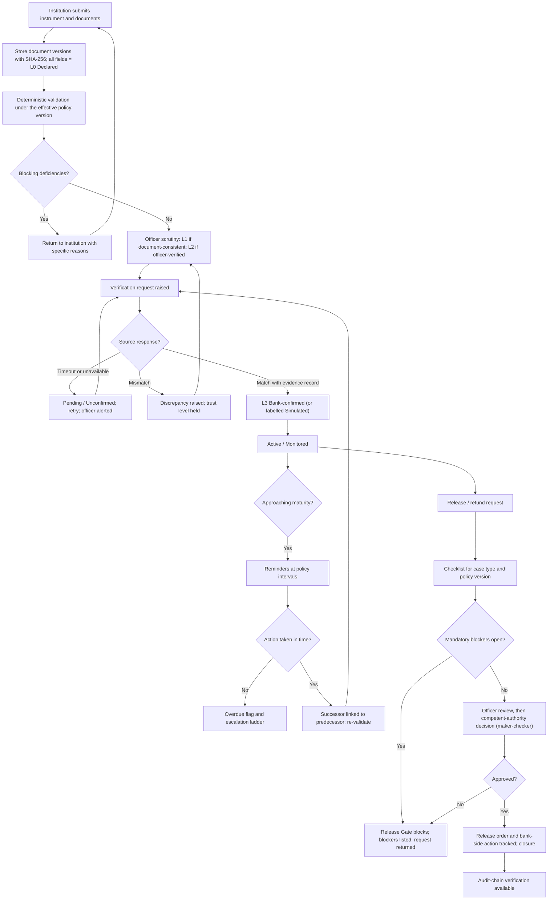
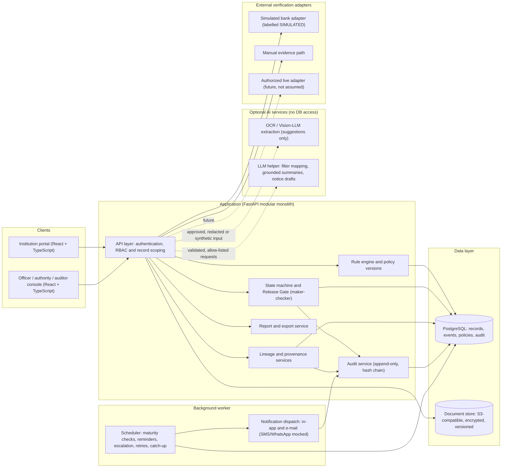
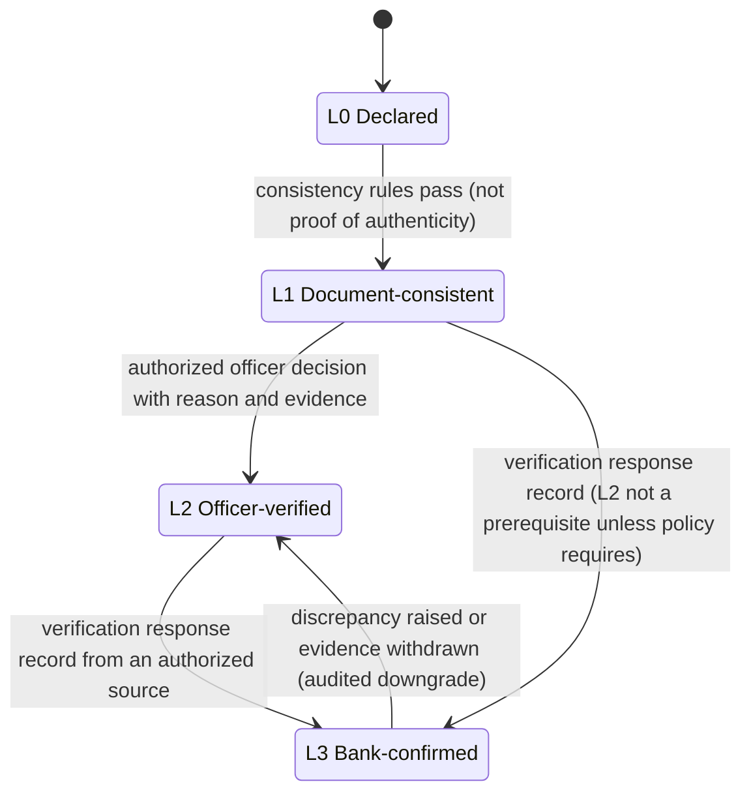
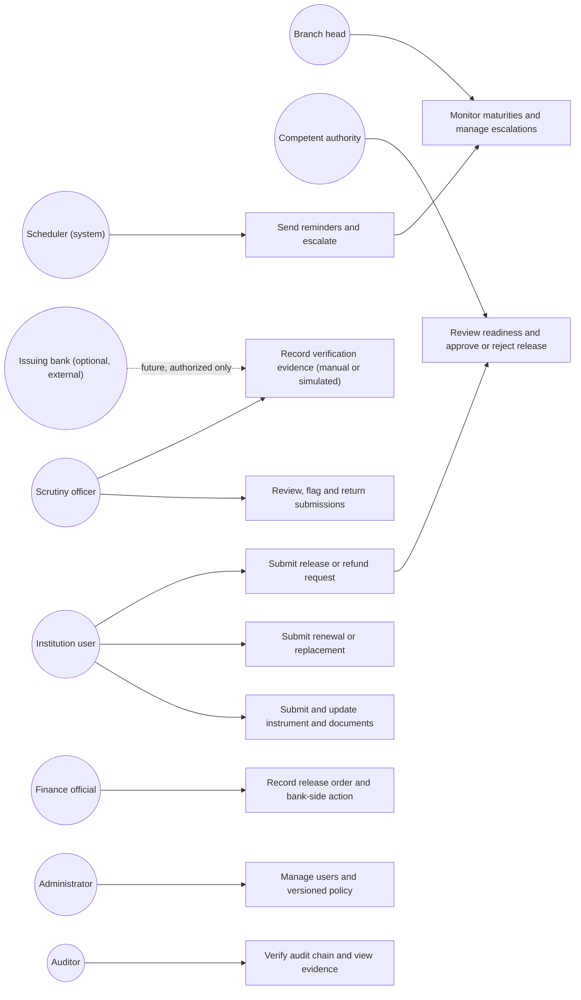

# 1. Cover Page

# FDR Sentinel
## Security Deposit / FDR Lifecycle Integrity Platform
### Project Synopsis

| Field | Value |
|---|---|
| **SIH 2026 Problem Statement ID** | 26265 |
| **Problem statement title** | Streamline of Security Deposit / FDR Portal |
| **Organization** | All India Council for Technical Education (AICTE), Regulation Bureau |
| **Theme / Category** | Smart Automation / Software |

# Table of Contents

1. Cover Page
2. Abstract
3. Introduction and Background
4. Official Problem Statement Analysis
5. Problem Definition and Motivation
6. Existing Systems and Related Work
7. Literature Review
8. Research Gap and Proposed Contribution
9. Proposed Solution
10. Objectives and Scope
11. System Architecture
12. Functional Modules
13. AI Integration and Smart-Automation Strategy
14. Trust, Security, Privacy, and Governance
15. Technology Stack and Rationale
16. Methodology and Implementation Plan
17. Testing and Evaluation Framework
18. Feasibility and Viability
19. Expected Outcomes and Impact
20. Limitations and Risk Analysis
21. Future Scope
22. Conclusion
23. References
24. Appendices (A–F)
25. Quality Report (companion to this document)

---

# 2. Abstract

AICTE's approval-related regulatory work may require institutions to create and maintain security deposits, commonly held as Fixed Deposit Receipts (FDRs). Managing these instruments involves institution-wise records, supporting documents, verification, maturity monitoring, renewal or replacement, and release or refund handling. The official statement for SIH 2026 PS 26265 describes a need for a secure, centralized portal that gives the Regulation Bureau an accurate, current view of instrument status and time-sensitive actions, where fragmented records and manual correspondence make this difficult [OFF][1].

**FDR Sentinel** is proposed as a *complementary lifecycle-integrity and workflow-orchestration layer* — not a replacement for any AICTE system. Its central idea is that the problem is **lifecycle control and trust, not file storage**: a system can store every scan and still be unable to say whether an instrument was independently confirmed, whether a replacement was linked to its predecessor, whether a release condition remains open, or whether a status change was authorized [PROP]. The proposed platform therefore combines (i) a per-field provenance and four-level trust model (L0 Declared, L1 Document-consistent, L2 Officer-verified, L3 Bank-confirmed); (ii) deterministic validation with explainable flags; (iii) a policy-versioned maturity, reminder and escalation engine; (iv) renewal/replacement lineage that never overwrites history; (v) a server-side release gate with maker-checker separation; and (vi) a hash-chained, verifiable audit history.

The design baseline is a modular monolith (React/TypeScript front end, FastAPI back end, PostgreSQL, S3-compatible document store, a background worker). **Artificial intelligence is an optional assistive layer, not the foundation**: eight candidate capabilities — Vision-LLM field extraction, explainable anomaly flags, a transparent 0–100 review-priority score, natural-language search mapped to safe filters, evidence-grounded summaries, drafted notices, maturity analytics, and document classification — are evaluated and prioritized, with a strict rule that extraction is not authentication, flags are not proof of fraud, model text is not an official decision, and no model participates in release or refund authorization [PROP].

Security controls include role-based access with institution tenant isolation, encrypted storage, signed time-limited document links, upload hardening, audit of authorization failures, and a hash-chain verification screen with an acknowledged residual privileged-operator risk. Implementation is planned as a prototype on **synthetic data**, with bank confirmation **simulated and visibly labelled** because no bank FDR-confirmation interface is evidenced [SIM][UNVER]. Evaluation is defined through functional, workflow, authorization, extraction-accuracy, notification-reliability and audit-integrity tests. **No performance improvement, cost saving, or fraud-prevention outcome is claimed**; any such outcome must be measured against a baseline obtained from an authorized pilot.

---

# 3. Introduction and Background

## 3.1 Security deposits and FDRs in the AICTE approval context

AICTE is the statutory body under the Ministry of Education, Government of India, that performs approval-related regulatory activities for technical institutions under applicable regulations, approval process handbooks and prescribed procedures [OFF][1]. Publicly available AICTE material shows that security deposits are part of that approval landscape:

- AICTE's published guidance describes an online path in which a new-institute application showing "Deposit Requested" requires the institution to check and pay the security-deposit amount through the institute web portal; after payment the sub-status becomes "Deposit Received", and government institutions are described as exempt from payment but required to submit an affidavit to the Regional Office [DOC][2].
- AICTE's approval-process manual pages list user manuals for checking and paying the security deposit and for applying online for JFDR [DOC][4][5].
- Excerpts of the *Approval Process Handbook 2024-25 to 2026-27* (APH) retrieved in this research describe a Security Deposit clause under which the deposited amount remains with the Council for 10 years and the principal is returned to the Trust/Society/Company on completion of the term; they also describe an AICTE right of lien over the FDR in specified circumstances, penalty provisions in specified cases, and release procedures for particular cases such as progressive closure, merger and conversion to a private university [DOC][6]. These excerpts were seen as search-result text on government-hosted and institution-hosted copies; the **primary APH text must be read before any policy rule is encoded** [UNVER].
- The guidelines for grant of approvals 2024-27 state that the Trust/Society/Company applies online and uploads documents on the AICTE web portal for release of the Security Deposit, to be processed per the procedure in the APH [DOC][7]. AICTE's 2025-26 approval-process attachments page lists portal-generated affidavit formats for submitting the security deposit (Affidavit-3) and for releasing it (Affidavit-6) [DOC][8].
- A letter of intent hosted by an institution instructs uploading a scanned FDR and affidavit to the portal and submitting the original FDR [DOC, secondary host][9]; a 2002 Lok Sabha reply described pledged joint FDRs with originals under regional-officer custody (historical) [DOC][10].

**Consequence for positioning.** AICTE evidently has public, online processes for deposit payment and for release applications. This synopsis therefore does **not** claim that no portal or workflow exists, and it does not allege deficiencies in AICTE's internal tooling, which is not public [ASSUME].

## 3.2 Why traceability and timely handling matter

A fixed deposit is a time-bound instrument: it has an issue date, a maturity date, a lien or pledge arrangement, and a set of documents that evidence it. Three properties make lifecycle handling consequential:

1. **Time-sensitivity** — missed maturity or renewal events have administrative consequences (for example, the APH describes penalties tied to early encashment or non-creation of the required deposit [DOC][6], and a circular reproduced on a document-sharing site states that institutions with matured FDRs must apply through the portal while those with unresolved legal or compliance issues are ineligible for release [DOC, weak secondary source ⚠][11]).
2. **Evidence quality** — a scanned copy is the institution's representation; it is not independent confirmation by the issuing bank. A July 2026 audit circular, reported in the PRD as drawn from a C&AG headquarters letter, describes an inquiry-reported case in which fake FDRs were issued to government bodies and instructs auditors to check independent bank confirmation, periodic reconciliation, treatment of matured deposits and segregation of duties [DOC][12]. That case does not concern AICTE; it is cited only as evidence that regulators treat independent confirmation and separation of duties as audit-critical for FDRs. A further fake-FDR matter involving a state government was reported in 2026 on a secondary encyclopaedic source and is mentioned only as context, with low evidentiary weight [DOC, secondary ⚠][13].
3. **Accountability** — releases and refunds are financial actions that must follow regulations, prescribed conditions and competent-authority authorization [OFF][1]; an auditor must be able to reconstruct who decided what, on which evidence, under which rule version.

## 3.3 The role of workflow automation

Workflow automation is appropriate for the repetitive, rule-governed parts of the lifecycle — checking completeness, computing days to maturity, sending reminders, routing cases, preventing out-of-sequence transitions, and recording events. It is **not** appropriate for determining banking facts without an authorized source, making legal determinations, or releasing funds; the problem statement itself frames the portal as assisting authorized officials [OFF][1], and `Context.md` records that the system "may assist, validate, flag, route, remind, and record" but "must not exceed the authority of the applicable policy or of the competent official" [PROP].

## 3.4 Terminology

A *security deposit* is a required amount maintained under applicable rules; an *FDR* is one kind of bank-issued instrument that may evidence it. The two terms are not treated as identical in every case [PROP]. *JFDR* denotes the jointly held FDR process referenced in AICTE manual listings [4][5]; its exact definition is to be confirmed from AICTE primary documents [UNVER]. The name "FDR Sentinel" is a proposed project name, not an existing AICTE system.

---

# 4. Official Problem Statement Analysis

## 4.1 Restatement

PS 26265, *Streamline of Security Deposit / FDR Portal* (AICTE Regulation Bureau, Smart Automation, Software), asks for a secure, centralized and user-friendly portal for the Regulation Bureau and other authorized stakeholders to manage security deposits/FDRs across their administrative lifecycle: recordkeeping, document submission, verification support, discrepancy handling, validity and maturity monitoring, reminders and escalation, renewal/replacement, release/refund requests, dashboards, reports, audit trails and secure access [OFF][1]. The stated overall goal is an efficient, transparent and accountable digital mechanism [OFF][1].

> **Source note.** The official SIH portal page was not retrieved in this research. The requirement list below is taken from the problem-statement text supplied by the team and recorded in `Context.md` §1.2 and PRD §3.2. It must be re-checked against the official SIH 2026 problem statement before formal submission [UNVER].

## 4.2 Explicit requirements (PS-01 … PS-17)

| ID | Official requirement (paraphrased) | Tag |
|---|---|---|
| PS-01 | Maintain institution-wise and instrument-wise records of relevant security deposits/FDRs | [OFF] |
| PS-02 | Capture instrument reference numbers, issuing bank details, amount, issue date, maturity date, validity status, supporting documents and current administrative status, as applicable | [OFF] |
| PS-03 | Enable digital submission and secure storage of FDRs and other prescribed supporting records | [OFF] |
| PS-04 | Support authorized officials in reviewing submissions and identifying incomplete records | [OFF] |
| PS-05 | Where supported, facilitate verification through legitimate bank-issued mechanisms | [OFF] |
| PS-06 | Distinguish institution-submitted information from independently confirmed information | [OFF] |
| PS-07 | Flag missing fields, inconsistencies and discrepancies requiring scrutiny | [OFF] |
| PS-08 | Monitor maturity, validity, renewal/replacement requirements and other prescribed timelines | [OFF] |
| PS-09 | Generate configurable advance reminders; flag overdue or unresolved cases for follow-up | [OFF] |
| PS-10 | Record and track release, discharge or refund requests, subject to rules, conditions and competent-authority authorization | [OFF] |
| PS-11 | Dashboard of active, expiring, matured, renewed, released and pending instruments | [OFF] |
| PS-12 | Search; document-history review; permitted-field updates; scrutiny observations; case-status tracking | [OFF] |
| PS-13 | Reports on pending verification, upcoming maturity, missing documents, cases needing intervention | [OFF] |
| PS-14 | Role-based access, secure document storage, appropriate encryption, audit trails, controlled access to financial/institutional information | [OFF] |
| PS-15 | Consider integration with existing AICTE systems and bank-verification services only where feasible and formally authorized | [OFF] |
| PS-16 | Demonstrate measurable improvement in record accuracy, verification turnaround, renewal monitoring, manual effort, visibility of pending cases | [OFF] |
| PS-17 | Test at least: new FDR submission, validity tracking, approaching maturity, renewal, discrepancy identification, authorized release processing | [OFF] |

The statement also refers to renewal/replacement monitoring with complete change history, escalation of unresolved cases, and a user-friendly design [OFF][1]; these are folded into PS-08/09/10/12/14.

## 4.3 What the statement does not require

Per `Context.md` §1.3, the statement does not require the system to move money or act as a payment gateway; become a bank or determine banking facts without an authorized source; replace AICTE's approval or e-governance systems; make legal or regulatory determinations; approve or refuse institutions or release funds through AI; integrate every bank regardless of availability or authorization; or depend on machine learning for core functionality [INF from the supplied statement]. These are treated as design boundaries, not as official text.

## 4.4 Intended outcomes, constraints and beneficiaries

| Aspect | Content | Tag |
|---|---|---|
| Intended outcomes | Reduced repetitive administration; improved record accuracy; timely alerts; transparent lifecycle tracking; compliance with AICTE requirements and authorized financial procedures | [OFF] |
| Constraints | Integration only where technically feasible and formally authorized; release subject to competent-authority authorization; access controlled for financial/institutional information | [OFF] |
| Beneficiaries (explicit) | AICTE Regulation Bureau and other authorized stakeholders | [OFF] |
| Beneficiaries (derived) | Scrutiny officers, branch heads, competent authority, finance officials, institution representatives, auditors, administrators, IT/e-Governance | [INF] |

## 4.5 Requirement-to-solution mapping (summary)

The full 17-row mapping with module and PRD requirement identifiers is in **Appendix A**. In summary: PS-01–04 → repository, document and validation modules; PS-05–07 → provenance/verification and anomaly modules; PS-08–09 → maturity monitor and notifications; PS-10 → release workflow and role-separated approvals; PS-11–13 → dashboard, search and reports; PS-14 → access control and audit; PS-15 → adapter interfaces with simulated/manual fallback; PS-16–17 → evaluation framework (Section 17).

**Inferred workflow gaps are not official facts.** Where this synopsis later discusses operational challenges (Section 5), only the problem statement's own description of fragmented records, manual correspondence and status-visibility difficulty is treated as sourced; all further challenges are labelled as hypotheses.

---

# 5. Problem Definition and Motivation

## 5.1 Core problem

The core problem is **lifecycle control and trust**. The operational questions the platform is meant to answer are: which institution an instrument belongs to; what its recorded facts and source documents are; which values were declared, extracted, checked by an officer, or independently confirmed; what the administrative and verification status is; what deadline applies and to whom it is assigned; whether a renewal is linked to its predecessor; whether release conditions and approvals are complete; and whether an auditor can reconstruct a decision [PROP; derived from `Context.md` §2.1].

## 5.2 Challenges and their evidence status

| # | Operational challenge | Evidence status | Source |
|---|---|---|---|
| C1 | **Fragmented records and manual correspondence** make an accurate current view of status and time-sensitive actions difficult | **Stated** by the problem setter | [OFF][1] |
| C2 | **Document handling** — scans, affidavits and supporting records must be submitted, stored and re-submitted with versions | Process documented (portal uploads of scanned FDR/affidavit; original FDR submission); scale of difficulty unknown | [DOC][9][8]; [HYP] on severity |
| C3 | **Information consistency** — entered values may differ from document values or from records held elsewhere | Hypothesis; no AICTE statistic found | [HYP] |
| C4 | **Verification tracking** — distinguishing declared from bank-confirmed information | Required by PS-06; audit circular shows regulators treat independent confirmation as critical for FDRs generally | [OFF][1]; [DOC][12] |
| C5 | **Maturity monitoring** — missed follow-ups near maturity | Hypothesis; handbook and circular material shows maturity and release are administratively consequential | [HYP]; [DOC][6][11] |
| C6 | **Renewal lineage** — replacements detached from predecessors, losing history | Required by PS ("complete change history"); incidence unknown | [OFF][1]; [HYP] |
| C7 | **Release controls** — release depends on case-type-specific conditions (e.g., closure, merger, conversion cases) and on authorization | Release is online and condition-dependent per APH/guideline excerpts; failures unknown | [DOC][6][7]; [HYP] |
| C8 | **Auditability** — reconstructing who decided what and why | Required by PS-14; audit-circular emphasis on segregation of duties | [OFF][1]; [DOC][12] |
| C9 | **Duplicated or reused documents** across institutions | Hypothesis; no AICTE evidence | [HYP] |
| C10 | **Loss of context on officer turnover** | Hypothesis | [HYP] |

## 5.3 Baseline and impact statement

No public baseline statistic for delay, loss, error rate or manual effort was found in this research [UNVER]. Accordingly, the project makes no claim of improvement; it defines how improvement would be measured (Section 17) and treats the existence and severity of challenges C3, C5, C6, C9 and C10 as **hypotheses to be validated with AICTE staff** [HYP].

## 5.4 Motivation

The motivation for the project is therefore twofold: (a) to satisfy the problem statement's request for a centralized, accountable lifecycle mechanism [OFF][1]; and (b) to explore whether a trust-first design — in which uncertainty, provenance and authorization are first-class data rather than free-text notes — adds value on top of AICTE's existing public portal processes. Part (b) is a proposition to be tested, not an established gap [HYP].

---

# 6. Existing Systems and Related Work

## 6.1 What is publicly documented

Public sources establish that AICTE already operates web-portal processes touching deposits (payment status, affidavits, online release applications) and that handbook rules for deposits and release exist and vary by year and institution category [DOC][2][4][5][6][7][8][15]. Public sources do **not** describe AICTE's internal tools for tracking maturities, confirming instruments with banks, linking renewals, gating release or auditing decisions. Whether such internal tooling exists is **unknown** and is a first-order question for stakeholder validation [ASSUME]. **The absence of a feature in a public document is not evidence that the feature is absent from internal systems.**

## 6.2 Comparison of relevant approaches

| System / approach | Purpose | Relevant capability | Evidence / source | Scope boundaries visible in the source | Relevance to FDR Sentinel |
|---|---|---|---|---|---|
| **AICTE web-portal security-deposit payment process** (2018-19 manual; 2019-20 guide) | Let new-institute applicants check and pay the deposit and track "Deposit Requested/Received" | Online amount check, online payment, sub-status update, helpdesk route for discrepancies; affidavit step; government-institution exemption with affidavit | [2][3] (dated) | Describes initial deposit payment for an application cycle; the guide text does not describe maturity tracking, instrument-level provenance or release gating | Shows an existing online process; FDR Sentinel must complement, not duplicate or replace it |
| **AICTE online release application and affidavits** (guidelines 2024-27; APH 2024-27 excerpts; 2025-26 attachments) | Let the Trust/Society/Company apply online for release of the deposit; portal-generated affidavits | Online release application; document upload; case-specific release conditions (closure, merger, conversion cases); right of lien; penalty provisions | [6][7][8] (APH text seen only as excerpts) | Excerpts describe the application route and conditions; they do not describe the officer-side tracking, verification or audit mechanisms | Confirms release is an online, condition-dependent process; supports a configurable, policy-versioned checklist and a release gate (PS-10) |
| **JFDR online application manuals** | Guide institutions to apply online for JFDR | Application guidance | [4][5] (titles/listings only; contents not read) | Contents not read | Existence confirmed; details to be obtained from AICTE [UNVER] |
| **Historic cohort-specific HQ notices** (e.g., release of FDRs of institutions established 2010-11) | Communicate release timelines for a cohort | Cohort-wide release instruction | [14] (PRD-recorded) | Cohort notice; not a system | Illustrates that rules vary by cohort and year → policy versioning |
| **Manual bank-confirmation correspondence and audit reconciliation** | Independently confirm deposits with the issuing bank | Letters/e-mail through official channels; reconciliation; segregation of duties | [12] (audit circular, as recorded in the PRD) | A control practice, not a software platform | Establishes the L3 "bank-confirmed" concept and the need for a manual-evidence path, because no API is evidenced |
| **NeSL electronic Bank Guarantee (e-BG) and Entity Locker** | Paperless issuance and lifecycle of bank guarantees; reported retrieval channel | Bank-originated, digitally verifiable instrument; integration with e-procurement portals reported | [16][17] (secondary and departmental sources) | Covers **bank guarantees, not FDRs**; the sources do not evidence an FDR confirmation channel | Design precedent for bank-originated verifiable instruments; **must not** be cited as FDR verification access; keep an adapter slot only |
| **Spreadsheets / e-mail trackers** | Presumed status quo for fragmented tracking | Ad hoc lists and reminders | Inferred from the problem statement's "fragmented records" language [OFF][1]; actual AICTE practice unknown | — | The baseline FDR Sentinel would be measured against [HYP] |
| **Tamper-evident logging designs** (hash chains, Merkle trees, Certificate Transparency) | Detect alteration of append-only logs | Hash chaining, consistency proofs, auditing | [26][27][28] (peer-reviewed / IETF) | Detects, does not prevent; needs frequent auditing; trust anchored outside the operator for strong guarantees | Provides the technical basis for the audit chain and its honest limits |
| **Document-AI and OCR pipelines** (LayoutLM family, Donut, Tesseract, VLMs) | Extract fields from document images | Layout-aware extraction, OCR-free parsing | [29]–[35] | Benchmarks are on public datasets, not Indian bank FDR layouts; VLM transcription can silently "rewrite" imperfect text [34] | Supports *optional, human-confirmed* extraction only |
| **Treasury / ERP / contract-lifecycle products** | Generic instrument or contract tracking | Not evaluated | No evidence gathered | — | Not compared; revisit if AICTE names a platform [UNVER] |

**No competitor product is compared**, because no off-the-shelf regulator-side FDR lifecycle product was verified in this research [UNVER]. No claim of superiority is made.

## 6.3 Where the proposal may complement existing processes

If, after validation, AICTE's existing portals do not already provide them, FDR Sentinel's complementary value would lie in: per-field trust provenance and distinction of declared vs confirmed information (PS-06); renewal/replacement lineage; deadline monitoring with escalation (PS-08/09); evidence-gated release readiness (PS-10); and a verifiable audit chain (PS-14). Each is a **proposition to validate**; none is asserted as a documented gap [HYP].

---

# 7. Literature Review

## 7.0 Scope and method

The review covers the eight areas in the project brief. Sources were located through web search and retrieved bibliographic records; items marked ✔/◐ in Section 23 had their title, authors, venue, date and (where stated) DOI confirmed or their text read in this research; items marked ○ carry bibliographic records from the PRD and **must be re-checked before formal submission**. Findings are reported only as stated in the source abstract or text that was read; no result is generalized beyond the source's own setting. Where a research area lacked a verified, directly relevant study, this is stated rather than filled with weak citations (Sections 7.7, 7.8).

## 7.1 OCR and document information extraction

| Work | Research problem | Method | Verified findings | Limitations | Relevance |
|---|---|---|---|---|---|
| Smith, *An Overview of the Tesseract OCR Engine*, ICDAR 2007 [29] ○ | Describe an open-source OCR engine | Classical OCR pipeline | Not re-read in this research | Pre-neural; multilingual limits (see [34]) | Candidate local OCR baseline |
| Xu et al., *LayoutLM*, KDD 2020 [30] ◐ | Text-only pre-training ignores layout in scanned documents | Joint pre-training of text and 2-D layout (image features added for downstream tasks) | Reported gains on form understanding (70.72→79.27), receipt understanding (94.02→95.24) and document-image classification (93.07→94.42) in the abstract | Public benchmarks (forms, receipts, RVL-CDIP-type tasks); not bank FDRs | Basis for layout-aware extraction and classification (AI Capabilities 1 and 8) |
| Huang et al., *LayoutLMv3*, ACM MM 2022 [31] ◐ | Mismatched pre-training objectives for text and image | Unified text–image masking and word-patch alignment | Abstract reports state-of-the-art results on text-centric tasks (form, receipt, DocVQA) and image-centric tasks (classification, layout analysis) | Document-oriented; benchmark-specific | Candidate for fine-tuned extraction if licensing and data permit |
| Kim et al., *Donut*, ECCV 2022 (LNCS 13688, pp. 498–517) [32] ◐ | OCR-dependent pipelines are costly, inflexible across languages/types and propagate OCR errors | OCR-free end-to-end transformer; SynthDoG synthetic generator | Paper reports strong speed/accuracy on document tasks; motivates synthetic-data pre-training | Needs task-specific fine-tuning data; not validated on Indian FDRs | Shows synthetic data can bootstrap extraction — relevant because only synthetic data will be available |

**Synthesis.** Layout-aware and OCR-free models are mature on public benchmarks, but none is evidenced on Indian bank FDR layouts [UNVER]. For this project, extraction is positioned as *data-entry assistance with human confirmation* (Section 13), never as validation.

## 7.2 Vision-language models for structured extraction

| Work | Research problem | Method | Verified findings | Limitations | Relevance |
|---|---|---|---|---|---|
| Lee et al., *Do VLMs Read or Rewrite? On Transcription Faithfulness in Vision-Language Models*, arXiv:2607.21617 (2026) [34] ✔ | Do VLMs transcribe literally, or "correct" imperfect text? | FaithC4 benchmark: 1,455 rendered single-page documents (English, Chinese, Korean); scramble / random / visually-similar perturbations; 15 systems; layer probing of one model; a 150-PDF real-document ID-extraction check | Under ~5% character perturbation, English WER degradation reached up to 6.9 points for general-purpose VLMs, 0.1–3.4 for OCR-specialized VLMs, under 0.8 for traditional OCR; corrupting ~5% of characters raised errors on unperturbed text by up to 7.3× for general VLMs; on 150 product-compliance PDFs, OCR→LLM pipelines reached median F1 93.5% vs 68.6% for direct VLMs on identifier extraction | Preprint; synthetic rendered PDFs; three scripts (Devanagari not tested); mechanism probed on one model; ID-extraction check is a different domain | **Directly relevant**: FDR numbers and dates are identifier-like strings; supports separating reading from understanding, comparing extracted vs entered values, and mandatory human confirmation |
| He et al., *Seeing is Believing? Mitigating OCR Hallucinations in MLLMs*, arXiv:2506.20168 (2025) [35] ◐ | OCR hallucination when answer fields are degraded | Described in [34] as studying document images with locally blurred/occluded answer fields | Only the characterization in [34] was read | Abstract not read | Supports treating low-quality scans as a risk (uncertainty flag) |
| Liu et al., *OCRBench*, Sci. China Inf. Sci. 67(12), 2024 [33] ◐ | Evaluate OCR ability of large multimodal models | Benchmark | Title/venue confirmed from citing paper's reference list; findings not re-read | — | Evaluation reference for VLM-based extraction |

**Synthesis.** Recent evidence cautions that VLMs can silently normalize what they read; this is a design input for provenance tagging (`Vision-LLM-Extracted`, never "verified"), literal-OCR cross-checks for identifiers, and field-level evaluation (Section 17) [RES][34].

## 7.3 Human-in-the-loop AI and uncertainty handling

| Work | Research problem | Method | Verified findings | Limitations | Relevance |
|---|---|---|---|---|---|
| Amershi et al., *Guidelines for Human-AI Interaction*, CHI 2019 [37] ◐ | Consolidate design guidance for AI-infused systems | Synthesis of 150+ recommendations into 18 guidelines; validated in rounds including a study with 49 practitioners across 20 products | 18 guidelines grouped by when they apply (initially, during interaction, when wrong, over time), including making clear what the system can do | Design guidance, not a measured outcome in this domain | Informs "show what the system can do/uncertainty", correction paths and granular feedback |
| Parasuraman & Manzey, *Complacency and Bias in Human Use of Automation*, Human Factors 52(3):381–410, 2010 [38] ◐ | Integrate research on automation complacency and bias | Review and integrated attentional model | Complacency occurs in naive and expert participants and is not overcome by simple practice; automation bias leads to omission and commission errors when aids are imperfect | General automation literature, not document review specifically | Justifies not letting AI outputs pre-fill decisions silently and requiring reasons for dismissals |
| NIST, *AI Risk Management Framework 1.0*, NIST AI 100-1, 2023 [22] ◐; *Generative AI Profile*, NIST AI 600-1, 2024 [23] ◐ | Voluntary framework for managing AI risk | Govern/Map/Measure/Manage functions; GenAI profile | Existence, date and DOI confirmed; contents not exhaustively read | Voluntary, non-sector-specific | Governance vocabulary for documenting AI limits and oversight |

## 7.4 Duplicate detection and explainable anomaly detection

| Work | Research problem | Method | Verified findings | Limitations | Relevance |
|---|---|---|---|---|---|
| Elmagarmid, Ipeirotis, Verykios, *Duplicate Record Detection: A Survey*, IEEE TKDE 19(1):1–16, 2007 [40] ◐ | Entities appear in multiple differing representations; errors arise from transcription, incompleteness, non-standard formats | Survey of similarity metrics, detection algorithms, scalability techniques | Establishes that approximate matching and review are needed when there is no common key | Pre-dates modern learned matchers | Supports reference-number normalization, flag-for-review (never auto-merge) |
| Liu, Ting, Zhou, *Isolation Forest*, IEEE ICDM 2008 [41] ○ | Efficient unsupervised anomaly detection | Tree-based isolation | Not re-read | Needs representative data; scores are not explanations | Optional only; not required for rule flags |
| Lundberg & Lee, *SHAP*, NeurIPS 2017 [42] ○ | Attribute model predictions to features | Additive attribution | Not re-read | Post-hoc explanations of opaque models can mislead [39] | Optional |
| Chandola, Banerjee, Kumar, *Anomaly Detection: A Survey*, ACM Computing Surveys 41(3), 2009 [43] ○ | Categorize anomaly-detection methods | Survey | Not re-read | — | Background |
| Rudin, *Stop explaining black box ML models for high-stakes decisions…*, Nature Machine Intelligence 1:206–215, 2019 [39] ◐ | Black-box models with post-hoc explanations in high-stakes use | Perspective/argument | Argues for inherently interpretable models in high-stakes decisions, since post-hoc explanations may not be faithful | Perspective, not an empirical test in AICTE-like workflows | Supports explicit rules and a transparent weighted score over an opaque classifier |

## 7.5 Risk prioritization in administrative workflows

No peer-reviewed study specific to regulator-side FDR or deposit-case prioritization was identified in this research [UNVER]. The proposed 0–100 review-priority score is therefore **an engineering design** justified by the interpretability argument [39] and by the audit-circular emphasis on confirmation and reconciliation [12], with weights disclosed as prototype assumptions rather than learned or validated values [PROP].

## 7.6 Secure document management, access control and tamper-evident logging

| Work | Research problem | Method | Verified findings | Limitations | Relevance |
|---|---|---|---|---|---|
| Ferraiolo et al., *Proposed NIST Standard for RBAC*, ACM TISSEC 4(3):224–274, 2001 [25] ○ | Standardize role-based access control | Formal RBAC model | Not re-read | Does not address record-level tenancy by itself | Role model basis |
| NIST SP 800-53 Rev. 5 [21] ○ | Security and privacy control catalogue | Control families (AC-5 separation of duties, AC-6 least privilege, AU-9 audit protection per PRD) | Not re-read here | Catalogue, not an implementation | Control language for RBAC, maker-checker and audit protection |
| OWASP ASVS and File Upload Cheat Sheet [24] ○ | Secure web-application and upload practice | Verification standard / guidance | Not re-read | Guidance | Upload hardening and web-risk checklist |
| Schneier & Kelsey, *Cryptographic Support for Secure Logs on Untrusted Machines*, USENIX Security 1998, pp. 53–62 [27] ◐ (journal version: *Secure Audit Logs to Support Computer Forensics*, ACM TISSEC, 1999, pp. 159–176 — volume/issue to be confirmed, see §25) | Logs on a machine that may be compromised | Forward-secure hash-chained log entries | Entries created before compromise cannot be undetectably modified or destroyed | Protects entries *before* compromise; assumes key handling | Basis for hash chaining |
| Crosby & Wallach, *Efficient Data Structures for Tamper-Evident Logging*, USENIX Security 2009, pp. 317–334 [26] ◐ | Tamper-evident logging against untrusted loggers and insiders | Tree-based history structure with logarithmic audit and lookup | Abstract states tamper-resistance may be impossible but tamper-detection should be guaranteed; frequent auditing is needed | Detects misbehaviour, does not prevent it | Justifies "tamper-evident, not tamper-proof" wording and periodic verification |
| Laurie, Langley, Kasper, *Certificate Transparency*, RFC 6962, 2013 [28] ◐ | Public auditing of certificate issuance | Append-only Merkle-tree logs; consistency and audit proofs | Logs are publicly auditable and untrusted; RFC is Experimental and **now obsoleted by RFC 9162** per the IETF datatracker | Obsoleted; designed for TLS certificates | Precedent for external anchoring of log heads (future scope) |
| Greshake et al., *Not what you've signed up for…*, AISec 2023 (arXiv:2302.12173) [36] ◐ | Security of LLM-integrated applications | Taxonomy and demonstrations of indirect prompt injection | Retrieved content blurs data and instructions; demonstrated against real and synthetic applications | Attacks demonstrated on specific systems | Supports treating document text as data, giving models no database or tool access |

## 7.7 Workflow automation, reminders and exception management

No peer-reviewed source on reminder/escalation design for deadline workflows was verified in this research [UNVER]. The proposed scheduler properties — idempotent notifications, catch-up after outage, bounded retries, explicit failed-delivery states — are **engineering practice**, justified by the problem statement's reminder and escalation requirements (PS-09) and tested directly in Section 17 rather than supported by citation [PROP].

## 7.8 Literature comparison matrix

| Source | Area | Evidence type | Domain match to FDR lifecycle | Design element it informs |
|---|---|---|---|---|
| LayoutLM [30], LayoutLMv3 [31], Donut [32] | Extraction | Peer-reviewed benchmark results | Low–medium (forms/receipts) | Optional extraction; synthetic data bootstrapping |
| FaithC4 [34] | VLM faithfulness | Preprint with benchmark and real-doc check | Medium (identifier-like strings) | Human confirmation; provenance tag; literal-OCR cross-check |
| Amershi [37], Parasuraman & Manzey [38] | Human–AI | Guidelines; review | General | Uncertainty display; automation-bias safeguards |
| Rudin [39] | Interpretability | Perspective | General high-stakes | Rule-based flags; transparent score |
| Elmagarmid [40] | Duplicates | Survey | Medium | Duplicate-flag design |
| Schneier–Kelsey [27], Crosby–Wallach [26], RFC 6962 [28] | Audit logs | Peer-reviewed/IETF | High (technique) | Hash chain, verification, external anchoring |
| Greshake [36] | LLM security | Peer-reviewed workshop paper | General | No tools/DB access for models; documents as data |
| NIST AI RMF [22], GenAI profile [23], SP 800-53 [21], OWASP [24] | Governance/security | Standards/guidance | General | Controls, documentation, upload hardening |
| (none verified) | Risk prioritization; reminder workflows | — | — | Design stated as engineering assumption |

## 7.9 Research-to-design rationale

| Research finding | Design decision |
|---|---|
| VLMs may rewrite imperfect text; direct VLM identifier extraction underperformed OCR→LLM pipelines in one check [34] | Extraction output is a *suggestion* tagged `OCR-Extracted`/`Vision-LLM-Extracted`; extracted-vs-entered conflicts raise flags; low-confidence fields highlighted; numeric identifiers cross-checked with literal OCR where used |
| Automation complacency/bias persists even in experts [38]; guidelines advise clarity on capability limits and correction [37] | AI never pre-fills decisions; dismissal of a flag requires a reason; UI states "Advisory — human review required" |
| High-stakes decisions favour interpretable models [39] | Deterministic rule engine first; priority score is a disclosed weighted formula, not a trained classifier |
| Duplicates arise from transcription errors and missing common keys [40] | Probable-duplicate *flag* using normalized bank + reference and file hash; never auto-merge |
| Tamper-evidence detects but does not prevent; auditing must be frequent [26][27] | Hash-chained append-only audit with replayable verification screen; wording avoids "tamper-proof"; external head anchoring listed as future work |
| Retrieved content can act as instructions [36] | LLM features have no DB credentials/tools; natural-language search emits only an allow-listed filter schema validated and authorized by the backend |
| Regulators emphasize independent confirmation and separation of duties for FDRs [12]; no FDR confirmation API evidenced [16][17] | L0–L3 trust model; L3 only from a response record; simulated adapter labelled SIMULATED; manual-evidence path |
| Rules vary by handbook year and case type [6][15] | Policy-as-data with versions; decisions store the policy version in force |

---

# 8. Research Gap and Proposed Contribution

## 8.1 Gaps

| Gap | Basis | Label |
|---|---|---|
| Public documents describe deposit payment and release applications but not an officer-side lifecycle layer with field-level trust provenance, renewal lineage, escalation and evidence-gated release | Absence in public sources [2][4][5][6][7][8] — absence of evidence, not evidence of absence | [HYP] |
| The problem statement asks to distinguish submitted from independently confirmed information, with bank verification "where supported" | Official text | [OFF][1] |
| No bank FDR-confirmation interface is evidenced; the nearest national platform covers bank guarantees only | [16][17] | [UNVER] on FDR channel |
| Document-extraction research is not validated on Indian bank FDR layouts; VLM faithfulness issues are documented | [30]–[34] | [RES] |
| No verified literature on prioritization scoring or reminder design for regulator-side deposit workflows | Search outcome | [UNVER] |

## 8.2 Proposed contribution

The contribution is **product and system integration**, not a new algorithm: bringing together, in one coherent lifecycle layer, (1) **lifecycle integrity** — separation of administrative state, trust state and verification-request status; (2) **field-level provenance** — each field's value, source type, actor/service, time and evidence reference; (3) **explainable discrepancies** — every flag stores rule ID, policy version, evidence, comparison and next action; (4) **maturity monitoring** with policy-versioned reminders and escalation; (5) **renewal lineage** — successor linked to predecessor, acyclic, never overwriting; (6) **controlled release** — server-side gate plus maker-checker, with no model call in the path; and (7) **auditability** — append-only, hash-chained events with replayable verification [PROP].

## 8.3 Novelty analysis

| Layer | Novelty assessment |
|---|---|
| Algorithms (rules, hashing, schedulers, weighted scoring, OCR/VLM) | **Standard techniques; no algorithmic novelty is claimed** |
| Trust model L0–L3 and per-field provenance | Application-level design; analogous provenance and maker-checker ideas are widely used — **no claim of being unprecedented** |
| Integration for this specific workflow | Defensible as *product-integration* innovation: combined fit to PS 26265's requirements and honest handling of unavailable bank channels |
| Empirical results | None; synthetic prototype evidence will demonstrate correctness of rules and workflow, not production accuracy or operational savings |

---

# 9. Proposed Solution

## 9.1 Positioning

> **FDR Sentinel is a trust-first lifecycle-integrity layer for AICTE-related security deposits/FDRs: it distinguishes declared from confirmed information, preserves renewal lineage, monitors deadlines, gates release on required evidence and authorization, and maintains a verifiable audit history.** [PROP; project positioning from `Context.md` §14]
>
> *Know what is declared. Know what is proven. Never silently lose a lifecycle event.*

It is a **lifecycle-integrity and workflow-orchestration platform**. It does not move money, act as a bank, replace AICTE's approval portal, assume a bank API, make legal determinations, or let AI authenticate, approve or release anything [PROP].

## 9.2 End-to-end flow

**Institution submission → validation → provenance assignment → authorized verification → maturity monitoring → renewal/replacement → release/refund request → competent-authority review → closure and audit.**

## 9.3 Step descriptions

1. **Submission.** An institution user (or an officer entering legacy data) creates an instrument record and uploads documents. Every document version is hashed (SHA-256) and stored; every field starts at **L0 Declared** [PROP].
2. **Validation.** A deterministic rule engine checks required fields, date logic, amount against a configured policy value, institution-name consistency and duplicates under the *effective policy version*; flags carry rule ID, policy version, evidence, severity and next action [PROP].
3. **Provenance assignment.** Fields may rise to **L1 Document-consistent** (consistent with uploaded documents — explicitly *not* proof of authenticity), to **L2 Officer-verified** by an authorized officer's decision with reason and evidence, and to **L3 Bank-confirmed** only when a verification-response record exists [PROP].
4. **Authorized verification.** An officer raises a verification request with a unique code; a response (real if ever authorized, manual with evidence, or simulated and labelled) is recorded. Timeouts and mismatches never yield L3 [PROP][SIM].
5. **Maturity monitoring.** A scheduler computes days to maturity and overdue conditions daily under a stated time-zone convention, sending reminders and escalating per policy [PROP].
6. **Renewal/replacement.** A successor is a *new* instrument linked to its predecessor; the predecessor is never overwritten and is not marked released merely because a successor was uploaded [PROP].
7. **Release/refund request.** The institution submits a request; the readiness engine evaluates the case-type checklist and lists satisfied and unmet items [PROP].
8. **Competent-authority review.** The server rejects approval while mandatory blockers are open; approval requires a delegated role and a reason; requester/reviewer cannot also approve where policy requires separation [PROP].
9. **Closure and audit.** The full history is preserved; an auditor can replay the audit chain [PROP].

## 9.4 Exception handling

| Exception | Required behaviour | Policy-dependent? |
|---|---|---|
| Missing documents | Checklist shows present / missing / unreadable / wrong-category / awaiting items; institution notified; progression blocked at the policy-defined stage | Yes — required document list per case and year |
| Conflicting extracted vs entered values | Both values retained with provenance; conflict flag; resolution by officer or institution is audited | No |
| Duplicate identifiers | Probable-duplicate flag (normalized bank + reference; identical file hash); officer review; never auto-merged; not treated as proof of fraud | Duplicate key definition to confirm |
| Failed/unavailable external verification | State stays Pending/Unconfirmed/Source unavailable; retries logged; L3 impossible | No |
| Approaching or past maturity | Reminders and escalation; maturity does not imply release eligibility | Intervals and recipients to be approved by AICTE |
| Replacement of an FDR | New instrument linked to predecessor; gap/overlap flagged per policy | Gap/overlap tolerance to confirm |
| Rejected/returned submission | Reason mandatory; prior versions retained | Reason categories to confirm |
| Unauthorized access attempt | Denied server-side and logged | No |
| Failed notification | Delivery status recorded; bounded retries; case not treated as "institution informed" | Permitted channels to confirm |

## 9.5 Automation and human oversight

| Activity | Automation level | Human role |
|---|---|---|
| Date arithmetic, completeness checks, duplicate flags, state-transition validation | **Automated, deterministic** | Reviews flags; resolves with reason |
| Reminders, escalation, retries, catch-up | **Automated** | Receives, acts, reassigns |
| Field extraction, classification, summaries, drafted notices (optional) | **AI-assisted suggestions** | Confirms, edits, adopts; accountable for adopted text |
| L2 verification | **Human decision** | Authorized officer |
| L3 confirmation | **Evidence record** from an authorized source or labelled simulation | Officer records; system does not infer |
| Release/refund approval | **Human decision only** | Competent authority; no model call in the gate path |

---

# 10. Objectives and Scope

## 10.1 Objectives

**Primary**

| ID | Objective | Linked PS items |
|---|---|---|
| OBJ-01 | One institution-wise/instrument-wise register with documents and status | PS-01–03 |
| OBJ-02 | Explicit provenance and verification state for key facts, with no upgrade without evidence | PS-05–07 |
| OBJ-03 | Surface time-sensitive events with configurable reminders and escalation | PS-08–09 |
| OBJ-04 | Preserve renewal/replacement lineage and change history | PS-08, PS-12 |
| OBJ-05 | Control release/refund through explainable readiness checks and human authorization | PS-10 |
| OBJ-06 | Dashboards, search and reports for pending work | PS-11–13 |
| OBJ-07 | RBAC, encryption and a tamper-evident audit trail | PS-14 |

**Secondary**

| ID | Objective | Linked PS items |
|---|---|---|
| OBJ-08 | Integration-ready design that is honest about what is real, simulated or planned | PS-15 |
| OBJ-09 | Measure improvement against a baseline rather than assert it | PS-16–17 |
| OBJ-10 | Evaluate optional AI assistance without letting it become a decision-maker | (project choice) |

## 10.2 Intended users and stakeholders

Scrutiny/verification officers; section/branch heads; competent authority/approver; finance/accounts officials; institution representatives; system administrators; auditors (read-only); AICTE IT/e-Governance; and, optionally, issuing banks as external confirmation sources [PROP; PRD §7].

## 10.3 In scope for the MVP prototype

Institution/instrument registry; secure document upload with versioning and hashing; deterministic validation with explained flags; trust levels and field provenance; administrative state machine with server-side transition rules; maturity monitor with configurable reminders and escalation; renewal lineage; release request, checklist, blockers and gated, maker-checker approval; dashboard and essential reports; RBAC with tenant isolation; hash-chained audit with verification screen; simulated bank-confirmation adapter and manual-evidence path; synthetic data with a demo-only date control; automated tests for the six official scenarios (plus duplicate, source-timeout, cross-tenant denial and audit-tamper cases) [PROP].

## 10.4 Explicitly out of scope

Live bank or AICTE-system integration; SSO/DSC; payment or money movement; production hosting and certification; legal-policy encoding beyond configurable examples; trained predictive models; native mobile applications; any claim of real-time bank verification, forgery detection, immutability, or automatic approval [PROP].

## 10.5 Future enhancements

See Section 21 (authorized bank interface; AICTE integration/SSO/DSC; improved extraction; natural-language search; evidence-grounded summaries; bilingual notices; renewal-miss prediction only with authorized historical data; pilot).

## 10.6 Key assumptions and dependencies

| ID | Assumption / dependency | Needed from |
|---|---|---|
| A-1 | Current APH deposit and release rules by year and case type | AICTE policy owner; primary APH text |
| A-2 | Whether any bank offers an electronic FDR confirmation channel | AICTE–bank agreements |
| A-3 | Delegation of powers (who may verify, recommend, clear, approve, close) | AICTE office orders |
| A-4 | Reminder intervals, recipients, escalation periods, overdue definitions | AICTE Regulation Bureau |
| A-5 | Duplicate-key definition and gap/overlap tolerances | AICTE records and bank conventions |
| A-6 | Retention periods; DPDP and CERT-In applicability; data-fiduciary role | Legal and AICTE IT |
| A-7 | Hosting, identity provider/SSO, notification channels | AICTE IT |
| A-8 | Availability of any authorized, anonymized real documents | AICTE; otherwise synthetic only |
| A-9 | Hackathon duration, team structure and evaluation criteria | Official SIH 2026 guidelines [UNVER] |

---

# 11. System Architecture

## 11.1 Baseline and justification

The architecture follows `Context.md` §7 and PRD §17/§19: **a modular monolith plus a background worker**, with optional AI services behind a narrow interface and external verification behind adapters. No change to that baseline is proposed. Two clarifications are added and labelled as proposals: (a) record-scoped authorization in application code with optional PostgreSQL row-level security as defence in depth; and (b) a distinct, optional AI-service boundary that receives no database credentials [PROP]. A modular monolith is chosen because it is simpler to build, test and explain within a prototype than distributed services; vertical scaling is assumed adequate for expected volumes and must be verified by load testing [PROP][ASSUME].

## 11.2 High-level architecture

## 11.3 Component responsibilities

| Component | Responsibility | Key constraints |
|---|---|---|
| **Frontend** (React, TypeScript, Tailwind) | Institution portal and officer console; display provenance/trust labels, flags with reasons, blockers, queues, dashboards; no business rules enforced only here | UI state changes cannot bypass backend rules |
| **API / auth layer** | Authentication; role and record-scope checks on every endpoint; request validation; OpenAPI | Server-side only authorization; institution tenant isolation |
| **Rule engine and policy service** | Evaluate configurable, versioned rules; store policy version with each decision | Rules are data, not code constants |
| **State machine and Release Gate** | Allowed-transition table; readiness evaluation; maker-checker; rejects approval while mandatory blockers are open | No model call in the gate path |
| **Lineage and provenance services** | Per-field provenance; predecessor/successor chain; acyclic constraint; L3 evidence constraint | Database constraints back the code |
| **Audit service** | Append-only events with previous-hash chaining; verification replay; first-failure report | Application role has no UPDATE/DELETE on audit tables |
| **PostgreSQL** | Relational integrity, workflow and audit events, indexes and reports | Constraints for uniqueness, lineage and L3 evidence |
| **Document store** (MinIO/S3-compatible) | Encrypted, versioned binary documents; signed time-limited access; no public paths | Hash and metadata held in PostgreSQL |
| **Background worker** | Daily maturity computation; idempotent reminders; escalation; retries; catch-up after outage | One reminder per (instrument, event, interval, recipient) |
| **Notification service** | In-app and e-mail; delivery status and retries; SMS/WhatsApp mock labelled | Failed delivery never counted as "informed" |
| **Optional AI services** | OCR/Vision-LLM extraction; LLM helper for filters, summaries, drafts | Suggestions only; approved/self-hosted or synthetic inputs |
| **Verification adapters** | One interface; simulated, manual, and (future) authorized live implementations | Simulated responses labelled in UI, exports and audit |

## 11.4 Data flow (typical case)

Browser → API (authenticated, scoped) → upload stored in the document store with a SHA-256 hash and metadata row in PostgreSQL → rule engine evaluates and writes flags → audit event appended → worker later reads maturity dates, writes reminder records and sends notifications, each attempt recorded → release request triggers readiness evaluation → authority decision recorded with policy version → audit chain verifiable on demand [PROP].

## 11.5 Lifecycle states and the separation of state from trust

An instrument's **administrative state** (`Draft → Submitted → Under Scrutiny → (Correction Required / Discrepancy Raised) → Active/Monitored → Expiring Soon → Renewal/Replacement Due → Renewed or Matured → Release Requested → Approved/Rejected/Returned → Released/Closed`), its **trust state** (L0–L3) and its **verification-request status** are kept as separate fields, because an instrument can be *Submitted*, *Expiring Soon* and *L0* at once. Conditions such as Overdue, Escalated, Source Unavailable and Disputed are better modelled as flags or sub-statuses than as mutually exclusive states; the final state machine must be validated with AICTE [PROP][ASSUME; `Context.md` §6.1].

## 11.6 Logical data model (illustrative)

`Institutions`, `Users`, `Roles/UserRoles`, `Instruments`, `InstrumentEvents`, `Documents/DocumentVersions`, `FieldProvenance`, `VerificationRequests`, `VerificationResponses`, `Discrepancies/Observations`, `ReleaseRequests`, `ChecklistItems/ReadinessAssessments`, `Approvals`, `Notifications`, `PolicyVersions`, `AuditEvents`. Relations: one institution has many instruments; an instrument has many documents, verifications, observations and events; instrument ↔ predecessor/successor (acyclic); a release request has many checklist items and approvals; every decision references its policy version; every material transition produces an audit event. The schema is illustrative until validated by AICTE [PROP]. No vector database or complex AI orchestration is required [PROP].

---

# 12. Functional Modules

For each module: **Purpose · Inputs · Processing · Outputs · Actors · Key safeguards**. Requirement IDs refer to PRD v0.1.

| # | Module | Purpose | Inputs | Processing | Outputs | Actors | Key safeguards |
|---|---|---|---|---|---|---|---|
| 1 | **Institution and user management** | Separate institution master data from instruments; manage users and roles | Institution details; user accounts; role assignments | Create/update; scope users to institutions or offices | Institution records; role map | Admin; institution user | Admin cannot approve financial actions by role; tenant scoping; MFA where approved IdP allows [FR-001, FR-090, FR-096] |
| 2 | **FDR / instrument repository** | One trusted register per instrument | Instrument fields (type, bank, reference, amount, dates, lien/pledge, office, state) | Validate dates and amount; duplicate-key check; mask identifiers in lists | Instrument records with stable IDs | Institution; officer | Raise duplicate *flag*, never auto-merge; separate admin state from trust state [FR-002–006] |
| 3 | **Secure document ingestion and versioning** | Store evidence safely with history | Files (allow-listed types and sizes) | Hash, version, categorize, scan; completeness checklist by case type and policy version | Immutable versions; checklist status | Institution; officer | Non-public storage; signed expiring links; malware handling; hash equality shown only as "identical file bytes" [FR-010–016] |
| 4 | **Extraction and validation** | Reduce re-keying; detect inconsistency | Entered values; documents; optional OCR output | Deterministic rules (required fields, dates, amount vs policy, name consistency); optional extraction comparison | Flags with rule, evidence, severity, next action | Officer | Extracted values are suggestions; flags use non-accusatory wording; dismissal needs a reason [FR-020–028] |
| 5 | **Provenance and verification** | Make evidence level explicit | Field values; officer decisions; response records | Assign L0–L3; verification request/response with unique code; conflict retention | Per-field provenance; verification records | Officer; (bank via adapter) | L3 impossible without a response record (DB constraint); timeout/mismatch never upgrades; SIMULATED label; manual path labelled [FR-030–038] |
| 6 | **Duplicate and anomaly detection** | Direct scrutiny to review-worthy cases | Normalized bank + reference; file hashes; metadata (later) | Probable-duplicate and identical-hash checks; optional heuristic indicators | Advisory flags | Officer | Heuristics labelled "Advisory — human review required"; no automatic trust change [FR-022–026] |
| 7 | **Maturity monitoring and alerts** | Never silently miss a deadline | Maturity/validity dates; policy intervals | Daily computation (stated time-zone convention); reminders; overdue; escalation ladder; idempotency; catch-up | Reminders; overdue/escalated lists; notification history | System; officer; branch head | Distinguish maturity, validity, institution due date, officer due date; maturity ≠ release eligibility; failed delivery surfaced [FR-040–048, FR-080–083] |
| 8 | **Renewal/replacement lineage** | Preserve history across replacements | Successor instrument; link request | Link to predecessor; cycle prevention; gap/overlap flag | Chain view | Institution; officer | Predecessor never overwritten or auto-released; acyclic constraint [FR-050–054] |
| 9 | **Release / refund workflow** | Track requests and enforce conditions | Request; documents; case type; policy version | Load checklist; evaluate readiness; list blockers; route | Readiness report; decision record | Institution; officer; authority; finance | Server-side gate; no model call in gate; UI flags cannot bypass authorization [FR-060–069] |
| 10 | **Role-separated approvals** | Prevent single-person control | Review and approval actions | Maker-checker; delegated-role check; reason capture | Approval records | Officer; branch head (if delegated); authority | Requester ≠ approver where required; non-authority approval denied and logged [FR-066, FR-067] |
| 11 | **Audit trail and reporting** | Reconstruct decisions; report on pending work | Events from all modules | Append-only, hash-chained events; replay verification; reports (pending verification, upcoming maturity, missing documents, interventions) | Audit timeline; verification result; CSV/PDF if authorized | Auditor (read-only); officers | No UPDATE/DELETE path for application role; first failure reported; honest-limit wording [FR-074, FR-090–096] |
| 12 | **Optional AI-assisted search, summaries, notices** | Convenience, not decisions | Structured records; approved templates | Filter mapping to allow-listed schema; grounded summaries; drafting | Draft text/filters for human review | Officer | No DB credentials/SQL generation; officer adopts final text; legally effective notices require approval [PRD-AI-011, PRD-AI-006] |

---

# 13. AI Integration and Smart-Automation Strategy

## 13.1 Stance

**Deterministic rules and workflow integrity are the foundation; AI is an assistive layer.** The core requirements of PS 26265 are rule-based (completeness, dates, authorization, gating), and high-stakes decisions benefit from interpretable methods [39]. Human over-reliance on automated aids is documented even among experts [38], and guidance for human–AI systems stresses capability limits, uncertainty and correction [37][22].

### 13.1.1 Mandatory statements

1. **Extraction is not authentication.** Reading a value from a scan says nothing about whether the instrument is genuine.
2. **Anomaly flags do not prove fraud.** They indicate that human scrutiny is warranted; metadata signs can be benign and a hash match proves only byte-identity.
3. **Model-generated summaries are not official decisions.** Nothing is attributed to an officer until the officer reviews and adopts it.
4. **AI must not independently authorize release or refund.** No model call exists in the release-gate path.

### 13.1.2 Guardrails (testable)

| ID | Guardrail |
|---|---|
| AI-G1 | AI does not diagnose, certify, authenticate or approve any financial instrument |
| AI-G2 | Extracted fields are suggestions tagged `OCR-Extracted` or `Vision-LLM-Extracted`, never "verified" |
| AI-G3 | Anomaly or priority scores indicate review priority, not proven fraud; wording avoids accusation |
| AI-G4 | Scores are transparent: factor contributions, source data, configuration version, weights disclosed as prototype assumptions, not trained or validated |
| AI-G5 | AI-generated notes and notices need authorized review before finalization or dispatch |
| AI-G6 | No external bank-confirmation API is assumed; simulated confirmations are labelled SIMULATED |
| AI-G7 | Prediction depending on historical data is not presented as validated; synthetic-data results show only planted patterns |
| AI-G8 | Raw financial documents are not sent to an external model API without formal authorization, approved terms and security review |
| AI-G9 | Natural-language search maps to a restricted allow-listed read-only filter schema; no SQL generation; backend enforces authorization |
| AI-G10 | Model outputs are schema-validated; models must not invent missing values; low-confidence values highlighted; document text is untrusted data, not instructions [36] |

## 13.2 Evaluation of the eight capabilities

### Capability 1 — Vision-LLM FDR field extraction and reconciliation

| Item | Assessment |
|---|---|
| Problem addressed | Re-keying effort; comparison of entered vs document values |
| Proposed method | Render pages → OCR or approved vision model with fixed JSON schema → schema validation → side-by-side display with entered values → human confirms/corrects → save with provenance and audit event |
| Inputs / outputs | In: FDR scan/PDF (synthetic or authorized only). Out: candidate fields (bank, branch, FDR number, amount, issue date, maturity date, depositor name, whether AICTE is named as lien holder/beneficiary where explicit), confidence, conflicts |
| Nature | **AI-assisted** (non-deterministic) |
| Human review | **Mandatory** for every accepted value |
| Risks and safeguards | Silent "correction" of imperfect text [34]; unvalidated on Indian bank layouts; privacy → provenance tag, conflict flags, low-confidence highlighting, literal-OCR cross-check for identifiers, no external API on real documents without approval |
| Evaluation metrics | Field-level exact match per field and document type; character error rate for identifiers; uncertain/missing counts; human-correction rate (reported separately) |
| Recommendation | **Later phase (Phase B/C), optional**, only after core flow is stable and synthetic/authorized documents exist |

### Capability 2 — Explainable tamper and anomaly flags

| Item | Assessment |
|---|---|
| Problem addressed | Direct officer attention to review-worthy cases; PS-07 |
| Proposed method | **Core:** deterministic rules (maturity before issue; form vs document mismatch; same reference across institutions; identical file hash). **Later:** advisory metadata/image heuristics |
| Inputs / outputs | Entered values, extraction output, hashes, metadata → flag with rule ID, policy version, evidence, comparison, severity, next action |
| Nature | Deterministic (core); heuristic/AI-assisted (later) |
| Human review | Mandatory; dismissal requires a reason |
| Risks and safeguards | False positives (a re-saved legitimate PDF alters metadata); accusatory language → "requires scrutiny" wording; "Advisory — human review required" label; flags never change trust level |
| Evaluation metrics | Seeded-defect precision, recall and F1 for deterministic flags, **reported separately** from heuristic indicators; false-positive review burden |
| Recommendation | **MVP** for deterministic flags and duplicate/hash checks; heuristic indicators **later/research-only** |

### Capability 3 — Transparent 0–100 review-priority score

| Item | Assessment |
|---|---|
| Problem addressed | Flat lists; deciding what to review first (SN-12) |
| Proposed method | Configurable weighted formula over days to maturity, trust state, missing documents, unresolved discrepancy severity, overdue age, prior delay (if recorded); breakdown shown |
| Inputs / outputs | Structured case data → score + factor contributions + configuration version |
| Nature | **Deterministic** (not learned) |
| Human review | Score never decides; missing data stays "unknown", not penalized |
| Risks and safeguards | Misread as fraud probability; arbitrary weights → disclose weights as prototype assumptions; weight changes audited; simple sort/filter fallback |
| Evaluation metrics | Rank agreement with a reviewer-defined ordering on seeded cases; officer-rated usefulness (if a pilot exists); no accuracy claim against real outcomes |
| Recommendation | **Phase B**; transparent priority queue first, optional numeric score |

### Capability 4 — Natural-language search mapped to safe structured filters

| Item | Assessment |
|---|---|
| Problem addressed | Faster ad-hoc discovery ("FDRs maturing in 30 days that are not bank-verified") |
| Proposed method | LLM → restricted filter schema (allowed fields, operators, bounded date ranges, sort, pagination) → backend validates schema **and** user permissions → parameterized read-only query → show interpreted filter |
| Inputs / outputs | Text question → validated filter JSON → results with interpretation |
| Nature | **AI-assisted** front end over deterministic query |
| Human review | User sees interpreted filter; ambiguity triggers clarification |
| Risks and safeguards | Prompt injection and over-broad results [36] → no DB credentials, no SQL generation, allow-list, backend authorization, logging of interpretations |
| Evaluation metrics | Filter-translation accuracy on a labelled question set; rejection rate for malformed/ambiguous input; zero unauthorized-scope results in tests |
| Recommendation | **Later phase (Phase C)**; standard filters satisfy PS-12 first |

### Capability 5 — Evidence-grounded scrutiny summary

| Item | Assessment |
|---|---|
| Problem addressed | Case handover and re-reading effort |
| Proposed method | Generate from structured records and linked evidence only; every material assertion traceable to a field, document, event or verification record; unknowns stated as unknown |
| Inputs / outputs | Case record → draft note for officer edit |
| Nature | **AI-assisted** |
| Human review | Officer edits and adopts; stored as officer's adopted note with identity, time and audit |
| Risks and safeguards | Fabricated or unsupported statements; automation bias [38] → citation to record IDs, grounding checks, "draft" label, never attributed unreviewed |
| Evaluation metrics | Fraction of assertions traceable to sources; factual-error rate on seeded cases; officer edit distance |
| Recommendation | **Later phase (Phase C)** |

### Capability 6 — Drafted renewal, deficiency or status notices

| Item | Assessment |
|---|---|
| Problem addressed | Repetitive correspondence |
| Proposed method | **Template-first** population from verified system fields; optional LLM Hindi/English drafting preserving fixed wording, dates and references |
| Inputs / outputs | Case data + approved template → notice draft |
| Nature | Templates **deterministic**; LLM drafting **AI-assisted** |
| Human review | Authorized approval before dispatch for legally material messages |
| Risks and safeguards | Invented regulatory terms or promised dates → validation of every field against the case; fixed legal wording; recorded version, reviewer and dispatch result |
| Evaluation metrics | Field-match rate between notice and source; template coverage; approval turnaround (if measured) |
| Recommendation | **Templates: MVP**; **LLM drafting/translation: Phase C, optional** |

### Capability 7 — Maturity analytics and possible renewal-risk prediction

| Item | Assessment |
|---|---|
| Problem addressed | Workload planning; early warning |
| Proposed method | **Deterministic** month-wise maturity load (counts, amounts). **Prediction** of missed renewals only if labelled historical data exist |
| Inputs / outputs | Recorded maturity dates (and, for prediction, historical due dates, notices, submissions, delays) → chart; risk estimate |
| Nature | Aggregation: deterministic. Prediction: **dependent on historical data** |
| Human review | Aggregation: none required beyond normal review; any prediction advisory |
| Risks and safeguards | Synthetic data only reveals planted patterns [PROP] → prediction not marketed as validated |
| Evaluation metrics | Aggregation: equality with independent queries. Prediction (future): held-out AUC/precision-recall against real labels, calibration |
| Recommendation | **Aggregation: MVP/Phase B. Prediction: research-only / future** |

### Capability 8 — Document-type classification and completeness checking

| Item | Assessment |
|---|---|
| Problem addressed | Detect wrong-category or missing documents (PS-04/07) |
| Proposed method | Configurable checklist by case type and policy version (core); optional classifier of uploads (FDR copy, bank confirmation, lien/pledge letter, request letter, affidavit, payment evidence) with confidence and manual correction |
| Inputs / outputs | Uploads + checklist → present/missing/unreadable/wrong-category/awaiting list |
| Nature | Checklist **deterministic**; classifier **AI-assisted** |
| Human review | Manual category selection is the reliable fallback; presence ≠ adequacy |
| Risks and safeguards | Misclassification; encoding non-validated requirements → required documents configured and validated with AICTE, not inferred |
| Evaluation metrics | Classification accuracy and macro-F1 per class; missing-document detection precision/recall on seeded sets; manual-correction rate |
| Recommendation | **Checklist: MVP. Classifier: Phase B/C, optional** |

## 13.3 Prioritization summary

| Capability | Nature | Recommendation |
|---|---|---|
| 1 Vision-LLM extraction | AI-assisted | Later (B/C) |
| 2 Explainable flags | Deterministic core; heuristic later | MVP (core); later/research (heuristic) |
| 3 Priority score | Deterministic | Phase B |
| 4 NL search | AI-assisted over deterministic query | Later (C) |
| 5 Scrutiny summary | AI-assisted | Later (C) |
| 6 Notices | Template deterministic; LLM optional | MVP (templates); C (LLM) |
| 7 Analytics / prediction | Aggregation deterministic; prediction data-dependent | MVP/B (aggregation); research-only (prediction) |
| 8 Classification/completeness | Checklist deterministic; classifier AI-assisted | MVP (checklist); B/C (classifier) |

The overall recommendation, as in `Context.md` §5.11, is **not** to build all eight at once: protect the secure lifecycle, trust model, deterministic validation, deadline engine, lineage and release gate first.

---

# 14. Trust, Security, Privacy, and Governance

## 14.1 L0–L3 provenance and trust model

| Level | Meaning | Entry condition | Evidence required | Not implied |
|---|---|---|---|---|
| **L0 Declared** | Value entered or imported by the institution/officer | Any submission or import | Source type and actor recorded | Any correctness |
| **L1 Document-consistent** | Value is consistent with uploaded documents and rules | Deterministic consistency checks pass | Document version hash; rule results | **Authenticity** of the document |
| **L2 Officer-verified** | An authorized officer reviewed evidence and verified | Officer decision, reason, evidence references | Decision record | Independent bank confirmation |
| **L3 Bank-confirmed** | An authorized source confirmed the instrument | A verification-response record (source/method, reference, timestamp, result, evidence) tied to a unique request code | Response record; enforced by a database constraint | — |

Rules: no silent upgrade; a flag outcome can never raise trust; timeouts, mismatches and unavailability never yield L3; conflicting values are retained, not overwritten; trust is independent of administrative state [PROP][OFF PS-06 as the requirement basis][1].

**Simulated confirmations.** In the prototype, bank responses are produced by a test adapter. They are labelled **SIMULATED** in the interface, exports and audit data and are shown as "Simulated bank confirmation", **never** as real bank confirmation. Production mode disables simulation [SIM][PROP]. A manual path (officer records a bank letter/e-mail as evidence) is labelled as manual and distinguished from a system-received response [PROP].

## 14.2 Security controls

| Control area | Design | Basis |
|---|---|---|
| **Role-based access** | Server-side role and record-scope checks on every endpoint; least privilege; separation of duties; administrators manage accounts and configuration but cannot approve financial actions by role | RBAC model [25]; control concepts AC-5/AC-6 in NIST SP 800-53 [21][PROP] |
| **Tenant isolation** | Institution users see only their own records; no internal-only notes; automated test "Institution A cannot read Institution B" in CI; optional row-level security as defence in depth | PS-14 [OFF][1]; [PROP] |
| **Encrypted storage and transport** | TLS in transit; encryption at rest for database and object store; keys outside code | PS-14; [21] |
| **Document protection** | Allow-listed types and sizes; content scanning (e.g., EICAR test); non-public storage; signed, expiring URLs | OWASP guidance [24] |
| **Authentication** | Organization-approved IdP/SSO and MFA where available; prototype: local authentication with optional TOTP; rate limiting and lockout; failures logged | [ASSUME] on IdP; [21][24] |
| **Audit** | Append-only, hash-chained events including authorization failures and trust-change attempts; verification replay; auditor read-only | [26][27][21 AU-9][PROP] |
| **Secure AI processing** | Models receive no DB credentials or tools; untrusted document text treated as data; schema-validated outputs; approved/self-hosted or synthetic inputs; no raw financial documents to external APIs without authorization | [36][22][23][PROP] |
| **Policy/configuration governance** | Versioned, authorized, audited changes; named AICTE policy owner; decisions store the policy version | [PROP] |

**Honest limit of the audit chain.** A hash chain makes ordinary alteration *detectable*; a sufficiently privileged operator able to rewrite the entire chain is a residual threat unless head hashes are anchored to an independent store (future work). The project never claims immutability or tamper-proof behaviour [26][28][PROP].

## 14.3 Privacy, retention and legal considerations

| Topic | Verified position | Action |
|---|---|---|
| **DPDP Rules, 2025** | Notified 13 November 2025 as G.S.R. 846(E); the Gazette text read in search results states that Rules 1, 2 and 17–21 are in force on publication, Rule 4 one year after, and Rules 3, 5–16, 22 and 23 eighteen months after publication (i.e., around May 2027) [DOC][18]. Security-safeguard obligations are identified as Rule 6 in secondary summaries; confirm against the Gazette [UNVER]. One third-party site reports a *proposal* to shorten the 18-month period that it states has not been notified — **verify before relying** [UNVER] | Legal review of whether AICTE or the operator is the data fiduciary and which obligations apply [ASSUME] |
| **DPDP Act, 2023** | Phased commencement notified 13 Nov 2025 per secondary summaries; DPDP applies to digital personal data [DOC, secondary ⚠][19] | Check primary Gazette text |
| **CERT-In Directions, 28 April 2022 (No. 20(3)/2022-CERT-In)** | Multiple secondary summaries state 6-hour reporting of specified incidents and rolling 180-day retention of ICT logs within India, effective June 2022 [DOC, secondary ⚠][20] | AICTE IT to confirm applicability; primary PDF not opened [UNVER] |
| **Retention** | Periods for documents, audit logs and notices are policy decisions | Configurable; audit data not deletable through application paths [PROP] |
| **Data minimization** | Collect only fields needed; avoid storing full account numbers unless policy requires; mask identifiers in lists | [PROP] |
| **Personal data in documents** | Scans may contain signatory names and contact details | Treat as personal data; purpose-bound access |
| **Authorized approvals** | Only delegated roles approve; delegation source (AICTE office orders) is an open item | Q-3 in Appendix D |

No statement in this section is legal advice. Statutory applicability to AICTE or to a deployed system requires qualified legal review.

---

# 15. Technology Stack and Rationale

The stack below is the baseline from `Context.md` §7.2, described there as "one reasonable option", not the only valid architecture. **Every component is a proposal; none is presented as already operational** [PROP].

| Layer | Proposed choice | Why selected | Alternative considered |
|---|---|---|---|
| **Frontend** | React + TypeScript + Tailwind | Typed components suit a console that must make provenance, trust and flag states explicit; wide ecosystem for tables, forms and charts | Server-rendered templates (simpler, less interactive); other SPA frameworks (no decisive advantage evidenced) |
| **Backend** | Python + FastAPI | Typed request validation, auto-generated OpenAPI (supports PS-15 integration readiness), straightforward rule-engine and OCR integration in one language | Django (batteries-included admin/ORM, heavier); Node.js (less natural for the Python OCR/AI ecosystem) |
| **Database** | PostgreSQL | Relational integrity, constraints (uniqueness, acyclic lineage, L3 evidence), transactions, indexing, reporting; suits an event-and-state workflow | Document stores (weaker constraints); no vector database is needed |
| **Secure document storage** | S3-compatible object store (e.g., MinIO locally; managed equivalent in production) | Versioned binary storage separate from relational data; server-side encryption; signed URLs | Filesystem storage (simpler, weaker access/versioning story) |
| **Background jobs** | APScheduler / Celery Beat or equivalent; Redis queue only if needed | Daily maturity checks, reminders, escalation, retries, catch-up; idempotency keys prevent duplicate notices | Database-polled worker only (fewer moving parts; chosen if queue is unnecessary) |
| **Notification delivery** | In-app + SMTP e-mail (local mail catcher in demo); SMS/WhatsApp **mocked and labelled** unless an approved gateway exists | Satisfies PS-09 without assuming unavailable channels | Live SMS/WhatsApp (requires approved provider and templates [UNVER]) |
| **OCR / Vision-LLM (optional)** | PaddleOCR / docTR / Tesseract; or an approved vision-capable model under PRD guardrails | Local OCR avoids sending documents to external services; VLM use only with authorization, redaction or synthetic data [34][36] | Layout-aware models such as LayoutLMv3 or Donut [31][32] if training data and licences permit |
| **Optional LLM helper** | Approved provider or self-hosted deployment, behind a narrow service boundary | Restricted to filter mapping, grounded drafts and translation; never release decisions | None for the core; the lifecycle application requires no LLM |
| **Authentication** | Organization-approved IdP/SSO when available; otherwise local auth with RBAC and optional TOTP | Official SSO/MFA availability is unverified [ASSUME] | — |
| **Deployment** | Docker Compose for the prototype; production hosting per AICTE IT requirements | Reproducible demo and test environment; production choices depend on unknown AICTE constraints | Managed or on-prem orchestration (premature before requirements) |
| **Testing** | Unit, API and integration tests (rule engine, state machine, permissions, reminder idempotency, audit integrity) plus the scenario suite in Section 17 | Directly mirrors the evaluation gates | — |
| **CI/CD** | A pipeline that runs tests, lint, dependency and OWASP-based checks on every change; tool choice open | Prevents regressions in authorization and audit logic; the cross-tenant test runs in CI | Manual testing (insufficient for authorization guarantees) |

**Avoided on purpose:** distributed microservices, vector databases and AI orchestration frameworks — the PRD records them as unnecessary for a structured workflow, and a modular monolith plus worker is simpler to build, secure and explain [PROP].

---

# 16. Methodology and Implementation Plan

## 16.1 Development methodology

An **iterative, risk-first** approach is proposed: build the thin vertical slice that carries the highest integrity risk first (data model, authorization, state machine, release gate, audit), validate each increment against automated tests derived from the PS-17 scenarios, and only then add differentiators. This follows the critical path recorded in `Context.md` §8.5: *data model → authentication → submission/upload → rules → state machine → scheduler/reminders → renewal lineage → release gate → audit/tests → demo rehearsal*. If time is constrained, optional OCR or analytics are cut **before** release gating, trust-state honesty, replacement history or auditing [PROP].

## 16.2 Activities

| Activity | Description |
|---|---|
| **Requirement analysis** | Re-verify PS-01–PS-17 against the official SIH text; maintain a traceability matrix (PS → need → requirement → test); resolve open questions (Appendix D) with any accessible AICTE stakeholder; read the primary APH deposit/release clauses |
| **System design** | Finalize data model and the administrative state machine; define policy schema (versions, case types, required documents, intervals, escalation, checklists); define adapter interface; threat-model uploads, tenancy, AI inputs and the audit chain |
| **Implementation** | Vertical slices per phase below; rules and policies as data; database constraints for L3 evidence, uniqueness and acyclic lineage |
| **Integration strategy** | All external dependencies sit behind adapters; the prototype uses simulated or manual flows, visibly labelled; CSV import mimics an AICTE data feed; no live integration is claimed |
| **Testing** | Automated unit/API/integration tests; the six official scenarios plus duplicate, source-timeout, cross-tenant and audit-tamper cases; failure-recovery tests (Section 17) |
| **Security review** | OWASP-based checklist for access control, injection and uploads; authorization negative tests; secrets handling; AI-input review; documented residual risks |
| **Evaluation** | Synthetic-data evaluation per Section 17; honest status legend in the demo (Implemented / Simulated / Planned–integration-dependent) |

## 16.3 Phased roadmap (relative order; durations deliberately unspecified)

> The duration and structure of the hackathon were not verified from official guidelines [UNVER]. Phases are therefore expressed as dependency-ordered increments, not calendar commitments.

| Phase | Scope | Exit criteria | Depends on |
|---|---|---|---|
| **Phase 0 — Baseline** | Verify PS text; read APH clauses; fix state list; draft policy examples; build synthetic data generator and data dictionary | Traceability matrix drafted; assumptions registered | Access to official documents |
| **Phase A — Core lifecycle (must work end-to-end)** | Registry; authentication and 3–4 roles; submission and upload versioning; deterministic rules and explained flags; trust/provenance; state machine; maturity monitor and reminders; renewal lineage; release request, checklist, blockers and gated approval; dashboard and essential reports; hash-chained audit; automated tests for the six scenarios | All Must requirements pass; cross-tenant and gate-bypass tests green | Phase 0 data model |
| **Phase B — Demonstration differentiators** | Simulated bank-response flow (labelled); cross-institution duplicate and file-hash detection; completeness checklist and guided deficiency flow; transparent priority queue (optional 0–100 score); escalation beyond first reminder; hash-chain tamper test; deterministic maturity-load chart; exportable reports and notification log; demo date-advance control; optional OCR prefill only if the core is stable and synthetic documents exist | Seeded scenarios demonstrable; metrics computed per Section 17 | Phase A stable |
| **Phase C — Roadmap (not required for a credible core demo)** | Better extraction across layouts; advisory metadata/image indicators; natural-language filter search; grounded summaries; LLM-assisted notice drafting; renewal-miss prediction (only with authorized real data); authorized live bank interface; AICTE integration/SSO/DSC; pilot | Gated on authorization, data and approval | Stakeholder access |

## 16.4 Suggested team allocation (planning suggestion, not a requirement)

Lead/product owner and demo storyline; backend/data model/API/RBAC; rules engine, state machine, scheduler and notifications; officer console, dashboard and queue UI; institution and release-workflow UI with simulated bank interface; QA/DevOps, synthetic data, test automation, audit verification and metrics [`Context.md` §8.4].

---

# 17. Testing and Evaluation Framework

**Principles.** Evaluation uses **synthetic or authorized data only**. **No numerical result exists at this stage.** Targets given below are *provisional*; any figure produced on synthetic data is **prototype evidence** that the rules and workflow behave as designed, not evidence of production accuracy, real-bank connectivity or operational savings [PROP][ASSUME].

## 17.1 Test data

A visibly fictional dataset (initially about 60 institutions and 150–200 instruments, adjustable [ASSUME]) with a data dictionary and generation script, seeded with: valid cases; missing documents; date and amount defects; name mismatches; duplicate references across institutions; identical file hashes; renewal chains with gaps/overlaps; instruments across maturity windows; released and rejected cases. No real institution, bank or document is used without authorization.

## 17.2 Evaluation matrix

| Area | Method | Metric definitions | Provisional pass criterion |
|---|---|---|---|
| **Functional testing** | Unit/API/integration tests per requirement; acceptance criteria in PRD §12 | Requirement coverage = tested requirements ÷ Must requirements; pass rate | All Must requirements have a passing test |
| **Official scenarios (PS-17)** | End-to-end scripts: new submission; validity tracking; approaching maturity; renewal; discrepancy identification; authorized release; plus duplicate, source timeout, cross-tenant denial, audit tamper | Scenario pass/fail with expected state, flags, notifications and audit events | All scenarios pass on a clean build |
| **Workflow and authorization** | State-transition matrix tests (allowed and disallowed); negative tests per role; maker-checker; release-gate bypass attempts via API; admin-cannot-approve | Violations allowed = number of forbidden actions that succeed | **Zero** forbidden actions succeed; zero cross-tenant reads |
| **OCR / extraction field-level accuracy** *(if built)* | Compare extracted fields to ground truth on synthetic FDR images with varied layouts, noise and resolution; keep identifiers' literal-OCR cross-check | Per-field **exact match** = correct fields ÷ total fields; **CER** for identifiers; uncertain/missing counts; **human-correction rate**; reported per field and per document type, never pooled with rule accuracy | Targets set after a pilot run; no target asserted now |
| **Completeness classification** *(if built)* | Labelled upload set per document class | Accuracy; per-class precision/recall; macro-F1; manual-correction rate; missing-document detection precision/recall | Reported, not targeted a priori |
| **Duplicate and anomaly test cases** | Seeded duplicates, hash collisions, form-vs-document mismatches, impossible dates; benign look-alikes (re-saved PDFs, name variants) | Precision, recall, F1 for **deterministic** flags; false-positive count on benign set; heuristic indicators reported **separately** | Seeded defects detected; benign variants produce reviewable flags rather than rejections |
| **Notification reliability** | Replay and restart tests; simulated gateway failures; clock manipulation via demo control | **Duplicate-notice rate** = duplicate sends ÷ expected sends; **missed-notice rate**; **retry-bound adherence**; catch-up correctness after worker stop/restart; failed-delivery visibility | Duplicate-notice rate 0 on replay; missed notices issued once after restart |
| **Audit integrity** | Verify chain on clean data; alter a **test copy** of one event; remove an event; re-order events | **Tamper detection rate** = detected ÷ attempted; position of first reported failure | 100% of seeded alterations detected on the test copy; wording limited to "tamper-evident" |
| **Failure recovery** | Backup then restore rehearsal; worker crash; source timeout | Restore success; data loss window observed; state consistency after recovery | One restore rehearsal passes; production RPO/RTO set by AICTE IT |
| **Performance** | Seeded load at demo scale and a larger synthetic scale | Response-time percentiles for search/dashboard (e.g., p95) | Provisional p95 under about 2 s at demo scale; larger scale reported, not promised |
| **Usability** | Task-based sessions with available participants; standard usability scale (instrument source not verified here) | Task success rate; time on task; error count; questionnaire score; ≥5 participants proposed | Reported as prototype evidence |
| **Security checks** | OWASP-based checklist; upload tests (disallowed type, test-malware sample, expired signed URL); injection tests on filters; AI-input tests | Pass/fail per checklist item | No critical items open |
| **Operational metrics (needs a baseline)** | Pilot only: record accuracy, verification turnaround, renewal-monitoring timeliness, manual effort, visibility of pending cases (PS-16) | Defined before measurement as before/after differences with the same data definitions | **No claim** without an authorized baseline |

## 17.3 Reporting rules

1. Every reported number states data type (synthetic/authorized), sample size and date.
2. Deterministic-rule results are never pooled with AI/heuristic indicators.
3. Simulated bank responses are never counted as bank-confirmation evidence.
4. Negative and uncertain outcomes are reported, not hidden.
5. Impact claims (time saved, accuracy gained, cost reduced) are reserved for measured pilot data.

---

# 18. Feasibility and Viability

| Dimension | Assessment | Depends on |
|---|---|---|
| **Technical** | **High** for the core lifecycle (rules, state machine, scheduler, RBAC, audit are well-understood engineering); **medium** for extraction (unvalidated on Indian bank layouts; VLM faithfulness caveats [34]); **low/unknown** for any live bank channel | Document samples; model approval; policy clarification |
| **Operational** | Plausible if the workflow matches AICTE practice; adoption risk from tool fatigue and distrust of automated flags; officers may rely on existing trackers | Stakeholder access; delegation-of-powers clarification; training |
| **Economic (conceptual)** | Open-source stack with modest infrastructure for the core; added cost for any approved model hosting, gateways, SSO/DSC or hosting accreditation. **No cost model or saving is claimed** | AICTE IT cost model |
| **Integration** | Adapter design keeps the core independent of unavailable integrations; real AICTE-portal, SSO/DSC and bank integrations require formal authorization and are **unverified** | AICTE e-Governance; bank agreements |
| **Security and privacy** | Feasible for the prototype with RBAC, encryption, upload hardening, audit; production readiness requires hosting standards, legal review (DPDP, CERT-In applicability) and security testing | AICTE IT; legal counsel |
| **Adoption risks** | Change management; varying institutional digital literacy; officer turnover; fear of false accusations from flags (mitigated by wording and reasons) | Pilot, training, feedback |
| **Long-term maintainability** | Modular monolith with policy-as-data keeps rule changes out of code; typed API and tests lower regression risk; requires an owner for policy versions | Named policy owner; documentation |

**Conclusions that depend on external inputs:** (1) real bank confirmation — depends on a formal channel; (2) rule correctness — depends on the primary APH and delegation orders; (3) extraction accuracy — depends on authorized sample documents; (4) predictive analytics — depends on historical labelled data; (5) all impact claims — depend on a measured baseline.

---

# 19. Expected Outcomes and Impact

| Anticipated benefit | How it would be measured | Status |
|---|---|---|
| One trustworthy record per instrument | Share of instruments with complete required fields; duplicate-resolution count | **Expected** — not demonstrated |
| Clear separation of declared vs confirmed information | Proportion of key fields at each trust level; zero silent upgrades in tests | **Prototype-testable** on synthetic data |
| Fewer missed deadlines | Overdue-but-unnotified count; time from reminder to action (pilot) | **Expected**; needs baseline |
| Reduced manual tracking effort | Time-and-motion or task-log comparison before/after | **Expected**; needs baseline |
| Faster, better-informed release review | Time from request to decision; share of requests returned for missing items | **Expected**; needs baseline |
| Reconstructable decisions | Audit-chain verification result; proportion of decisions with policy version and evidence | **Prototype-testable** |
| Better visibility of pending cases | Dashboard/query equality with independent queries (prototype); user-rated visibility (pilot) | Prototype-testable; pilot for user value |

**Expected outcomes are not demonstrated outcomes.** No percentage improvement, monetary saving or fraud-prevention effect is claimed. The platform's controls are designed to make evidence and uncertainty visible; they do not by themselves prevent fraud or guarantee that a presented instrument is genuine.

---

# 20. Limitations and Risk Analysis

| # | Risk / limitation | Mitigation | Residual risk |
|---|---|---|---|
| R1 | **No verified bank FDR-confirmation channel**; simulated adapter is not real confirmation | L3 only from response records; SIMULATED label everywhere; manual-evidence path; adapter ready for authorized channel | L3 in production unavailable until a channel exists |
| R2 | **OCR/VLM uncertainty and silent text rewriting** [34]; unvalidated on Indian bank layouts | Suggestions only; provenance tag; conflict flags; low-confidence highlighting; literal-OCR cross-check; field-level evaluation | Residual extraction errors reaching a distracted reviewer |
| R3 | **Data availability** — no real documents or historical outcomes | Synthetic data; claims limited to prototype evidence; prediction deferred | Production accuracy unknown |
| R4 | **Changing or unclear policy** (rules vary by year/case [6][15]) | Policy-as-data with versions; decisions store the policy version; confirm primary APH | Misconfigured policy yields wrong checklist |
| R5 | **External integration dependencies** (AICTE systems, SSO/DSC, banks) | Adapter interfaces; CSV import; fallback manual flows | Integration timelines outside team control |
| R6 | **Privacy and security** — financial documents with personal data; DPDP/CERT-In applicability open | Minimization; masking; encryption; approved/self-hosted AI; legal review | Compliance determination pending |
| R7 | **Model errors and false positives** — flags may stigmatize institutions | Advisory labelling; non-accusatory wording; reason-required dismissal; flags never alter trust | Over-scrutiny burden |
| R8 | **Automation bias** [38] | Mandatory human confirmation; no pre-filled decisions; displayed uncertainty | Cannot be eliminated |
| R9 | **Audit chain operator risk** [26] | Replay verification; restricted DB roles; future external anchoring | Privileged rewriting of the whole chain undetected without anchoring |
| R10 | **Notification failures** | Delivery-status records; bounded retries; failed-delivery dashboard; case not "informed" on failure | Recipient may still miss a notice |
| R11 | **LLM prompt injection / data leakage** [36] | No DB/tool access; allow-listed schema; redaction; approval before dispatch | New attack styles |
| R12 | **Adoption constraints** — officer trust, training, workload | Explainable flags; simple queue; pilot feedback | Behavioural change uncertain |
| R13 | **Over-claiming** in presentation | Status legend (Implemented/Simulated/Planned); evidence register (Appendix F) | Reviewer misunderstanding |
| R14 | **Time constraint** | Protect core before differentiators; cut OCR/analytics first | Reduced demo breadth |

---

# 21. Future Scope

**Defensible extensions (not committed MVP scope):**

1. **Authorized bank-verification integration** after a formal AICTE–bank agreement, a bank-supported channel and data-sharing authorization (if AICTE ever accepts e-BG, an adapter for bank-originated instruments such as those on NeSL/Entity Locker could be evaluated [16][17]).
2. **Production-grade AICTE integrations** — approval/e-Governance portal data, identity provider/SSO and digital signatures — subject to authorization.
3. **Improved extraction** across varied FDR layouts with uncertainty handling, using authorized anonymized samples and field-level evaluation [30]–[35].
4. **Advanced analytics** — renewal-miss prediction only once representative labelled historical data exist and a validation set supports claims.
5. **Multilingual assistance** — Hindi/English templates and optional model-assisted drafting with officer approval.
6. **Broader reporting** — evidence packs for audit; external anchoring of audit-chain heads [28].
7. **Pilot** with an authorized stakeholder to measure the baseline and effect (PS-16).

---

# 22. Conclusion

FDR Sentinel is proposed as a complementary, trust-first lifecycle-integrity layer for AICTE-related security deposits and FDRs. Public AICTE material shows that deposit payment and online release applications already exist; the proposed contribution is therefore **lifecycle integrity** — explicit provenance, renewal lineage, deadline escalation, evidence-gated release and a verifiable audit history — rather than a new portal. Literature and standards reviewed here support the key design choices: deterministic rules before AI; human confirmation of any extracted value, because VLM transcription can silently "correct" what it reads [34]; interpretable scoring for high-stakes use [39]; and tamper-*evident*, not tamper-proof, audit logging [26][27].

Human oversight is not an add-on but the decision structure: AI may suggest and summarize, while officers verify and the competent authority approves; no model participates in release or refund authorization. Before any production deployment the following are required: confirmation of the current APH rules and delegation of powers; evidence of an authorized bank-confirmation channel (or an accepted manual alternative); authorized sample documents for extraction evaluation; legal and security review (DPDP, CERT-In applicability, hosting standards); a measured baseline and pilot; and a named owner for policy versions. Until then, the project's claims remain proposals supported by design rationale and, at best, synthetic-data prototype evidence.

---

# 23. References

**Verification key.** ✔ full text read in this research · ◐ bibliographic record and/or relevant text confirmed through search retrieval (title, authors, venue, date, DOI or URL checked against at least one authoritative or institutional record; full text not read) · ○ bibliographic details carried over from the PRD and **not re-opened here — verify before formal submission** · ⚠ secondary source (law-firm, news, encyclopaedic or document-sharing summary of a primary document). **Access date for all web sources: 24 October 2026.** No DOI has been supplied unless it appeared in a retrieved record or the PRD.

## 23.1 Project sources

[1] Official problem statement text, SIH 2026 PS 26265, "Streamline of Security Deposit/FDR Portal", AICTE Regulation Bureau, as supplied by the project team and recorded in [44] §1 and [45] §3. The official SIH portal page (sih.gov.in) was **not retrieved**. Status: supplied text; ○ for independent verification.

[44] Project team. *SIH 2026 — AICTE Security Deposit / FDR Portal: Consolidated Project Context, Research Summary, Solution Design, and Implementation Guidance* (`Context.md`). 2026. Supplied file. ✔

[45] Project team. *FDR Sentinel — Product Requirements Document (PRD)*, v0.1 draft, 24 October 2026 (`FDR_Sentinel_PRD.md`). Supplied file. ✔ No SRS was supplied.

## 23.2 Official, government and legal sources

[2] AICTE. "Simple Steps for Making Security Deposit through Online" (2019-20 application era; year approximate). https://aicte.gov.in/sites/default/files/Security_Deposit.pdf — ◐ (text retrieved).

[3] AICTE. "User Manual for Security Deposit Payment", Approval Process 2018-19. https://aicte.gov.in/sites/default/files/User%20Manual_Security%20Deposit%20Payment.pdf — ○.

[4] AICTE. Approval-process manuals listing (A.Y. 2021-22), including "User Manual For applying online JFDR for Institutions" and "User Manual To check the Security Deposit Amount and Pay the Security Deposit Amount". https://aicte.gov.in/node/2167 — ◐ (listing text only; manual contents not read).

[5] AICTE. Approval-process manuals listing including "Security Deposit Amount and Pay the Security Deposit Amount Online through AICTE's web portal". https://aicte.gov.in/node/1709 — ◐ (listing only).

[6] AICTE. *Approval Process Handbook 2024-25 to 2026-27* (APH). Primary location recorded in [45]: https://aicte.gov.in/sites/default/files/APH%20Final.pdf (**not opened**). Excerpts relied on were read as search-result text from copies hosted at: https://cdnbbsr.s3waas.gov.in/s35938b4d054136e5d59ada6ec9c295d7a/uploads/2025/03/2025031399.pdf (government CDN, Mar 2025); https://sairam.edu.in/wp-content/uploads/2025/04/AICTE-GREIVIENCE-AND-REDRESSAL-.pdf (institution-hosted, p. 62); https://www.crescent.education/wp-content/uploads/2026/03/APH-Final-downloaded-on-23.12.2025.pdf (institution-hosted). — ◐ ⚠ (excerpts only; clause numbers and conditions must be read in the primary text).

[7] AICTE. *All India Council for Technical Education (Grant of Approvals for the Technical Institutions) Guidelines, 2024-27*. Copy at https://indiankanoon.org/doc/173919027/ — ◐ ⚠ (secondary legal-database copy; excerpt on online release application).

[8] AICTE. "Approval Process 2025-26 (Important Documents / Attachments & Formats)" — lists Affidavit-3 (submission of security deposit) and Affidavit-6 (release of security deposit). https://www.aicte-india.org/bureaus/approval/approal-process-2024-25/approval-process-2024-25-attachments — ◐.

[9] AICTE letter of intent (sample hosted by an institution), instructing upload of scanned FDR and affidavit and submission of the original FDR; undated. https://www.stisttvm.edu.in/public/images/uploads/AICTE%20LOI.pdf — ◐ ⚠ (secondary host).

[10] Lok Sabha Unstarred Question No. 4294, answered 17 December 2002 (AICTE pledged joint FDRs). https://eparlib.nic.in/bitstream/123456789/439331/1/53245.pdf — recorded in [45] as opened ✔; not re-opened here.

[11] "Circular — FDR List: Institutions completion of Maturity Period, Not Applied on Portal" (document-sharing site, relating to release of matured FDRs under APH 2024-27). https://www.scribd.com/document/974568476/Circular-FDR-List-Institutions-completion-of-Maturity-Period-Not-Applied-on-Portal — ◐ ⚠ (provenance unverified; weak evidence).

[12] Office of the Accountant General (Audit-II), Kerala. Circular "Verification of Government Deposits/Investments with Banks…", 20 July 2026, forwarding a C&AG headquarters letter of 22 May 2026 (circular number illegible in the retrieved scan). https://cag.gov.in/uploads/ae_circulars_office_orders/CircularsOfficeOrders-06a759096da1e76-62695435.pdf — recorded in [45] as opened ✔ (figures "as stated in the document"); **not re-fetched in this research**.

[13] "Haryana Government accounts fraud" (encyclopaedic summary; reports 2026 fake or non-existent fixed deposits in a state-government context). https://en.wikipedia.org/wiki/Haryana_Government_accounts_fraud — ◐ ⚠ (secondary; context only; figures not relied on).

[14] AICTE HQ. "Release of FDRs created by the Technical Institutes established in the year 2010-11" (Feb 2019). https://aicte.gov.in/sites/default/files/Message%20for%20portal.pdf — ○.

[15] AICTE. "APH Changes 2020-21 — Stakeholders Workshop" (2020). https://aicte.gov.in/sites/default/files/APH%20Changes%2020-21-%20Stakeholders%20Workshop-1.pdf — ○.

[16] IndiaLaw. "Digital Transformation of Bank Guarantees: NeSL's Integration of Electronic Bank Guarantees with Entity Locker", 8 May 2026. https://www.indialaw.in/blog/banking-and-finance/electronic-bank-guarantees/ — ○ ⚠.

[17] Directorate General of Shipping. Office Order 134 of 2025 and e-BG SOP, 24 Nov 2025. https://betadgs.dgshipping.gov.in/download/1764045242_692531ba86f21_office-order-134-of-2025-001.pdf — ○.

[18] Ministry of Electronics and Information Technology. *Digital Personal Data Protection Rules, 2025*, G.S.R. 846(E), The Gazette of India, Extraordinary, Part II Sec. 3(i), New Delhi, 13 November 2025. Commencement clause read in a non-official PDF copy: https://www.dpdpa.com/DPDP_Rules_2025_English_only.pdf ; official location cited by a secondary source: https://www.meity.gov.in/static/uploads/2025/11/53450e6e5dc0bfa85ebd78686cadad39.pdf — ◐ (verify against the official Gazette).

[19] *Digital Personal Data Protection Act, 2023* (Act 22 of 2023) and staggered commencement notification (G.S.R. 843(E), 13 November 2025) as reported in: Legal 500, "India's Digital Personal Data Protection Act: Phased Rollout And Key Compliance Milestones" https://www.legal500.com/intelligence/india/privacy/india's-digital-personal-data-protection-act-phased-rollout-and-key-compliance-milestones ; DLA Piper, *Data Protection Laws of the World — India* https://www.dlapiperdataprotection.com/?t=law&c=IN — ◐ ⚠ (primary text not opened).

[20] CERT-In. *Directions under sub-section (6) of section 70B of the Information Technology Act, 2000 relating to information security practices, procedure, prevention, response and reporting of cyber incidents for Safe & Trusted Internet*, No. 20(3)/2022-CERT-In, 28 April 2022. Summaries read: Nishith Desai Associates, https://nishithdesai.com/research-and-articles/hotline/technology-law-analysis/cyber-security-india-revamps-rules-on-mandatory-incident-reporting-allied-compliances-5507 ; Mondaq (LexCounsel), https://www.mondaq.com/Article/1209928 . Primary PDF recorded in [45]: https://www.cert-in.org.in/PDF/CERT-In_Directions_70B_28.04.2022.pdf (**not opened**). — ◐ ⚠.

[21] NIST. *Security and Privacy Controls for Information Systems and Organizations*, SP 800-53 Rev. 5, 2020 (updates since). DOI 10.6028/NIST.SP.800-53r5. https://csrc.nist.gov/pubs/sp/800/53/r5/upd1/final — ○.

[22] Tabassi, E. *Artificial Intelligence Risk Management Framework (AI RMF 1.0)*, NIST AI 100-1, National Institute of Standards and Technology, January 2023. DOI 10.6028/NIST.AI.100-1. https://nvlpubs.nist.gov/nistpubs/ai/nist.ai.100-1.pdf — ◐.

[23] NIST. *Artificial Intelligence Risk Management Framework: Generative Artificial Intelligence Profile*, NIST AI 600-1, 26 July 2024. DOI 10.6028/NIST.AI.600-1 — ◐ (existence, date and DOI seen on NIST's AI RMF page).

[24] OWASP. *Application Security Verification Standard* https://owasp.org/www-project-application-security-verification-standard/ ; *File Upload Cheat Sheet* https://cheatsheetseries.owasp.org/cheatsheets/File_Upload_Cheat_Sheet.html — ○.

## 23.3 Research publications and technical standards

[25] Ferraiolo, D. F.; Sandhu, R.; Gavrila, S.; Kuhn, D. R.; Chandramouli, R. "Proposed NIST Standard for Role-Based Access Control." *ACM Transactions on Information and System Security* 4(3):224–274, 2001. DOI 10.1145/501978.501980 — ○.

[26] Crosby, S. A.; Wallach, D. S. "Efficient Data Structures for Tamper-Evident Logging." *Proceedings of the 18th USENIX Security Symposium*, Montreal, August 2009, pp. 317–334. https://www.usenix.org/legacy/event/sec09/tech/full_papers/crosby.pdf (conference page: https://www.usenix.org/conference/usenixsecurity09/technical-sessions/presentation/efficient-data-structures-tamper-evident) — ◐ (abstract text read).

[27] Schneier, B.; Kelsey, J. "Cryptographic Support for Secure Logs on Untrusted Machines." *Proceedings of the 7th USENIX Security Symposium*, January 1998, pp. 53–62. https://www.schneier.com/academic/archives/1998/01/cryptographic_suppor.html — ◐. Journal version: Schneier, B.; Kelsey, J. "Secure Audit Logs to Support Computer Forensics." *ACM Transactions on Information and System Security*, 1999, pp. 159–176 (the author's page lists "v. 1, n. 3"; the PRD lists 2(2) with DOI 10.1145/317087.317089 — **volume/issue/DOI to be confirmed against the ACM record**). https://www.schneier.com/academic/archives/1999/05/secure_audit_logs_to.html — ◐.

[28] Laurie, B.; Langley, A.; Kasper, E. "Certificate Transparency." RFC 6962, IETF, June 2013 (Experimental; obsoleted by RFC 9162 per the IETF datatracker). https://www.rfc-editor.org/rfc/rfc6962 — ◐.

[29] Smith, R. "An Overview of the Tesseract OCR Engine." *Proc. ICDAR 2007*. DOI 10.1109/ICDAR.2007.4376991 — ○.

[30] Xu, Y.; Li, M.; Cui, L.; Huang, S.; Wei, F.; Zhou, M. "LayoutLM: Pre-training of Text and Layout for Document Image Understanding." *Proc. 26th ACM SIGKDD Conference on Knowledge Discovery and Data Mining (KDD '20)*, 2020, pp. 1192–1200. DOI 10.1145/3394486.3403172; arXiv:1912.13318 — ◐.

[31] Huang, Y.; Lv, T.; Cui, L.; Lu, Y.; Wei, F. "LayoutLMv3: Pre-training for Document AI with Unified Text and Image Masking." *Proc. 30th ACM International Conference on Multimedia (MM '22)*, Lisboa, 2022. DOI 10.1145/3503161.3548112; arXiv:2204.08387 — ◐.

[32] Kim, G.; Hong, T.; Yim, M.; Nam, J.; Park, J.; Yim, J.; Hwang, W.; Yun, S.; Han, D.; Park, S. "OCR-free Document Understanding Transformer." *Computer Vision – ECCV 2022*, LNCS, pp. 498–517. DOI 10.1007/978-3-031-19815-1_29; arXiv:2111.15664 — ◐.

[33] Liu, Y.; Li, Z.; Huang, M.; Yang, B.; Yu, W.; Li, C.; Yin, X.-C.; Liu, C.-L.; Jin, L.; Bai, X. "OCRBench: On the Hidden Mystery of OCR in Large Multimodal Models." *Science China Information Sciences* 67(12), 2024 (arXiv:2305.07895 per citing literature) — ◐ (bibliographic details from the reference list of [34]; paper not read).

[34] Lee, G. G.; Ak, K. E.; Mohta, J.; Xu, Y.; Dimitriadis, D. "Do VLMs Read or Rewrite? On Transcription Faithfulness in Vision-Language Models." arXiv:2607.21617, 2026 (preprint; Amazon). https://arxiv.org/pdf/2607.21617 — ✔ (full text read).

[35] He, Z.; Zhang, C.; Wu, Z.; Chen, Z.; Zhan, Y.; Li, Y.; Zhang, Z.; Wang, X.; Qui, M. "Seeing is Believing? Mitigating OCR Hallucinations in Multimodal Large Language Models." 2025 (arXiv:2506.20168). https://arxiv.org/pdf/2506.20168 — ◐ (title and authors from the reference list of [34]; abstract not read).

[36] Greshake, K.; Abdelnabi, S.; Mishra, S.; Endres, C.; Holz, T.; Fritz, M. "Not what you've signed up for: Compromising Real-World LLM-Integrated Applications with Indirect Prompt Injection." *Proc. ACM Workshop on Artificial Intelligence and Security (AISec)*, 2023. arXiv:2302.12173; DOI 10.48550/arXiv.2302.12173 — ◐.

[37] Amershi, S.; Weld, D.; Vorvoreanu, M.; Fourney, A.; Nushi, B.; Collisson, P.; Suh, J.; Iqbal, S.; Bennett, P. N.; Inkpen, K.; Teevan, J.; Kikin-Gil, R.; Horvitz, E. "Guidelines for Human-AI Interaction." *Proc. 2019 CHI Conference on Human Factors in Computing Systems*, Glasgow, 2019, 13 pp. DOI 10.1145/3290605.3300233 — ◐.

[38] Parasuraman, R.; Manzey, D. H. "Complacency and Bias in Human Use of Automation: An Attentional Integration." *Human Factors* 52(3):381–410, June 2010. DOI 10.1177/0018720810376055 — ◐.

[39] Rudin, C. "Stop Explaining Black Box Machine Learning Models for High Stakes Decisions and Use Interpretable Models Instead." *Nature Machine Intelligence* 1(5):206–215, May 2019. DOI 10.1038/s42256-019-0048-x — ◐.

[40] Elmagarmid, A. K.; Ipeirotis, P. G.; Verykios, V. S. "Duplicate Record Detection: A Survey." *IEEE Transactions on Knowledge and Data Engineering* 19(1):1–16, January 2007. DOI 10.1109/TKDE.2007.250581 — ◐.

[41] Liu, F. T.; Ting, K. M.; Zhou, Z.-H. "Isolation Forest." *Proc. IEEE International Conference on Data Mining (ICDM)*, 2008. DOI 10.1109/ICDM.2008.17 — ○.

[42] Lundberg, S. M.; Lee, S.-I. "A Unified Approach to Interpreting Model Predictions." *Advances in Neural Information Processing Systems (NeurIPS)*, 2017. arXiv:1705.07874 — ○.

[43] Chandola, V.; Banerjee, A.; Kumar, V. "Anomaly Detection: A Survey." *ACM Computing Surveys* 41(3), Article 15, 2009. DOI 10.1145/1541880.1541882 — ○ (not in the PRD; bibliographic record from the author's knowledge; verify).

---

# 24. Appendices

## Appendix A — Official problem statement-to-solution mapping

| PS ID | Official requirement (short) | FDR Sentinel response | Modules (Section 12) | Principal PRD requirements | Verification |
|---|---|---|---|---|---|
| PS-01 | Institution-/instrument-wise records | Separate institution master and instrument records; stable IDs; role- and tenant-scoped views | 1, 2 | FR-001, 003, 005, 070–072, 090 | Create institution with 3 instruments; counts equal DB queries |
| PS-02 | Reference, bank, amount, dates, validity, documents, status | Configurable field set; separate maturity, validity and due dates | 2, 3 | FR-002, 004, 010–012, 041 | Field persistence tests |
| PS-03 | Digital submission and secure storage | Versioned, hashed uploads in protected storage; signed expiring links | 3 | FR-010–016; SEC-004/006 | Upload, version, access-denied tests |
| PS-04 | Review submissions; identify incomplete records | Completeness checklist by case type and policy version; deterministic validation | 3, 4 | FR-004, 015, 020, 028, 065 | Missing-document scenario |
| PS-05 | Verify via legitimate bank mechanisms where supported | Verification-request/response model with unique code; simulated, manual and future authorized adapters | 5 | FR-033–038, 121; AI-G6 | Match / mismatch / timeout paths demonstrable |
| PS-06 | Distinguish submitted vs confirmed | Per-field provenance; L0–L3; L3 only from a response record | 5 | FR-030–033, 037; BR-001–003 | Direct L3 write rejected |
| PS-07 | Flag missing/inconsistent/scrutiny documents | Rule engine with explainable flags; duplicate/hash flags | 4, 6 | FR-020–027 | Seeded-defect precision/recall |
| PS-08 | Monitor maturity, validity, renewal timelines | Daily monitor; lineage; policy-versioned intervals | 7, 8 | FR-040–041, 047, 050–054 | Time-travel test |
| PS-09 | Configurable reminders; overdue flags; escalation | Policy intervals; idempotent reminders; escalation ladder; failure surfacing | 7 | FR-042–046, 080, 083 | Replay and restart tests |
| PS-10 | Release/discharge/refund tracking under authority | Checklist, readiness engine, server-side gate, maker-checker, delegated approval | 9, 10 | FR-060–069; BR-007; AI-G5 | Gate-bypass negative tests |
| PS-11 | Dashboard of status categories | Role-scoped dashboards with a metric dictionary | 11 | FR-070, 076–077 | Counts vs independent queries |
| PS-12 | Search, history, permitted updates, observations, status | Filters; document/field history; append-only observations | 2, 3, 11 | FR-071–073, 075 | Filter and history tests |
| PS-13 | Automated reports | Pending verification; upcoming maturities; missing documents; interventions | 11 | FR-074; PRD §18.3 | Report rows match drill-down |
| PS-14 | RBAC, secure storage, encryption, audit trails | RBAC with record scoping; encryption; hash-chained audit; auditor read-only | 1, 3, 11 | FR-090–096; SEC-001–008; NFR-001–003, 008 | Cross-tenant, audit-tamper tests |
| PS-15 | Consider integration where feasible and authorized | Adapter interfaces; CSV import; simulation labelled; no integration assumed | 5, 11 | §19 of PRD; FR-121; NFR-013 | Adapter-off test |
| PS-16 | Measurable improvement | Metric definitions and baseline plan; no pre-measured claims | (evaluation) | PRD §23.2 KPIs | KPI measurement plan |
| PS-17 | Scenario testing | Six official scenarios plus four extra | (evaluation) | FR-120–122 | Scenario suite |

## Appendix B — Abbreviations and glossary

| Term | Meaning |
|---|---|
| AICTE | All India Council for Technical Education |
| APH | Approval Process Handbook |
| e-BG | Electronic Bank Guarantee |
| CERT-In | Indian Computer Emergency Response Team |
| DPDP | Digital Personal Data Protection (Act 2023 / Rules 2025) |
| DSC | Digital Signature Certificate |
| FDR | Fixed Deposit Receipt |
| IdP / SSO | Identity provider / single sign-on |
| JFDR | Jointly held FDR process referenced in AICTE manual listings [UNVER on definition] |
| L0–L3 | Trust levels: Declared; Document-consistent; Officer-verified; Bank-confirmed |
| LLM / VLM | Large language model / vision-language model |
| LoA | Letter of Approval |
| MFA / TOTP | Multi-factor authentication / time-based one-time password |
| MVP | Minimum viable prototype |
| OCR / CER / WER | Optical character recognition / character error rate / word error rate |
| PRD / SRS | Product Requirements Document / Software Requirements Specification |
| PS | Problem statement |
| RBAC | Role-based access control |
| SIH | Smart India Hackathon |
| Provenance | Record of a value's source type, actor/service, time and evidence |
| Maker-checker | Rule that the preparer of an action cannot also approve it |
| Release Gate | Server-side check that blocks approval/release while mandatory blockers are open |
| Tamper-evident | Alteration is detectable; not "tamper-proof" |

## Appendix C — High-level use-case diagram

The end-to-end workflow is in Section 9.2; the architecture is in Section 11.2; the L0–L3 transitions are in Section 14.1.

## Appendix D — Assumptions and open questions

| ID | Question | Why it matters |
|---|---|---|
| Q-1 | Which APH/rule version applies to each institution type and case (new institute, new programme/level, closure, merger, conversion)? | Required documents, amounts, release conditions |
| Q-2 | What is the exact current release checklist, including affidavit formats and clearances? | Release gate content (FR-061/062) |
| Q-3 | Who may scrutinize, verify, recommend, clear, approve and close a case (delegation orders)? | Role and maker-checker design |
| Q-4 | What systems currently record deposit payment, FDR records, release requests and JFDR status? | Integration scope; avoids duplication |
| Q-5 | Is there an approved bank-confirmation channel, and for which banks/instrument types? | Whether L3 can ever be system-received |
| Q-6 | Approved document formats; retention periods for documents, logs and notices; privacy/security standards | Retention and DPDP/CERT-In design |
| Q-7 | Required identity provider/SSO and hosting environment | Authentication and deployment |
| Q-8 | Permitted notification channels; recipients per category | Notification design |
| Q-9 | Is legacy data migration in scope, and who owns data cleaning? | Import module |
| Q-10 | Which metrics and baseline process can an authorized pilot measure? | PS-16 evidence |
| Q-11 | Do physical original FDRs remain in regional custody, and is custody tracking in scope? | Possible additional module |
| Q-12 | Duplicate-key definition; gap/overlap tolerance; overdue definition | Rule configuration |
| Q-13 | Official SIH 2026 duration and evaluation criteria | Plan scoping |
| Q-14 | Whether the DPDP 18-month commencement has been or will be shortened by notification | Compliance timing |

## Appendix E — AI capability prioritization matrix

*Qualitative team judgement for planning; not a measured score.*

| # | Capability | Value to PS requirements | Build effort | Privacy / security risk | Decision risk if wrong | Evidence base | Recommendation |
|---|---|---|---|---|---|---|---|
| 1 | Vision-LLM extraction | Medium (PS-03/07 convenience) | Medium–High | High (financial documents) | Medium (wrong prefilled value) | Mixed; faithfulness caveats [34] | Later (B/C), optional |
| 2 | Explainable flags | High (PS-07) | Low–Medium (deterministic) | Low | Medium (false positives) | Interpretability argument [39] | **MVP** (core); heuristics later |
| 3 | Priority score | Medium (PS-12 usability) | Low | Low | Medium (misread as fraud probability) | Interpretable-design argument [39]; no domain study | Phase B |
| 4 | NL search | Low–Medium | Medium | Medium–High (injection) [36] | Medium | Security literature | Later (C) |
| 5 | Scrutiny summary | Medium | Medium | Medium | Medium–High (unsupported statements) | Automation-bias literature [38] | Later (C) |
| 6 | Notices | Medium–High (PS-09) | Low (templates) / Medium (LLM) | Low / Medium | Medium (legal wording) | Engineering practice | Templates MVP; LLM C |
| 7 | Maturity analytics / prediction | Medium (PS-11/13) | Low (aggregation) / High (prediction) | Low | Low (aggregation) / Medium (prediction) | No real data | Aggregation MVP/B; prediction research-only |
| 8 | Classification / completeness | High (PS-04) for checklist | Low (checklist) / Medium (classifier) | Medium | Medium | Layout models on public data [30][31][32] | Checklist MVP; classifier B/C |

## Appendix F — Evidence register (major claims → sources)

| # | Claim | Evidence status | Source(s) |
|---|---|---|---|
| E1 | The problem statement describes fragmented records, manual correspondence and a need for status visibility, deadline monitoring, verification, workflow and auditability | Official text as supplied; portal page not retrieved | [1][44] |
| E2 | AICTE web portal supports checking and paying the security deposit online; sub-status "Deposit Received"; helpdesk route; government-institution affidavit route | Documented, dated (2019-20) | [2][3] |
| E3 | Online release application for the security deposit exists under the 2024-27 guidelines/APH | Documented (excerpts); primary clause text not read | [6][7] |
| E4 | APH excerpts: deposit remains with the Council for 10 years; principal returned on completion of term; lien right; penalty provisions; case-specific release conditions | Documented (excerpts); verify in primary text | [6] |
| E5 | Portal-generated Affidavit-3 (submission) and Affidavit-6 (release) exist for 2025-26 | Documented | [8] |
| E6 | JFDR user manuals are listed on AICTE pages | Documented (titles only) | [4][5] |
| E7 | Rules vary by year/institution type (2020-21 workshop deck; handbook cycles) | Documented, dated | [15][6] |
| E8 | An audit circular (July 2026) describes a reported fake-FDR case in other government bodies and directs checks of independent bank confirmation, reconciliation, matured-deposit treatment and segregation of duties | Government circular as recorded in the PRD; not re-fetched | [12] via [45] |
| E9 | No evidence of an FDR bank-confirmation API was found; NeSL e-BG covers bank guarantees only | Negative search result; absence is not proof | [16][17] |
| E10 | VLMs may silently rewrite imperfect text; pipelines outperformed direct VLMs on identifier extraction in one 150-document check | Preprint, read in full | [34] |
| E11 | Complacency/automation bias occurs in experts and is not removed by practice | Review article abstract | [38] |
| E12 | Interpretable models are advocated over explained black boxes for high-stakes decisions | Perspective article | [39] |
| E13 | Tamper-evident logs detect rather than prevent tampering; frequent auditing is needed | Peer-reviewed abstract/slides | [26][27] |
| E14 | RFC 6962 append-only Merkle logs are publicly auditable; the RFC is obsoleted by RFC 9162 | IETF record | [28] |
| E15 | DPDP Rules 3, 5–16, 22, 23 commence 18 months after publication of G.S.R. 846(E) (13 Nov 2025) | Gazette text seen in a non-official copy | [18] |
| E16 | CERT-In directions (28 Apr 2022) require 6-hour incident reporting and rolling 180-day log retention in India | Multiple secondary summaries; primary not opened | [20] |
| E17 | No public AICTE baseline for delay, loss, error rate or manual hours was found | Negative search result | — |
| E18 | Operational challenges C3, C5, C6, C9, C10 (Section 5.2) are plausible but unproven | **Hypotheses** | [44] §2.2 |
| E19 | No peer-reviewed study of regulator-side deposit prioritization or reminder-workflow design was verified | Negative search result | — |

---

# 25. Quality Report (companion to this document)

## 25.1 Major sources verified in this research

- **Read in full:** the supplied project sources [44][45] (the PRD's middle sections were read; a few sub-sections between lines 248–258, 789–933 were not individually viewed); the 2026 preprint on VLM transcription faithfulness [34].
- **Bibliographic record and/or relevant text confirmed through retrieval:** AICTE deposit guide [2] and manual listings [4][5]; the AICTE 2025-26 affidavit listing [8]; APH 2024-27 and the 2024-27 guidelines (excerpts, [6][7]); LayoutLM [30], LayoutLMv3 [31], Donut [32], Greshake et al. [36], Amershi et al. [37], Parasuraman & Manzey [38], Rudin [39], Elmagarmid et al. [40], Crosby & Wallach [26], Schneier & Kelsey (1998 paper) [27], RFC 6962 [28], NIST AI RMF [22]; the DPDP Rules commencement clause [18]; consistent secondary descriptions of the CERT-In directions [20].
- **Carried over from the PRD and not re-opened:** the CAG-related audit circular [12] and Lok Sabha reply [10] (the PRD records both as opened), NeSL/DG Shipping sources [16][17], Tesseract [29], Isolation Forest [41], SHAP [42], RBAC [25], NIST SP 800-53 [21], OWASP [24]; and the Chandola survey [43], which is added from the author's knowledge and is **unverified**.

## 25.2 Claims that remain assumptions

AICTE-internal workflow and tooling; existence or absence of a bank FDR-confirmation channel; correctness of every APH rule (excerpts only); delegation of powers; reminder intervals and escalation periods; duplicate key and gap/overlap tolerances; retention periods; DPDP/CERT-In applicability and the data-fiduciary role; hosting, SSO and notification channels; hackathon duration and evaluation criteria; synthetic dataset size; all operational challenges labelled [HYP]; all provisional performance targets; all effort/feasibility ratings (Appendix E is team judgement).

## 25.3 Research and policy questions requiring follow-up

1. Obtain the **official SIH 2026 PS 26265 text** from the portal and reconcile it with PS-01–PS-17.
2. Read the **primary APH 2024-27 clauses** (1.12 Security Deposit; release procedure and case-specific conditions; penalty provisions; lien) and the AICTE circular on matured-FDR release; replace excerpt-level statements.
3. Establish whether AICTE tools already provide any of the proposed lifecycle capabilities (Q-4), to convert hypotheses [HYP] into findings.
4. Confirm any bank-confirmation channel (Q-5).
5. Verify against the **ACM Digital Library**: Schneier & Kelsey journal volume/issue/DOI; and verify the ○ references before formal submission.
6. Re-fetch the CAG-linked circular [12] and quote only figures as stated in it.
7. Open the Gazette/primary text for DPDP Rules, the Act's commencement notification and the CERT-In directions; confirm whether the 18-month period has been modified (Q-14).
8. Seek peer-reviewed work on prioritization and reminder workflows, or state them as engineering practice in the formal report.

## 25.4 Inconsistencies and discrepancies discovered

| # | Observation | Where | Suggested resolution |
|---|---|---|---|
| I-1 | The PRD says APH deposit/release clauses were **not opened** and release-process details are unverified; this research found excerpt-level evidence that an **online release application**, 10-year retention, lien and penalty provisions, and case-specific release conditions exist | PRD §3.1, §4.2, §15 vs this synopsis §3.1, §6.2 | Update PRD BR-007/008/009 and §5 after reading the primary APH; the synopsis already frames the project as complementary |
| I-2 | Schneier & Kelsey journal citation differs: PRD gives *TISSEC* 2(2):159–176, DOI 10.1145/317087.317089; the author's page lists "v. 1, n. 3" | PRD R20 vs [27] | Verify on ACM DL; the synopsis cites the verified 1998 USENIX paper and flags the journal record |
| I-3 | RFC 6962 is cited as the Certificate Transparency reference in the PRD (R19) but is **obsoleted by RFC 9162** | PRD R19 vs [28] | Cite RFC 9162 alongside or instead, once opened |
| I-4 | Dataset size differs between sources (PRD A.1: context offers two ranges; PRD proposes ≈60 institutions / 150–200 instruments) | `Context.md` vs PRD | The synopsis adopts the PRD proposal as adjustable [ASSUME] |
| I-5 | The master prompt refers to a **finalized PRD/SRS** and to `context.md`; only a **draft PRD v0.1** and `Context.md` were supplied; **no SRS** | Task brief | The synopsis states its basis and treats PRD IDs as provisional |
| I-6 | The PRD cites the official PS as supplied text only (official page not retrieved) and a third-party mirror in `Context.md` §15 was not opened | PRD R1, `Context.md` §15 | Re-verify on the SIH portal |
| I-7 | The L3→L2 "audited downgrade" and an L1→L3 direct path appear in the synopsis diagram (Section 14.1) but are not explicit PRD requirements | Synopsis §14.1 vs PRD FR-031–033 | Confirm with the PRD owner or remove from the diagram |
| I-8 | The PRD notes that the eight AI capabilities are candidates with differing priorities; the synopsis assigns "MVP / later / research-only" labels consistent with that, but the "Should/Could" labels in the PRD for flags and score are collapsed into "MVP (core)" and "Phase B" | PRD §13.3 vs synopsis §13.3 | Align when the PRD is revised |
| I-9 | The PRD's note that 18-month DPDP commencement implies "about May 2027" is consistent with the Gazette clause read here, but one third-party site mentions an unnotified proposal to shorten the period | PRD §16.3 vs [18] | Re-check status; see Q-14 |

**Not claimed anywhere in this document:** that the project is implemented, tested, certified or validated; that real bank confirmation is available; that any model detects forged FDRs; that any time, cost or accuracy improvement has been achieved.

*End of document.*
