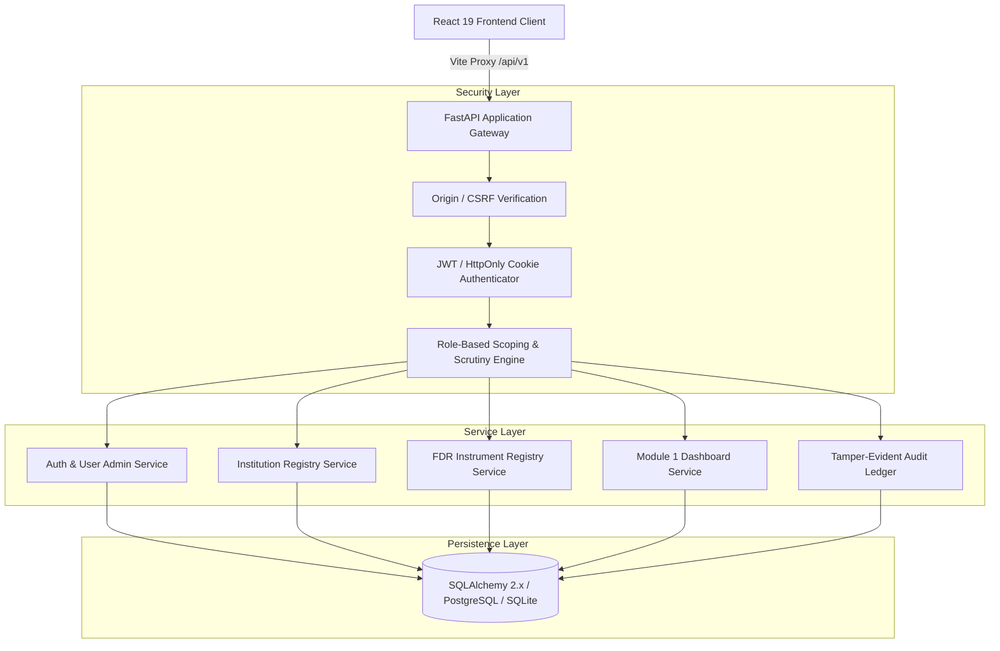
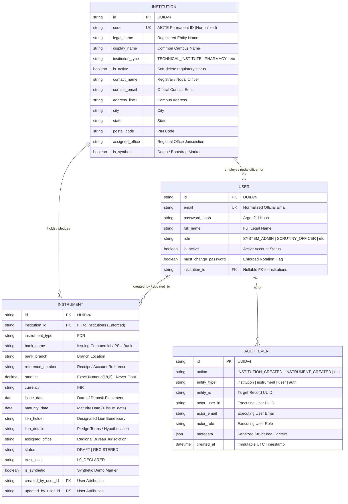

# FDR Sentinel — Module 1 Architecture & Technical Specification
## Core Identity, RBAC, Institution Registry & Instrument Registry Foundation

**System:** FDR Sentinel (AICTE Security Deposit / FDR Lifecycle Integrity Platform)  
**Problem Statement ID:** 26265  
**Stage:** Module 1 Complete Handover  
**Document Classification:** Internal Architecture & Developer Reference  

---

## 1. Architectural Overview

Module 1 establishes the authoritative data models, security perimeter, tenant isolation mechanisms, and financial record registry for **FDR Sentinel**. 



---

## 2. Component Structure

### 2.1 Backend Modules (`backend/app/modules/`)
1. **`auth`**:
   - `models.py`: `User` entity with Argon2id password hashing, mandatory password rotation flag (`must_change_password`), and optional foreign-key institution linkage (`institution_id`).
   - `dependencies.py`: `get_current_active_user`, `require_roles`, `verify_csrf_origin`.
   - `service.py`: Authentication, session generation, administrator user provisioning, last-admin protection, and temporary credential rotation.
   - `router.py`: Versioned endpoints (`/auth/login`, `/auth/logout`, `/auth/me`, `/auth/change-password`, `/auth/roles`, `/auth/users`).
2. **`institutions`**:
   - `models.py`: `Institution` entity with unique normalized AICTE permanent ID code, operating names, legal classifications, full postal address, nodal officer contact details, and soft-delete flag (`is_active`).
   - `service.py`: Validated registration, case-insensitive duplicate code rejection, permitted field patch logic, and auditable deactivation.
   - `router.py`: Versioned endpoints (`/institutions`, `/institutions/{id}`, `/institutions/{id}/status`).
3. **`instruments`**:
   - `models.py`: Statutory `Instrument` entity with UUID primary key, enforced `institution_id` foreign key, decimal currency precision (`Numeric(18, 2)`), administrative status (`status`), evidentiary trust tier (`trust_level`), and derived read-only maturity indicator (`maturity_indicator`).
   - `service.py`: Basic validation, conservative duplicate-reference warning path, scoped search/filtering, and permitted corrections.
   - `router.py`: Versioned endpoints (`/instruments`, `/instruments/{id}`, `/instruments/summary`).
4. **`dashboard`**:
   - `router.py`: Versioned scoped metrics endpoint (`/dashboard/summary`) dynamically returning institution counts, active/draft instruments, trust distribution, approaching maturities, and total deposit values.
5. **`audit`**:
   - `models.py`: Immutable `AuditEvent` ledger capturing actor user ID, email, role, action, entity type, target entity ID, IP address, and sanitized metadata.
   - `service.py`: Centralized audit logging utility with recursive credential stripping (`sanitize_dict`).

---

## 3. Data Relationships & Domain Schema



---

## 4. Separation of the Three Core Concepts

Module 1 explicitly avoids collapsing distinct business states into a single generic status:

| Concept | Field / Property | Supported Values | Mutability & Enforcement |
|---|---|---|---|
| **Administrative Workflow Status** | `status` (DB column) | `DRAFT`, `REGISTERED` | Represents current lifecycle workflow stage. Initial values for registry module. Downstream release stages belong to Module 5. |
| **Evidentiary Trust Level** | `trust_level` (DB column) | `L0_DECLARED`, `L1_DOCUMENT_CONSISTENT`, `L2_OFFICER_VERIFIED`, `L3_BANK_CONFIRMED` | Initialized strictly to `L0_DECLARED` upon registration. Ordinary registry endpoints reject escalation attempts. Promotions occur only through Module 2 OCR, Module 3 Scrutiny, and Module 4 Bank Confirmation. |
| **Derived Maturity Indicator** | `maturity_indicator` (Computed property) | `ACTIVE`, `EXPIRING_SOON`, `EXPIRED` | Computed dynamically from `maturity_date - today`. Warning window: `EXPIRING_SOON` when remaining days are between `0` and `90`. Never stored as a database status. |

---

## 5. Conservative Duplicate-Reference Warning Path

Financial instrument registries require resilient fraud and error prevention without accidentally suppressing records needed for investigation:

1. **Non-Unique Database Index**:
   - `reference_number` is indexed for fast lookup, but a unique constraint is intentionally not placed in the schema to ensure duplicate submissions are never rejected at the transport level.
2. **Normalized Query Comparison**:
   - `lower(trim(bank_name))` and `lower(trim(reference_number))` are compared against existing instruments.
3. **Structured Warning Interception (HTTP 409)**:
   - When matches exist and `confirm_duplicate: true` is absent, the API returns:
     ```json
     {
       "success": false,
       "error": "A security deposit with matching bank and reference number already exists in the registry.",
       "code": "DUPLICATE_REFERENCE_WARNING",
       "details": {
         "warning_message": "A record with this bank and reference number already exists...",
         "matching_records": [ ... ]
       }
     }
     ```
   - The UI displays an explainable dialog with existing record details and a prominent "Confirm & Register Anyway" button.
4. **Auditable Override**:
   - Submitting with `confirm_duplicate: true` creates an independent record and logs `duplicate_warning_overridden: true` with matched IDs in the audit ledger. Records are **never silently merged**.

---

## 6. Multi-Tenant Isolation & Role Scoping

| Role | Scope | Permitted Registry Actions |
|---|---|---|
| `SYSTEM_ADMIN` | Bureau-wide | Create/update institutions, provision users, edit permitted instrument fields. |
| `SCRUTINY_OFFICER` | Bureau-wide | View all institutions and instruments; record scrutiny notes and permitted corrections. |
| `BRANCH_HEAD` | Bureau-wide | Read-only oversight of institutions, instruments, and queues. |
| `COMPETENT_AUTHORITY`| Bureau-wide | Read-only inspection across all records and audit histories. |
| `FINANCE_OFFICER` | Bureau-wide | Read-only inspection of instruments, bank details, and values. |
| `AUDITOR` | Bureau-wide | Read-only compliance inspection of records, metadata, and audit events. |
| `INSTITUTION_USER` | **Strictly Scoped** | Can read and edit permitted contact fields on **own institution only**; can create and manage instruments for **own institution only**. All cross-institution reads or edits are rejected with HTTP 403. |

---

## 7. Future Extension Points

- **Module 2 (Document Ingestion & Multi-OCR Pipeline)**: Uploaded deposit receipt PDF documents will attach directly to `Instrument.id`, triggering automated text extraction and elevation to `L1_DOCUMENT_CONSISTENT`.
- **Module 3 (Deterministic Validation & Anomaly Detection Engine)**: Scrutiny officer verification interface to record verification checklists, elevation to `L2_OFFICER_VERIFIED`, and defect logging.
- **Module 4 (Official Bank Confirmation Gateway)**: Bank direct API integrations or SFTP statement reconciliation to promote instruments to `L3_BANK_CONFIRMED`.
- **Module 5 (Lien Tracking, Renewal Workflows & Release Governance)**: Full lifecycle state machine (`RELEASED`, `ENCASHED`, `REPLACED`), renewal lineage graphs, and competent authority approval gates.
