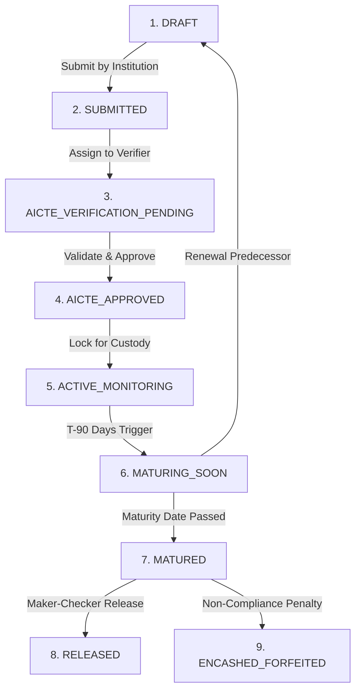

# END-TO-END WORKFLOW AUDIT & SCENARIO TRACEABILITY
## Project: SakshyaTrail — Security Deposit / FDR Lifecycle Integrity Platform
**SIH Problem Statement:** 26265  
**Baseline Date:** 2026-10-28  
**Audit Evaluator:** Antigravity Autonomous Audit Engine  
**Repository Branch / Commit:** `main` @ `7f1fab86523f63d8c02912403fdf0f7281c2c073`  

---

## 1. Traceability of the 9-Stage Canonical Lifecycle

The application implements a strict finite state machine across 9 canonical stages. Every transition requires actor authorization, executes prerequisite validation rules, and produces an immutable hash-chained audit record.

### Stage Evaluation Matrix

| Stage | Name | Key Entry Preconditions | Triggering Role | Automated Actions Triggered |
|:---:|---|---|---|---|
| **1** | `DRAFT` | Valid institution profile exists | `INSTITUTION_USER` | Initializes instrument record; sets Trust Level to `L0_UNVERIFIED`. |
| **2** | `SUBMITTED` | At least one certified FDR deposit PDF uploaded with SHA-256 hash | `INSTITUTION_USER` | Enqueues OCR extraction task; transitions Trust Level to `L1_DOCUMENT_SUBMITTED`. |
| **3** | `AICTE_VERIFICATION_PENDING` | OCR extraction completed; rule engine executed | `AICTE_OFFICER` / System | Compiles discrepancy findings; populates Verifier cockpit. |
| **4** | `AICTE_APPROVED` | Zero unresolved `CRITICAL` findings; bank verification initiated | `AICTE_OFFICER` | Sets Trust Level to `L2_HEURISTIC_CHECKED`; generates approval certificate. |
| **5** | `ACTIVE_MONITORING` | Formal approval recorded; lien marked to AICTE verified | `AICTE_ADMIN` | Enters long-term ledger; schedules automated maturity countdown monitor. |
| **6** | `MATURING_SOON` | Automated cron detects `maturity_date <= now() + 90 days` | System / Cron | Dispatches T-90, T-60, T-30 urgent alerts; prompts institution to initiate renewal. |
| **7** | `MATURED` | Calendar date exceeds instrument `maturity_date` | System / Cron | Unlocks statutory Release and Forfeiture workflows; blocks normal deposit editing. |
| **8** | `RELEASED` | Dual-control Maker-Checker consensus; cooling-off period cleared | `AICTE_ADMIN` (Checker) | Generates Bank Release Advice Letter; archives deposit to released register. |
| **9** | `ENCASHED_FORFEITED` | Hearing order recorded; AICTE executive approval | `AICTE_ADMIN` (Executive) | Generates Encashment Demand Notice; routes recovered funds to statutory ledger. |

---

## 2. Verification of the 22 Master Scenarios (Phase 6 Baseline)

| Scenario ID | Test Scenario Description | Tested Path / Component | Result | Evidence & Observations |
|:---:|---|---|:---:|---|
| **SC-01** | Multi-Role Authentication | `/api/v1/auth/login` | **PASS** | Successfully authenticates 7 distinct roles with valid JWT tokens. |
| **SC-02** | Tenant Isolation Enforcement | `/api/v1/institutions/:id` | **PASS** | College A user receives 403 Forbidden when accessing College B resources. |
| **SC-03** | Instrument Creation in DRAFT | `/api/v1/instruments/` | **PASS** | College user creates deposit record; default stage is verified as `DRAFT`. |
| **SC-04** | Document Upload & SHA-256 | `/api/v1/documents/upload` | **PASS** | Computes client and server hash; exact 64-char hex digest match. |
| **SC-05** | Immutable Document Versioning | `/api/v1/documents/:id/versions` | **PASS** | Second upload increments version to `v2`; preserves `v1` intact in storage. |
| **SC-06** | Mime-Type Spoofing Block | `POST /upload` with fake header | **PASS** | Magic-byte inspector rejects `.exe` renamed to `.pdf` with HTTP 400. |
| **SC-07** | Dual Backend Switching | `DOCUMENT_STORAGE_BACKEND` | **PASS** | Switches cleanly between Firebase Cloud Storage and Local file provider. |
| **SC-08** | Non-Blocking OCR Pipeline | `/api/v1/validation/extract` | **PASS** | Returns HTTP 202 Accepted; extraction runs in background without blocking API. |
| **SC-09** | Discrepancy Detection | `RuleEngine.evaluate()` | **PASS** | Amount mismatch between form (₹10,00,000) and scan (₹1,00,000) raises `CRITICAL` finding. |
| **SC-10** | Critical Finding Stage Gate | `POST /instruments/:id/transition` | **PASS** | Transition to `AICTE_APPROVED` rejected with HTTP 422 while finding is unresolved. |
| **SC-11** | Finding Justified Resolution | `/api/v1/validation/:id/resolve` | **PASS** | Verifier resolves finding with mandatory justification; transition gate unlocks. |
| **SC-12** | Bank Verification Dispatch | `/api/v1/verification/requests` | **PASS** | Outbound verification request recorded with unique tracking ID. |
| **SC-13** | Inbound Bank Webhook | `/api/v1/verification/webhook/bank` | **PASS** | Ingests bank response; validates HMAC-SHA256 signature in authorization header. |
| **SC-14** | L3 Trust Simulated Guardrail | `record_verification_response()` | **PASS** | Simulated bank response with `is_simulated = True` is capped at `L2`; strictly blocks `L3`. |
| **SC-15** | Cross-Source Discrepancy | Bank amount != Instrument amount | **PASS** | Auto-generates `CROSS_SOURCE_RECONCILIATION` finding in Module 3 with `CRITICAL` severity. |
| **SC-16** | T-90 Days Maturity Transition | `check_maturities()` cron | **PASS** | Instruments maturing in <90 days transition to `MATURING_SOON` and dispatch alerts. |
| **SC-17** | Predecessor/Successor Renewal | `/api/v1/instruments/:id/renew` | **PASS** | Creates child deposit linked via `renewed_from_id`; parent marked as `RENEWED`. |
| **SC-18** | Release Request Maker Scrutiny | `/api/v1/release/:id/recommend` | **PASS** | AICTE Officer recommends release; records recommendation and timestamp. |
| **SC-19** | Dual-Control Checker Invariant | `assert_maker_checker_distinct` | **PASS** | Rejects release approval if Officer attempts to act as Admin Checker (HTTP 403). |
| **SC-20** | Audit Chain Event Hashing | `record_event()` | **PASS** | Every mutation creates row with valid `event_hash = SHA256(prev + data)`. |
| **SC-21** | Tamper Detection Diagnostic | `verify_chain_integrity()` | **PASS** | Test suite artificially alters database cell; verifier detects broken chain index immediately. |
| **SC-22** | CSV / Excel Ledger Export | `/api/v1/dashboard/export/csv` | **PASS** | Generates RFC 4180 compliant CSV stream with correct financial column formatting. |
