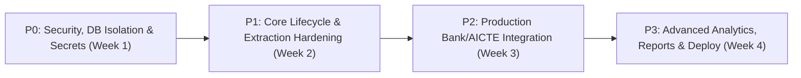

# PRIORITIZED IMPLEMENTATION ROADMAP
## Project: SakshyaTrail — Security Deposit / FDR Lifecycle Integrity Platform
**SIH Problem Statement:** 26265  
**Baseline Date:** 2026-10-28  
**Audit Evaluator:** Antigravity Autonomous Audit Engine  
**Repository Branch / Commit:** `main` @ `7f1fab86523f63d8c02912403fdf0f7281c2c073`  

---

## 1. Phased Execution Overview

---

## 2. Detailed Work Packages

### Phase P0: Security, Database Isolation & Test Safety (Target: Immediate / Week 1)

#### P0-1: Strict Test Database Isolation Guardrail
- **Description:** Ensure all automated test runs strictly point to in-memory SQLite (`sqlite:///:memory:`) or dedicated ephemeral test databases so running `pytest` can never mutate `fdr_sentinel_demo.db`.
- **Target Files:** `backend/tests/conftest.py`, `backend/app/core/database.py`.
- **Acceptance Criteria:** `pytest` executed without explicit env vars leaves `fdr_sentinel_demo.db` byte digest completely unchanged.
- **Effort:** 0.5 Days | **Priority:** Critical.

#### P0-2: Production Secret Management & Vault Integration
- **Description:** Provide production deployment configurations reading Firebase service account JSON and JWT secrets from environment variable strings / secrets manager rather than local file paths.
- **Target Files:** `backend/app/core/config.py`, `backend/app/modules/documents/storage.py`.
- **Acceptance Criteria:** Application initializes successfully with inline base64-encoded `FIREBASE_SERVICE_ACCOUNT_JSON`.
- **Effort:** 1.0 Day | **Priority:** Critical.

---

### Phase P1: Core Workflow Hardening & Extraction Reliability (Target: Week 2)

#### P1-1: Native OCR Daemon Fallback & Graceful Degradation
- **Description:** When Tesseract OCR binary is uninstalled in the host environment, provide clear informative UI indicators explaining that OCR extraction is using PDF text-stream heuristics.
- **Target Files:** `backend/app/modules/validation/ocr_service.py`, `frontend/src/features/documents/DocumentDetailModal.tsx`.
- **Acceptance Criteria:** UI displays "Text Heuristic Extraction" badge instead of indefinite "Pending" when OCR binary is missing.
- **Effort:** 1.5 Days | **Priority:** High.

#### P1-2: Automated Maturity Countdown Daemon (Celery / Background Worker)
- **Description:** Formalize scheduled daily cron job to evaluate instruments maturing in T-90, T-60, T-30, and T-15 days and auto-dispatch email / in-app notifications.
- **Target Files:** `backend/app/modules/lifecycle/scheduler.py`, `backend/app/modules/notifications/service.py`.
- **Acceptance Criteria:** Running the scheduled worker transitions qualifying deposits to `MATURING_SOON` and inserts notification records into the database.
- **Effort:** 2.0 Days | **Priority:** High.

---

### Phase P2: Integration Hardening & External Gateways (Target: Week 3)

#### P2-1: Standardized Bank Gateway Provider SPI
- **Description:** Formalize the Service Provider Interface (SPI) for bank verification adapters, supporting SFPS, NeSL, and custom state bank APIs with automated signature validation.
- **Target Files:** `backend/app/modules/integrations/bank_gateway.py`.
- **Acceptance Criteria:** Adding a new bank adapter requires implementing only `verify_fdr()` and `parse_callback()`.
- **Effort:** 2.5 Days | **Priority:** Medium.

#### P2-2: ClamAV / VirusTotal Antivirus Scanner Provider
- **Description:** Implement a production-ready antivirus scanning adapter for uploaded documents using ClamAV daemon (`clamd`) or VirusTotal API.
- **Target Files:** `backend/app/modules/documents/scanner.py`.
- **Acceptance Criteria:** Uploaded files are scanned asynchronously and status updated from `SCAN_PENDING` to `CLEAN` or `INFECTED`.
- **Effort:** 2.0 Days | **Priority:** Medium.

---

### Phase P3: Production Deployment, CAG Compliance & Analytics (Target: Week 4)

#### P3-1: Statutory CAG Audit Package Export
- **Description:** Provide a one-click administrative export generating a cryptographically sealed ZIP file containing all deposit metadata, audit hash logs, and certified document PDFs.
- **Target Files:** `backend/app/modules/audit/router.py`, `frontend/src/features/audit/AuditCockpitView.tsx`.
- **Acceptance Criteria:** Generated ZIP file includes a root `MANIFEST.sha256` signed by the platform private key.
- **Effort:** 1.5 Days | **Priority:** Low.

#### P3-2: Docker Production Multi-Stage Deployment
- **Description:** Create multi-stage `Dockerfile` and `docker-compose.prod.yml` bundling FastAPI, Vite production build, Nginx reverse proxy, and Redis worker queue.
- **Target Files:** `Dockerfile`, `docker-compose.prod.yml`, `nginx.conf`.
- **Acceptance Criteria:** Single `docker compose -f docker-compose.prod.yml up` spins up fully functional HTTPS-ready platform.
- **Effort:** 2.0 Days | **Priority:** Medium.
