# Module 7 Architecture: Command Center, Search, Reporting & Audit

**Project:** FDR Sentinel (SIH 2026 Problem Statement ID 26265)  
**System Layer:** Module 7 — Operational Intelligence & Compliance  
**Last Updated:** October 2026  

---

## 1. Executive Summary & Purpose

Module 7 delivers the centralized operational cockpit, unified search, administrative drill-down, operational reporting, and cryptographic audit integrity verification for FDR Sentinel. It aggregates operational telemetry and statutory metrics across Modules 1 through 6 while preserving strict mathematical boundaries between administrative workflow statuses, evidentiary trust levels, calendar maturity, and refund release states.

All metric calculations are derived deterministically from database records via parameterized SQL aggregations (`func.count`, `func.sum`, `group_by`) rather than in-memory approximations, with multi-tenant row-level authorization applied prior to calculation.

---

## 2. Architecture Diagram

```mermaid
flowchart TD
    subgraph Frontend ["Frontend (React 19 + TypeScript + Vite + Tailwind CSS)"]
        CC["Command Center Cockpit<br/>(/command-center)"]
        US["Unified Search & Drilldown<br/>(/search)"]
        IH["Instrument Historical Timeline<br/>(/instruments/:id/history)"]
        OR["Operational Reports & Export<br/>(/reports)"]
        AE["Tamper-Evident Audit Explorer<br/>(/audit)"]
    end

    subgraph API ["REST API Layer (FastAPI v1)"]
        DASH_ROUTER["Dashboard Router<br/>/api/v1/dashboard/*"]
        AUDIT_ROUTER["Audit Router<br/>/api/v1/audit/*"]
        SEARCH_ROUTER["Search Router<br/>/api/v1/dashboard/search"]
        REPORT_ROUTER["Report Router<br/>/api/v1/dashboard/reports/*"]
    end

    subgraph Services ["Application Services"]
        DS["DashboardService<br/>(Metrics Aggregation)"]
        PS["PriorityService<br/>(Triage Queue 0-100)"]
        SS["SearchService<br/>(Multi-Attribute Search)"]
        RS["ReportService<br/>(CSV / PDF Export)"]
        HS["HistoryService<br/>(Scrutiny & Lineage)"]
        AQS["AuditQueryService<br/>(Verification Engine)"]
        ALS["log_audit_event<br/>(SHA-256 Hash Chain)"]
    end

    subgraph Storage ["Database Storage Layer (PostgreSQL / SQLite)"]
        DB_INST["instruments"]
        DB_DOCS["documents & versions"]
        DB_VAL["validation_findings"]
        DB_VER["verification_requests"]
        DB_REL["release_cases & orders"]
        DB_OBS["scrutiny_observations"]
        subgraph Ledger ["Append-Only Immutable Ledger"]
            DB_AUDIT["audit_events<br/>(sequence_number, previous_hash, current_hash)"]
            TRIGGERS["DB Triggers & ORM Listeners<br/>(Abort on UPDATE / DELETE)"]
        end
    end

    CC --> DASH_ROUTER
    US --> SEARCH_ROUTER
    IH --> DASH_ROUTER
    OR --> REPORT_ROUTER
    AE --> AUDIT_ROUTER

    DASH_ROUTER --> DS
    DASH_ROUTER --> PS
    SEARCH_ROUTER --> SS
    REPORT_ROUTER --> RS
    DASH_ROUTER --> HS
    AUDIT_ROUTER --> AQS

    DS --> DB_INST
    DS --> DB_DOCS
    DS --> DB_VAL
    DS --> DB_VER
    DS --> DB_REL

    AQS --> DB_AUDIT
    ALS --> DB_AUDIT
    TRIGGERS -.-> DB_AUDIT
```

---

## 3. Subsystem Breakdown

### 3.1 Status & Aggregation Cockpit (PRD-FR-070, PRD-FR-076, PRD-FR-077)
- **Central Metric Dictionary:** Defined in [metrics.py](file:///c:/Users/bhome/OneDrive/Desktop/VIT/SIH/SIH%202026/TOP%2075/FDR_Sentinel/backend/app/modules/dashboard/metrics.py) with formal metric identifiers (`MTR-STAT-ACT`, `MTR-STAT-EXP`, `MTR-MAT-WINDOW`, etc.), mathematical definitions, inclusion/exclusion rules, and statutory disclaimers.
- **Aggregation Engine:** Implemented in [dashboard_service.py](file:///c:/Users/bhome/OneDrive/Desktop/VIT/SIH/SIH%202026/TOP%2075/FDR_Sentinel/backend/app/modules/dashboard/dashboard_service.py). Replaces client-side counting with parameterized database queries.
- **Maturity Load Chart:** 12-month calendar aggregation displaying count and total deposit amounts by calendar month. Disclaims that calendar maturity does not constitute release eligibility.

### 3.2 Transparent Priority Queue (PRD-FR-075)
- **Explainable Scoring Engine:** Implemented in [priority_service.py](file:///c:/Users/bhome/OneDrive/Desktop/VIT/SIH/SIH%202026/TOP%2075/FDR_Sentinel/backend/app/modules/dashboard/priority_service.py).
- **Composite Formula (0.0 to 100.0):**
  $$\text{Score} = (0.35 \times \text{Urgency}) + (0.25 \times \text{Discrepancy}) + (0.20 \times \text{Trust}) + (0.20 \times \text{Overdue})$$
- **Statutory Guardrail:** Accompanied by prominent UI disclaimers stating that the score is strictly an operational workflow-priority score to guide scrutiny triage, and is **NOT** a fraud probability or authenticity score.

### 3.3 Unified Search & Historical Timeline (PRD-FR-071, PRD-FR-072, PRD-FR-073)
- **Multi-Attribute Search:** Implemented in [search_service.py](file:///c:/Users/bhome/OneDrive/Desktop/VIT/SIH/SIH%202026/TOP%2075/FDR_Sentinel/backend/app/modules/dashboard/search_service.py). Supports keyword matching across references, banks, institutions, and states with strict pagination and sort allowlisting.
- **Unified Timeline:** Combines instrument creation, document versioning, validation discrepancies, bank verification requests, lifecycle evaluations, and release orders into a chronological sequence.
- **Append-Only Scrutiny Observations:** Implemented in [history_service.py](file:///c:/Users/bhome/OneDrive/Desktop/VIT/SIH/SIH%202026/TOP%2075/FDR_Sentinel/backend/app/modules/dashboard/history_service.py). Officer observations are strictly immutable once committed.

### 3.4 Operational Reports & Secure Exports (PRD-FR-074)
- **Four Standardized Reports:**
  1. `PENDING_VERIFICATION`: Outstanding bank verification requests and aging.
  2. `UPCOMING_MATURITIES`: Instruments reaching calendar maturity within specified window.
  3. `MISSING_DOCUMENTS`: Records with incomplete mandatory checklist items.
  4. `INTERVENTIONS`: Mismatches, expired items, and escalated compliance actions.
- **Streaming Export:** Generates streaming CSV and ReportLab-formatted PDF with statutory confidentiality banners, run metadata, and actor audit recording.

### 3.5 Tamper-Evident Audit Ledger & Verification Engine (PRD-FR-091 to PRD-FR-096)
- **Central Append-Only Service:** Implemented in [service.py](file:///c:/Users/bhome/OneDrive/Desktop/VIT/SIH/SIH%202026/TOP%2075/FDR_Sentinel/backend/app/modules/audit/service.py). Automatically logs continuous monotonic sequence numbers, links parent hashes (`previous_hash`), and computes canonical SHA-256 digests (`current_hash`).
- **Database Trigger Guardrails:** Rejects any `UPDATE` or `DELETE` on `audit_events`.
- **Replayable Verifier:** Implemented in [audit_query_service.py](file:///c:/Users/bhome/OneDrive/Desktop/VIT/SIH/SIH%202026/TOP%2075/FDR_Sentinel/backend/app/modules/dashboard/audit_query_service.py). Recomputes hashes across the ledger and reports first detected inconsistency.
- **Audit Explorer Frontend:** Read-only inspection UI in [AuditPage.tsx](file:///c:/Users/bhome/OneDrive/Desktop/VIT/SIH/SIH%202026/TOP%2075/FDR_Sentinel/frontend/src/app/routes/AuditPage.tsx) with "Verify Audit Chain" action, cryptographic proof inspect drawer, and multi-tenant scoping.

---

## 4. Security & Permissions Matrix

| Role | Command Center | Search | Reports & Export | Timeline & Observations | Audit Explorer | Verify Audit Chain | Release Approval |
|:---|:---:|:---:|:---:|:---:|:---:|:---:|:---:|
| `INSTITUTION_USER` | Scoped to own Inst | Scoped to own Inst | Scoped to own Inst | Scoped (Read-only) | Scoped to own Inst | ❌ Denied (403) | ❌ Denied (403) |
| `SCRUTINY_OFFICER` | Bureau-wide | Bureau-wide | Bureau-wide | Add Observations | Bureau-wide | ❌ Denied (403) | ❌ Denied (403) |
| `BRANCH_HEAD` | Bureau-wide | Bureau-wide | Bureau-wide | Add Observations | Bureau-wide | ✅ Authorized | ❌ Denied (403) |
| `COMPETENT_AUTHORITY` | Bureau-wide | Bureau-wide | Bureau-wide | Add Observations | Bureau-wide | ✅ Authorized | ✅ Authorized |
| `AUDITOR` | Bureau-wide | Bureau-wide | Bureau-wide | Read-only | Bureau-wide | ✅ Authorized | ❌ Denied (403) |
| `SYSTEM_ADMIN` | Bureau-wide | Bureau-wide | Bureau-wide | Add Observations | Bureau-wide | ✅ Authorized | ❌ Denied (403) |

---

## 5. Technology Stack Summary

- **Backend:** Python 3.14+, FastAPI 0.115+, SQLAlchemy 2.0 ORM, Alembic migrations, Pydantic v2, ReportLab 4.4+ (PDF generation).
- **Frontend:** React 19, TypeScript 5.7+, Tailwind CSS 4, Vite 8, Lucide React icons, Vitest + Testing Library.
- **Database Engine:** SQLite (local prototype with triggers) / PostgreSQL (production target with PL/pgSQL triggers).
