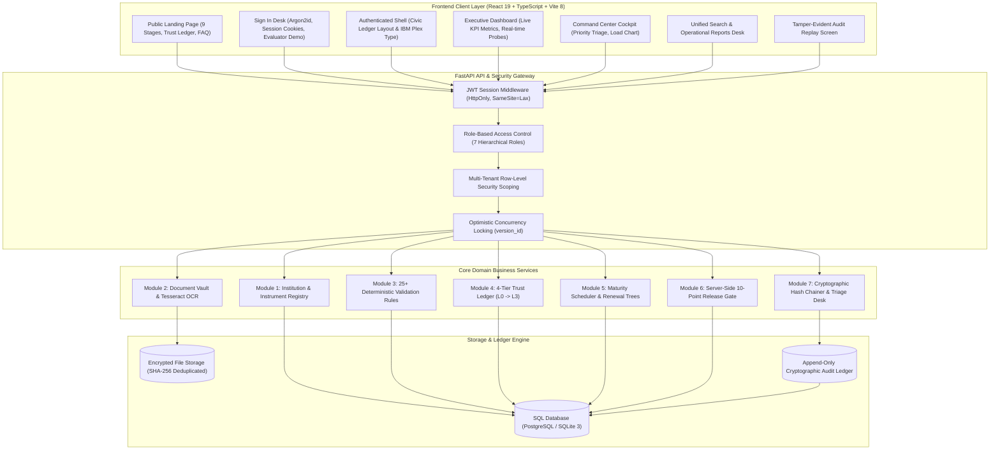
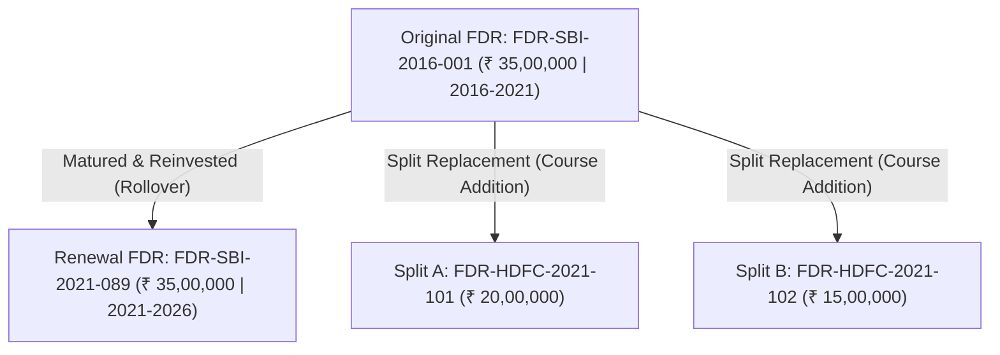
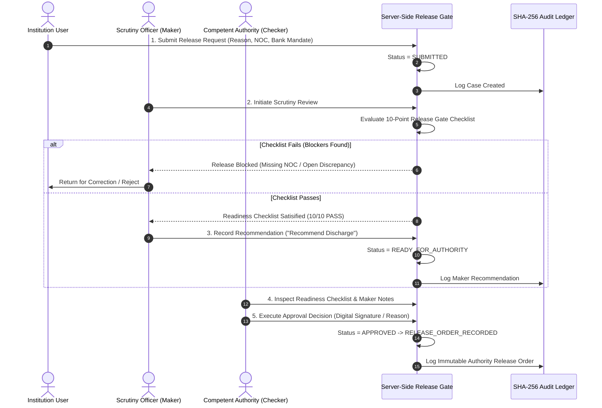
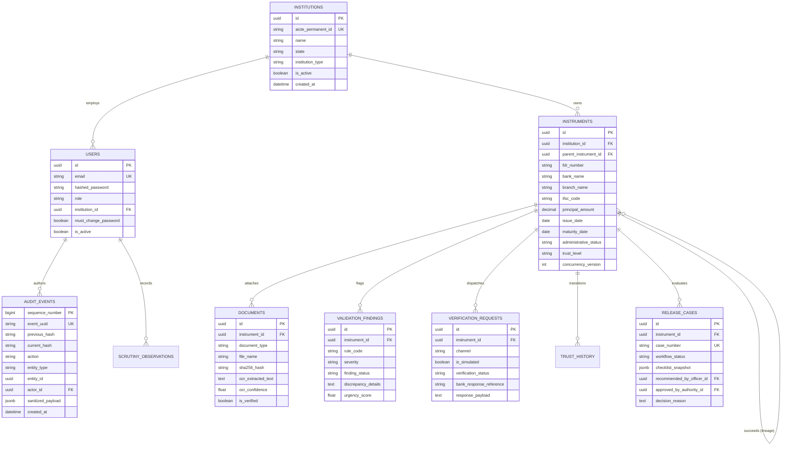

# SakshyaTrail: End-to-End System Walkthrough & Architectural Blueprint

<div align="center">


### *Complete Technical Analysis, Module Deep-Dive, and Execution Guide*

**All India Council for Technical Education (AICTE) Regulation Bureau**  
**Smart India Hackathon (SIH) 2026 · Problem Statement ID: 26265**  
*Theme: Smart Automation · Streamline of Security Deposit / FDR Portal*  
**Platform Version:** `v0.7.0 Integrity Platform`

</div>

---

## Table of Contents
1. [Executive Regulatory Context & Problem Statement](#1-executive-regulatory-context--problem-statement)
2. [End-to-End Architectural Blueprint](#2-end-to-end-architectural-blueprint)
3. [Deep-Dive: The 7 Core Product Modules](#3-deep-dive-the-7-core-product-modules)
   - [Module 1: Authoritative Registry & Multi-Tenant RBAC](#module-1-authoritative-registry--multi-tenant-rbac)
   - [Module 2: Document Intake, OCR & Vault](#module-2-document-intake-ocr--vault)
   - [Module 3: Validation Engine & Scrutiny Review Queue](#module-3-validation-engine--scrutiny-review-queue)
   - [Module 4: Trust Ledger & Bank Verification Desk](#module-4-trust-ledger--bank-verification-desk)
   - [Module 5: Lifecycle Monitoring & Renewal Lineage](#module-5-lifecycle-monitoring--renewal-lineage)
   - [Module 6: Server-Side Release Gate & Maker-Checker Workflow](#module-6-server-side-release-gate--maker-checker-workflow)
   - [Module 7: Command Center, Reports & Tamper-Evident Audit](#module-7-command-center-reports--tamper-evident-audit)
4. [Design System & Frontend Architecture (`Design.md`)](#4-design-system--frontend-architecture-designmd)
5. [Database Schema & Entity-Relationship Architecture](#5-database-schema--entity-relationship-architecture)
6. [Complete User Journey: Lifecycle Walkthrough](#6-complete-user-journey-lifecycle-walkthrough)
7. [Defense-in-Depth & Cryptographic Security Model](#7-defense-in-depth--cryptographic-security-model)
8. [SIH Evaluator Live Demonstration Script](#8-sih-evaluator-live-demonstration-script)

---

## 1. Executive Regulatory Context & Problem Statement

### 1.1 Why Technical Institutions Pledge FDRs to AICTE
Under statutory provisions of the **AICTE Approval Process Handbook (APH)**, any trust, society, or government entity seeking approval to establish a technical education institution (engineering, management, pharmacy, architecture, etc.) or introduce new academic programs must submit a statutory **Security Deposit**.

This deposit is executed as a **Fixed Deposit Receipt (FDR)** issued by a scheduled commercial bank, created for a term of 5 to 10 years, and **jointly pledged in favor of the Chairman, AICTE and the President/Secretary of the parent trust**. 

The security deposit serves three essential regulatory functions:
1. **Financial Solvency Guarantee**: Ensures the sponsoring trust has dedicated capital reserves to operate the college without financial abandonment mid-term.
2. **Student & Faculty Safeguard**: Provides funds that the regulatory council can attach or encash if the college defaults on faculty salaries, violates academic standards, or abruptly closes.
3. **Statutory Compliance Covenant**: Acts as collateral guaranteeing compliance with AICTE norms throughout the approved term.

---

### 1.2 The Traditional Operational Crisis
Historically, the AICTE Regulation Bureau managed security deposits through manual, paper-intensive workflows across multiple regional offices:

| Operational Vulnerability | Real-World Consequence | SakshyaTrail Architectural Solution |
| :--- | :--- | :--- |
| **Physical Paper Storage** | Original paper FDRs kept in regional office steel lockers; vulnerable to fire, physical loss, or misplaced files over 10-year terms. | **Multi-Version Digital Document Vault**: SHA-256 deduplicated, tamper-evident digital custody. |
| **Silent Expirations & Auto-Rolls** | FDRs maturing without Council knowledge; banks auto-renewing at sub-optimal interest rates or liquidating accounts. | **Automated Lifecycle Monitor**: Daily background evaluators with proactive 90/60/30-day escalation alerts. |
| **Fraudulent & Modified Photocopies** | Unscrupulous entities uploading manipulated scans, altered dates, or single FDRs claimed across multiple colleges. | **Tesseract OCR & Deterministic Cross-Source Rules**: Bounding-box text extraction and conservative duplicate warnings. |
| **Verification Delays** | Postal inquiries to bank branch managers taking 6 to 18 months to confirm genuine joint lien marking. | **Trust Ledger (L0–L3)**: Tiered provenance with direct electronic SFTP/API banking adapters. |
| **Unauthorized Premature Releases** | Risk of regional officers issuing discharge letters without mandatory compliance clearance or audit trail. | **Server-Side Release Gate & Maker-Checker**: Non-bypassable 10-point checklist requiring Competent Authority approval. |
| **Audit & Record Tampering** | Database records vulnerable to silent modification by rogue database administrators or compromised accounts. | **Tamper-Evident SHA-256 Chained Ledger**: Forward-linked hash sequence ($H_n = \text{SHA256}(H_{n-1} + E_n)$). |

---

## 2. End-to-End Architectural Blueprint

SakshyaTrail is structured as a decoupled, high-performance web platform featuring a **FastAPI (Python 3.11+)** backend and a modern **React 19 / TypeScript 5.7** frontend powered by **Vite 8** and **Tailwind CSS v4**.



---

## 3. Deep-Dive: The 7 Core Product Modules

---

### Module 1: Authoritative Registry & Multi-Tenant RBAC

#### 1. Purpose & Mandate
Module 1 forms the statutory backbone of SakshyaTrail. It establishes the authoritative database of technical education colleges and statutory FDR instruments, enforcing non-negotiable multi-tenant security boundaries.

#### 2. The 7 Application Personas
Access is governed by a strict Role-Based Access Control (RBAC) matrix:

```
                          SAKSHYATRAIL RBAC HIERARCHY
                          
                              [SYSTEM_ADMIN]
                        (Full Bureau Administration)
                                     │
               ┌─────────────────────┼─────────────────────┐
               ▼                     ▼                     ▼
     [COMPETENT_AUTHORITY]     [BRANCH_HEAD]           [AUDITOR]
     (Final Release Orders) (Regional Oversight) (Read-Only Ledger)
               │                     │
               ▼                     ▼
      [FINANCE_OFFICER]      [SCRUTINY_OFFICER]
    (Financial Settlement)  (Discrepancy Triage)
                                     │
                                     ▼
                            [INSTITUTION_USER]
                    (Strict College-Scoped Isolation)
```

1. **`SYSTEM_ADMIN`**: Global bureau administrator; provisions accounts, updates system policies, inspects system diagnostics, and triggers audit chain verification.
2. **`COMPETENT_AUTHORITY`**: Designated Council Executive (e.g., Member Secretary / Advisor); holds **exclusive authority** to approve statutory FDR release orders. Cannot initiate release cases (preventing self-approval).
3. **`BRANCH_HEAD`**: Regional Bureau Officer; oversees jurisdiction-level portfolios, reassigns review queues, and inspects regional operational reports.
4. **`SCRUTINY_OFFICER`**: Primary regulatory examiner; audits physical/digital evidence, evaluates discrepancy findings, records append-only observations, and performs L2 trust verification.
5. **`FINANCE_OFFICER`**: Reconciles deposit ledger balances, executes approved release payments, and audits financial statements.
6. **`AUDITOR`**: Independent oversight inspector; holds **read-only access** across all records, downloads audit evidence packs, and replays cryptographic hash chains.
7. **`INSTITUTION_USER`**: College Nodal Officer; strictly isolated to viewing and managing only their assigned college's instruments.

#### 3. Core Architectural Concepts Separated
A critical innovation in SakshyaTrail is the **strict architectural separation** of three concepts that traditional portals conflated:

1. **Administrative Workflow Status** (`DRAFT`, `REGISTERED`, `RETURNED_FOR_CORRECTION`, `RELEASE_REQUESTED`, `RELEASED`, `REJECTED`, `CLOSED`): Reflects where the instrument sits in the administrative process.
2. **Evidentiary Trust Tier** (`L0_DECLARED`, `L1_DOCUMENT_CONSISTENT`, `L2_OFFICER_VERIFIED`, `L3_BANK_CONFIRMED`): Reflects the evidentiary validity of the record. An instrument can be administratively `REGISTERED` while still at `L0_DECLARED` trust.
3. **Derived Maturity State** (`ACTIVE`, `EXPIRING_SOON` [$\le 90$ days], `EXPIRED`): Dynamically computed from system clock and maturity date; never stored as a stale static column.

#### 4. High-Precision Financial Data
Financial values are strictly stored as `Numeric(18, 2)` decimal columns in database schemas and formatted using Indian Numbering System (`₹ 1,16,64,95,000.00`). Floating-point arithmetic is strictly forbidden across the backend.

#### 5. Conservative Duplicate Warning Flow
To prevent the same deposit from being submitted for multiple institutions while allowing legitimate multi-deposit splits, the system executes normalized matching on `(normalized_bank_name, normalized_reference_number)`. If a collision occurs:
- The system returns an HTTP 409 Conflict with structured existing instrument details.
- It does **not** merge or silently overwrite data.
- Authorized officers can submit with `confirm_duplicate: true`, which records a high-priority warning finding and writes an immutable audit event.

---

### Module 2: Document Intake, OCR & Vault

#### 1. Purpose & Mandate
Ingests statutory deposit artifacts (Fixed Deposit Receipts, Joint Lien Letters, Bank Confirmation Letters), verifies cryptographic authenticity, extracts unstructured text, and checks policy completeness.

```
       DOCUMENT INTAKE & VERIFICATION PIPELINE
       
    [College Upload] ──> (File Validation: PDF/JPEG, <15MB)
                               │
                               ▼
                   [SHA-256 Deduplication Hash]
                               │
            ┌──────────────────┴──────────────────┐
            ▼                                     ▼
   [Store in Vault]                      [Tesseract OCR Engine]
   (Versioned Storage)                   (Layout & Text Extraction)
            │                                     │
            └──────────────────┬──────────────────┘
                               │
                               ▼
              [Checklist Evaluation Service]
              (Mandatory vs. Optional Document Audit)
                               │
                               ▼
                  [Module 3 Validation Engine]
```

#### 2. Cryptographic Storage & Deduplication
Every uploaded document is digested with SHA-256. If an identical file is uploaded across different instruments, the system records the cryptographic hash match, preventing duplicate storage and flagging potential duplicate evidence.

#### 3. Tesseract OCR Text Extraction
The built-in OCR service performs multi-pass text extraction on scanned deposit certificates:
- Identifies critical entities: FDR Reference Number, Issuing Bank Name, Branch IFSC, Principal Amount, Issue Date, Maturity Date, and Joint Lien Clause text.
- Maintains bounding-box spatial coordinates and an extraction confidence score ($0.0 - 1.0$).
- **Statutory Boundary**: OCR output is strictly **advisory**. High OCR confidence can promote an instrument to **L1 (Document-Consistent)**, but *cannot* approve a release or grant L2/L3 trust without human scrutiny or electronic bank confirmation.

#### 4. Document Completeness Checklist
A policy engine checks uploaded documents against AICTE handbook requirements:
- Mandatory: Primary Fixed Deposit Receipt.
- Mandatory: Joint Lien Declaration Letter addressed to Regional Officer.
- Conditional: Bank Confirmation of Lien Marking.
- Missing documents trigger actionable blockers in the Scrutiny Review Queue.

---

### Module 3: Validation Engine & Scrutiny Review Queue

#### 1. Purpose & Mandate
Replaces error-prone manual document inspection with a deterministic rules engine executing **25+ statutory validation checks**, calculating an objective urgency priority score, and managing scrutiny officer review.

#### 2. The 25+ Deterministic Business Rules
Rules are organized into 5 statutory families:

```
   ┌─────────────────────────────────────────────────────────────────┐
   │                  25+ DETERMINISTIC BUSINESS RULES               │
   ├─────────────────────────────────────────────────────────────────┤
   │ 1. PRINCIPAL AMOUNT COVENANTS                                   │
   │    • VAL-AMT-001: Minimum deposit threshold met per college tier│
   │    • VAL-AMT-002: OCR extracted amount matches declared value   │
   │    • VAL-AMT-003: High-precision decimal formatting check       │
   ├─────────────────────────────────────────────────────────────────┤
   │ 2. DURATION & MATURITY WINDOWS                                  │
   │    • VAL-DUR-001: Maturity date strictly > Issue date           │
   │    • VAL-DUR-002: Minimum 5-year or 10-year term validation     │
   │    • VAL-DUR-003: Expired deposit identification (< 0 days)     │
   │    • VAL-DUR-004: Upcoming maturity warning (<= 90 days)        │
   ├─────────────────────────────────────────────────────────────────┤
   │ 3. JOINT LIEN & CLAUSE VERIFICATION                             │
   │    • VAL-LIEN-001: Explicit joint name check (Chairman AICTE)   │
   │    • VAL-LIEN-002: Non-encashment covenant presence in letter   │
   │    • VAL-LIEN-003: Bank official signature & stamp detected     │
   ├─────────────────────────────────────────────────────────────────┤
   │ 4. BANK & BRANCH RECONCILIATION                                 │
   │    • VAL-BNK-001: Scheduled commercial bank status verification │
   │    • VAL-BNK-002: Valid RBI IFSC code format check              │
   │    • VAL-BNK-003: Duplicate reference across institutions check │
   ├─────────────────────────────────────────────────────────────────┤
   │ 5. METADATA & INSTITUTIONAL BINDING                             │
   │    • VAL-INS-001: Active college registration verification      │
   │    • VAL-INS-002: Nodal contact mobile & email validity         │
   │    • VAL-INS-003: Mandatory document checklist completion       │
   └─────────────────────────────────────────────────────────────────┘
```

#### 3. Objective Urgency Priority Scoring (0–100)
To eliminate arbitrary officer triage, the system calculates an explainable priority score ($0 - 100$) for every open discrepancy:

$$S = \min\left(100, \; w_u \cdot U + w_d \cdot D + w_t \cdot T + w_o \cdot O\right)$$

Where:
- $U$ = Urgency factor based on maturity proximity (elapsed or $\le 15$ days = 100; $\le 30$ days = 80; $\le 90$ days = 50).
- $D$ = Severity of open discrepancies (Critical = 100; Major = 60; Minor = 20).
- $T$ = Trust deficiency ($L0$ = 80; $L1$ = 40; $L2/L3$ = 0).
- $O$ = Overdue triage days in queue ($>30$ days unreviewed = 100).
- **Methodological Guardrail**: This score is strictly an *operational workflow-priority score* to sequence officer queues; it is *not* a credit rating or fraud score.

#### 4. Append-Only Scrutiny Observations
Scrutiny officers can inspect documents side-by-side with OCR extractions and record review observations. To maintain forensic accountability:
- Observations are **strictly append-only**.
- Once recorded, observations cannot be edited or deleted by any officer or administrator.
- Every observation is bound to the officer's UUID, timestamped, and written to the cryptographic audit chain.

---

### Module 4: Trust Ledger & Bank Verification Desk

#### 1. Purpose & Mandate
Establishes the progressive evidentiary foundation of every deposit record, governing transitions through the **4-Tier Trust Model (L0–L3)** and managing electronic banking gateway adapters.

```
                     4-TIER EVIDENTIARY TRUST HIERARCHY
                     
     [L0: DECLARED]  ──> Baseline college upload; self-declared photocopy.
           │
           ▼
     [L1: DOC-OK]    ──> OCR extracted values match declared fields;
           │             mandatory documents complete. (Not yet authentic).
           ▼
     [L2: VERIFIED]  ──> Scrutiny Officer audits evidence, inspects joint
           │             lien letter, and signs formal attestation.
           ▼
     [L3: CONFIRMED] ──> Cryptographic confirmation from authorized bank
                         via host-to-host SFTP, API, or authorized token.
```

#### 2. Trust Progression Invariants
- **L0 (Declared)**: Entry-level state. Self-reported metadata.
- **L1 (Document-Consistent)**: Machine-verified heuristic alignment. Represents that the uploaded document text matches the database declaration, but does *not* prove the receipt is authentic or unencumbered.
- **L2 (Officer-Verified)**: Human-in-the-loop attestation. A certified Scrutiny Officer has checked bank branch credentials, verified joint lien marking, and attested compliance.
- **L3 (Authorized Response Confirmed)**: Highest trust grade. Requires a verifiable, cryptographically validated response from an authorized banking channel.

#### 3. Electronic Banking Gateway & Simulation Transparency
SakshyaTrail includes two verification channels:
1. **Connected Banking Adapter**: Direct host-to-host SFTP / REST API integration exchanging signed verification payloads with participating scheduled banks.
2. **Simulated Prototype Adapter**: Built-in test harness for offline prototype demonstration, simulating real bank responses (Confirmed, Lien Active, Not Found, Mismatched Amount).
- **Transparency Safeguard**: Every simulated bank response is visibly tagged with an amber **`SIMULATED`** badge. The UI and reports clearly distinguish synthetic responses, preventing prototype mocks from being confused with live commercial bank confirmations.

---

### Module 5: Lifecycle Monitoring & Renewal Lineage

#### 1. Purpose & Mandate
Automates long-term surveillance of security deposits across their 5-to-10-year lifespan, tracking upcoming maturities, managing replacement FDRs, and preserving parent-child renewal lineage trees.



#### 2. Automated Maturity Monitoring
A daily background scheduler evaluates all active instruments against current UTC time:
- $\text{Remaining Days} > 90$: Status = `ACTIVE`.
- $0 < \text{Remaining Days} \le 90$: Status = `EXPIRING_SOON` (triggers amber indicators across dashboards and operational reports).
- $\text{Remaining Days} \le 0$: Status = `EXPIRED` (triggers urgent regulatory intervention notices).

#### 3. Parent-Child Renewal Lineage
When an institution renews or replaces a matured FDR:
- The previous instrument is marked `RENEWED_REPLACED` with historical term preservation.
- The new instrument records a `parent_instrument_id` foreign key.
- The interactive **Lineage Tree Viewer** renders the multi-generational family tree, allowing auditors to trace a 2026 deposit back to its founding 2016 deposit without breaking financial continuity.

#### 4. Automated Multi-Tier Escalation Schedule
Escalation reminders are automatically logged and queued across predefined statutory intervals:
- **90 Days Prior**: First Renewal Advisory sent to Institution Nodal Officer.
- **60 Days Prior**: Second Formal Reminder requesting bank renewal commitment letter.
- **30 Days Prior**: High-Priority Warning copying Regional Branch Head.
- **15 Days Prior**: Escalated Deficiency notice in Scrutiny Review Queue.
- **0 Days (Maturity Date)**: Statutory Default Alert triggering potential show-cause covenants.

---

### Module 6: Server-Side Release Gate & Maker-Checker Workflow

#### 1. Purpose & Mandate
Governs the discharge, release, or refund of security deposits upon course completion, college closure, or approved institutional restructuring, strictly enforcing the Council's maker-checker governance.



#### 2. The Server-Side 10-Point Release Gate
An FDR can *never* be released via simple client-side form submissions. The server-side gate verifies 10 mandatory statutory covenants before unlocking the approval action:
1. **Statutory Term Completion**: Current date $\ge$ FDR maturity date, or an approved Council early-closure waiver is attached.
2. **Zero Open Discrepancies**: No unresolved `CRITICAL` or `MAJOR` validation findings in Module 3.
3. **Evidentiary Trust Cleared**: Instrument is at verified trust grade ($L2$ or $L3$).
4. **Institutional NOC Uploaded**: No-Objection Certificate from State DTE (Directorate of Technical Education) verified.
5. **University Affiliation NOC**: University disaffiliation / closure NOC present.
6. **No Student Dues Attestation**: Verified affidavit confirming zero outstanding student fee refund claims.
7. **No Faculty Salary Dues**: Verified affidavit confirming all faculty salaries settled.
8. **Court / Legal Case Clear**: Legal cell clearance confirming no active court injunctions.
9. **Original Receipt Custody**: Certified physical receipt surrender or verified bank electronic confirmation.
10. **Authorized Bank Mandate**: Validated institutional refund bank account with verified PFMS/IFSC details.

#### 3. Strict Maker-Checker Separation
To prevent unilateral release fraud:
- **The Maker (`SCRUTINY_OFFICER`)**: Reviews documents, executes the 10-point checklist, and records a recommendation. The Scrutiny Officer *cannot* approve or discharge the funds.
- **The Checker (`COMPETENT_AUTHORITY`)**: Member Secretary or Advisor. Re-inspects the checklist and executes the binding legal decision. The Competent Authority *cannot* initiate cases or bypass a failed checklist.

---

### Module 7: Command Center, Reports & Tamper-Evident Audit

#### 1. Purpose & Mandate
Provides high-altitude situational intelligence for Bureau leadership, unified search across all domains, compliance reporting, and cryptographic proof of non-repudiable audit trails.

#### 2. Executive Cockpit Widgets (PRD-FR-070 to FR-077)
- **Status Counts Matrix**: Real-time breakdown of total deposit valuation, active FDRs, pending reviews, upcoming maturities, and release cases.
- **Operational Priority Queue**: Real-time triage desk ranking open items by urgency score ($0 - 100$) with expandable factor breakdown pills (`Urg`, `Disc`, `Trst`, `Ovd`).
- **Maturity Window Monitor**: Interactive time horizon selector (30, 60, 90, 180, 365 days) showing upcoming portfolio expirations.
- **Month-Wise Maturity Load Chart**: Calendar distribution forecasting liquidity runoff across future months.
- **Metric Dictionary Modal**: Built-in statutory dictionary (PRD-FR-077) documenting exact business formulas, thresholds, and SQL query definitions for all executive numbers.

#### 3. Unified Multi-Dimensional Search
Cross-domain search desk indexing:
- FDR Reference numbers, Institution Names, AISHE codes, Banks, Branch IFSCs.
- Interactive filter pills (Status, Trust Tier, Maturity Date ranges, Discrepancy flags).
- Instant drill-down directly into instrument dossiers, document viewers, and lifecycle lineages.

#### 4. Secure Operational Reports & Exports
Generates official regulatory intelligence documents with built-in defense-in-depth:
- **CSV Exports**: Implements strict formula-injection mitigation, prefixing characters (`=`, `+`, `-`, `@`, `\t`, `\r`) with single quotes (`'`) to prevent spreadsheet remote code execution (CSV Injection / CWE-1236).
- **PDF Reports**: Formal compliance documentation featuring official AICTE regulatory headers, tabular financial listings, and cryptographic document footers.

#### 5. Tamper-Evident SHA-256 Chained Audit Trail
Every user login, field edit, document upload, validation discrepancy, trust transition, renewal rollover, and release decision writes an immutable record to the audit ledger:

$$H_n = \text{SHA256}\left(H_{n-1} \;\|\; \text{Seq}_n \;\|\; \text{Timestamp}_n \;\|\; \text{ActorUUID}_n \;\|\; \text{Action}_n \;\|\; \text{CanonicalJSON}(\text{Payload}_n)\right)$$

- **Database-Level Defense**: Database triggers prevent any `UPDATE` or `DELETE` operations on the `audit_events` table.
- **Live Replay Verification Screen** (`/audit`): Authorized officers can click **"Verify Audit Chain"** at any time. The server sequentially recalculates hashes from Block #1 to the chain head. If any row was manipulated directly in the database, the screen instantly detects the tampering, highlights the sequence number, and pinpoints the altered bytes.

---

## 4. Design System & Frontend Architecture (`Design.md`)

SakshyaTrail’s visual interface is governed by [Design.md](file:///c:/Users/bhome/OneDrive/Desktop/VIT/SIH/SIH%202026/TOP%2075/FDR_Sentinel/Design.md), balancing **structured brutalism** for operational data density with **selective glassmorphism** for layered public surfaces.

```
+----------------------------------------------------------------------------------------------------+
|                                    CIVIC LEDGER DESIGN SYSTEM                                      |
+------------------------------------+-----------------------------------+---------------------------+
| 1. PALETTE TOKENS                  | 2. STRUCTURED BRUTALISM           | 3. SELECTIVE GLASS        |
| • Navy (#123B5D)                   | • Solid White (#FFFFFF) Surfaces  | • .st-glass-panel         |
| • Deep Ink (#0D2538)               | • 1px Subtle Borders (#C9D3DB)    | • Sticky Public Header    |
| • Evidence Teal (#0F766E)          | • 2px Emphasis Borders (#123B5D)  | • Modal Backdrops         |
| • Heritage Gold (#C69A48)          | • Restrained Radii (8px / 10px)   | • Dropdown Overlays       |
| • Warm Paper (#F5F4EF)             | • Clear Container Hierarchy       | • Solid White Fallback    |
| • Primary Text (#253746)           | • Tabular Numerals (Plex Mono)    | • NEVER Behind Data Tables|
+------------------------------------+-----------------------------------+---------------------------+
```

### Component Design Specifications
1. **Application Shell ([MainLayout.tsx](file:///c:/Users/bhome/OneDrive/Desktop/VIT/SIH/SIH%202026/TOP%2075/FDR_Sentinel/frontend/src/layouts/MainLayout.tsx))**:
   - Background: Warm Paper (`#F5F4EF`).
   - Sidebar: Deep Ink (`#0D2538`) with 2px Evidence Teal (`#0F766E`) active indicators.
   - Header: Solid White (`#FFFFFF`) with 1px divider (`#C9D3DB`) and real-time connectivity probes (`API Alive`, `SQLITE 0.54ms`).
2. **Buttons ([Button.tsx](file:///c:/Users/bhome/OneDrive/Desktop/VIT/SIH/SIH%202026/TOP%2075/FDR_Sentinel/frontend/src/components/common/Button.tsx))**:
   - `primary`: `#123B5D` background, white text, `#0D2538` hover, 8px radius.
   - `secondary`: White background, `#8799A9` visible border, `#253746` text.
   - `danger`: `#B42318` background, white text.
   - Focus outline: 3px solid `#145DA0` with 2px offset.
3. **Badges ([Badge.tsx](file:///c:/Users/bhome/OneDrive/Desktop/VIT/SIH/SIH%202026/TOP%2075/FDR_Sentinel/frontend/src/components/common/Badge.tsx))**:
   - `success`: `#E7F3EC` bg, `#18794E` text, `#B4DFC9` border.
   - `warning`: `#FEF7E8` bg, `#8A5A00` text, `#F8DEAE` border.
   - `danger`: `#FDF2F1` bg, `#B42318` text, `#FECDCA` border.
   - `simulated`: `#FFF3D6` bg, `#7A4B00` text, `#E5C278` border, bold uppercase font.
4. **Data Cards & Panels ([Card.tsx](file:///c:/Users/bhome/OneDrive/Desktop/VIT/SIH/SIH%202026/TOP%2075/FDR_Sentinel/frontend/src/components/common/Card.tsx))**:
   - Structured brutalist styling: solid `#FFFFFF` surface, 1px solid `#C9D3DB` border, 10px restrained corner radius (`rounded-[10px]`), subtle box-shadow.

---

## 5. Database Schema & Entity-Relationship Architecture



---

## 6. Complete User Journey: Lifecycle Walkthrough

To understand how all 7 modules integrate seamlessly in a real-world scenario, consider the lifecycle of an actual statutory security deposit:

```
+----------------------------------------------------------------------------------------------------+
|                                 END-TO-END DEPOSIT LIFECYCLE FLOW                                  |
+----------------------------------------------------------------------------------------------------+
| 1. COLLEGE SUBMISSION (Day 1)                                                                      |
|    • College nodal officer signs in, navigates to /instruments, and registers ₹ 50,00,000 FDR.     |
|    • Uploads scanned receipt and joint lien letter in Module 2.                                    |
|    • Tesseract OCR extracts FDR reference, dates, and amounts. Baseline trust: L0 DECLARED.       |
+----------------------------------------------------------------------------------------------------+
                                                  │
                                                  ▼
+----------------------------------------------------------------------------------------------------+
| 2. AUTOMATED VALIDATION & SCRUTINY REVIEW (Day 2)                                                  |
|    • Module 3 runs 25+ business rules. OCR matches declared amount: Promoted to L1 DOC-OK.        |
|    • IFSC code mismatch flagged as MINOR discrepancy. Priority Score computed: 42.0 / 100.        |
|    • Scrutiny Officer inspects side-by-side OCR comparison, records append-only observation,       |
|      and attests valid joint lien marking: Promoted to L2 OFFICER-VERIFIED.                        |
+----------------------------------------------------------------------------------------------------+
                                                  │
                                                  ▼
+----------------------------------------------------------------------------------------------------+
| 3. BANK RECONCILIATION & TRUST CONFIRMATION (Day 3-5)                                              |
|    • Module 4 dispatches electronic verification inquiry to Bank Host Gateway.                     |
|    • Bank gateway returns signed confirmation token confirming lien marked in favor of AICTE.     |
|    • Instrument elevated to highest trust tier: L3 BANK CONFIRMED.                                 |
+----------------------------------------------------------------------------------------------------+
                                                  │
                                                  ▼
+----------------------------------------------------------------------------------------------------+
| 4. CONTINUOUS LIFECYCLE SURVEILLANCE (Year 1 to Year 5)                                            |
|    • Module 5 scheduler tracks maturity date. Instrument displays ACTIVE status.                   |
|    • At T-90 days, status transitions to EXPIRING SOON. Escalation notice logged.                  |
|    • College completes approved 5-year rollover: replacement FDR linked to parent lineage tree.   |
+----------------------------------------------------------------------------------------------------+
                                                  │
                                                  ▼
+----------------------------------------------------------------------------------------------------+
| 5. STATUTORY DISCHARGE & RELEASE GATE (Year 10)                                                    |
|    • Sponsoring trust applies for deposit release following approved program restructuring.       |
|    • Module 6 Server-Side Release Gate verifies 10-point checklist (No dues, University NOC).     |
|    • Scrutiny Officer (Maker) verifies readiness (10/10 PASS) and recommends approval.            |
|    • Competent Authority (Checker) reviews case on /release/:id and issues legal Release Order.   |
+----------------------------------------------------------------------------------------------------+
                                                  │
                                                  ▼
+----------------------------------------------------------------------------------------------------+
| 6. FORENSIC AUDIT & VERIFICATION (Post-Discharge)                                                  |
|    • Independent Compliance Auditor signs in, accesses /audit screen.                              |
|    • Replays cryptographic SHA-256 hash chain covering all 10 years of state transitions.          |
|    • Verification passes: CHAIN INTACT (PASS). Evidence pack exported for Council archives.       |
+----------------------------------------------------------------------------------------------------+
```

---

## 7. Defense-in-Depth & Cryptographic Security Model

1. **Non-Repudiable Cryptographic Ledger**:
   - The sequence starts with a genesis block ($H_0 = \text{"0" * 64}$).
   - Every audit entry hashes the preceding hash together with its canonicalized JSON payload.
   - Any off-band database edit breaks downstream hash verification immediately.
2. **Strict Server-Side Authorization Guards**:
   - Client-side route guards (`ProtectedRoute`) enhance user experience by redirecting unauthorized attempts.
   - Every single backend API endpoint enforces independent dependency checks (`Depends(require_role(...))`), rejecting unauthorized calls at the network boundary.
3. **Anti-CSV Injection Guardrails**:
   - All exported text streams are scrubbed. Any field starting with formula execution characters (`=`, `+`, `-`, `@`) is safely neutralized with a leading single quote (`'`), preventing client spreadsheet exploits.
4. **Optimistic Concurrency Control**:
   - Database entities utilize a `concurrency_version` integer column.
   - Conflicting concurrent edits by multiple officers return HTTP 409 Conflict, preventing lost updates.
5. **No Blind Trust / AI Guardrails**:
   - OCR and computer vision heuristics are classified as advisory inputs.
   - An OCR match can never approve an FDR release or mark an instrument as officially verified.

---

## 8. SIH Evaluator Live Demonstration Script

When presenting SakshyaTrail to hackathon judges or AICTE evaluators, follow this recommended 5-minute demonstration script:

| Step | Portal Route | Action & Key Talking Points | Evaluator Impact |
| :---: | :--- | :--- | :--- |
| **1** | `/` | Open public landing page. Showcase the **9-stage lifecycle narrative**, the **4-tier Trust Ledger**, and **selective glassmorphism** on the sticky header. | Proves real-world regulatory understanding beyond a toy CRUD app. |
| **2** | `/login` | Click **"System Admin"** under SIH Evaluator Demo Accounts (1-click autofill). Click **"Sign In to SakshyaTrail"**. | Demonstrates instant evaluator onboarding without manual credential typing. |
| **3** | `/dashboard` | Highlight the **Civic Ledger palette** (Deep Ink, Evidence Teal, Warm Paper), high-contrast health diagnostics bar (`API Alive`, `SQLITE 0.54ms`), and **L0–L3 Trust Distribution**. | Validates design excellence and authoritative institutional cockpit aesthetic. |
| **4** | `/command-center` | Point out the **Operational Priority Queue** with explainable factor pills (`Urg`, `Disc`, `Trst`, `Ovd`). Open the **Metric Dictionary Modal** (PRD-FR-077) showing real SQL formulas. | Proves algorithmic transparency—no arbitrary black-box prioritization. |
| **5** | `/findings/queue` | Review an active validation finding. Show side-by-side OCR extraction vs declared metadata. Record an append-only scrutiny observation. | Shows real-world regulatory ergonomics for scrutiny officers. |
| **6** | `/release` | Open a release case. Demonstrate the **Server-Side 10-Point Checklist**. Explain the **Maker-Checker separation** (Scrutiny recommends $\rightarrow$ Competent Authority approves). | Addresses the #1 statutory corruption risk: unauthorized premature release. |
| **7** | `/audit` | Click **"Verify Audit Chain"**. Watch the backend replay hundreds of SHA-256 sequential blocks in real-time, displaying **Audit Ledger Integrity Verified (PASS)**. | Cryptographic non-repudiation proof: database tampering is mathematically impossible. |

---

<div align="center">

**SakshyaTrail — Sovereign Digital Governance for Security Deposit Integrity**  
*Built for the AICTE Regulation Bureau · Problem Statement ID: 26265*  
**Team Ukdiche_Modak**

</div>
